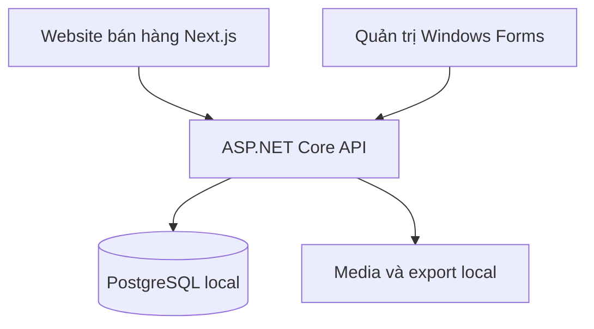
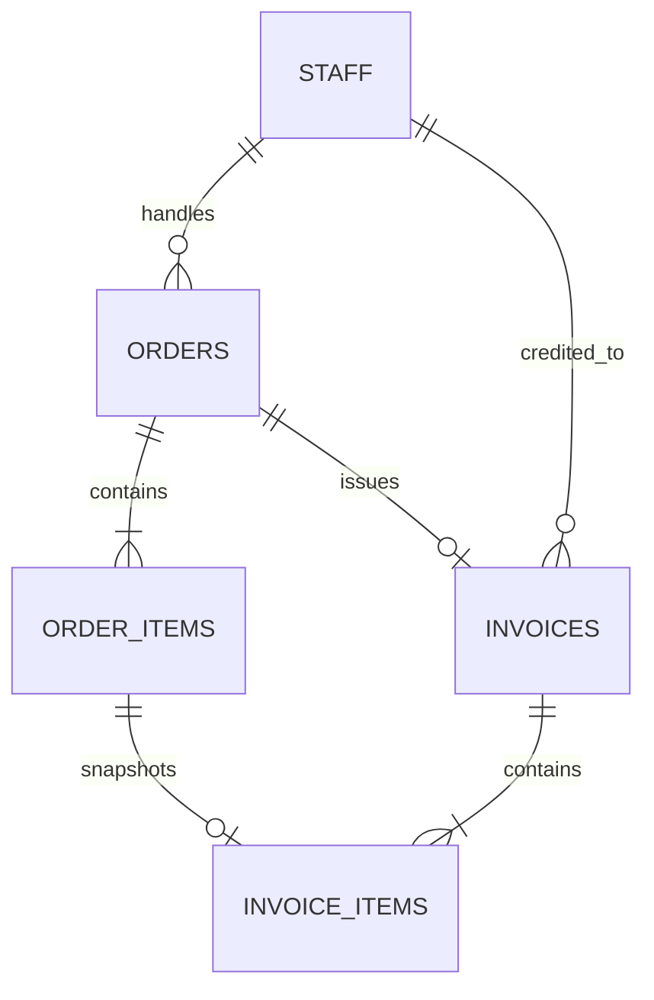
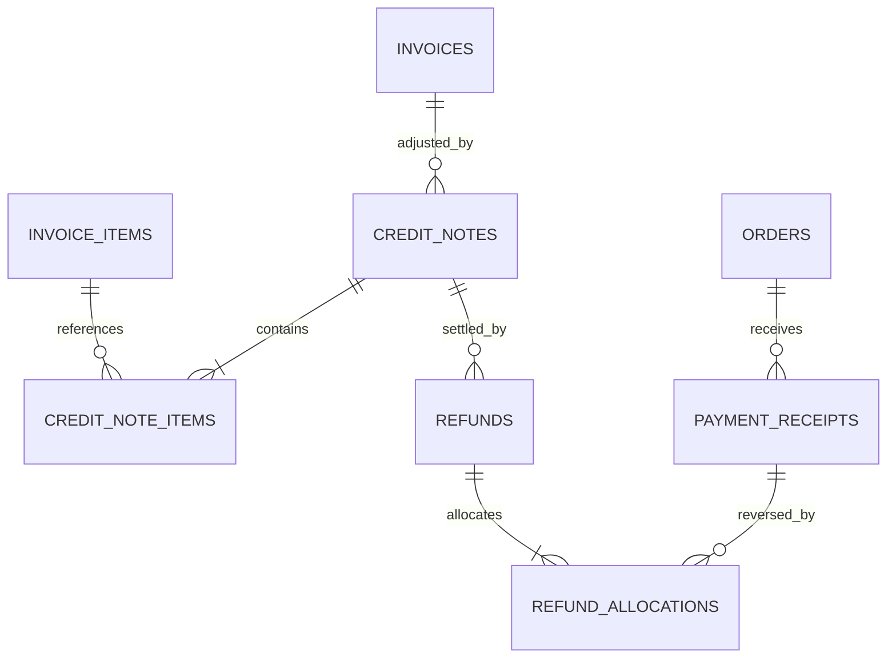

# BotZone BA v1.1 Web bán hàng và quản trị Windows Forms

Phiên bản: 1.1 · Cập nhật: 13/11/2026

Bản làm việc: https://chatgpt.com/space/page_8f87c964e4d481918aefa62f45db86f6

BotZone gồm website bán các nhóm sản phẩm Apple và ứng dụng quản trị C# Windows Forms, phục vụ đồ án nhóm. Ưu tiên có bản demo local hoạt động sớm, sau đó hoàn thiện trải nghiệm và các nghiệp vụ quản trị.

BA v1.1 cập nhật ngày 13/11/2026 theo yêu cầu mới: storefront là web, toàn bộ giao diện quản trị là Windows Forms native. Bản này thay thế v1.0 về kiến trúc, công nghệ admin, truy cập dữ liệu, auth, xuất file và tiêu chí giao diện. Phạm vi sản phẩm, chính sách, phân quyền và bảy nhóm tiêu chí database vẫn có hiệu lực. Giải pháp local được chọn: Next.js storefront + ASP.NET Core API dùng chung + WinForms + PostgreSQL/Docker. Codex đã được người dùng giao việc theo bản cũ nên phải kiểm kê hiện trạng trước khi chuyển, không giả định chưa có mã hoặc dữ liệu.

# Phạm vi đã chốt

| Hạng mục | Quyết định đã chốt |
| --- | --- |
| Bối cảnh | Đồ án nhóm, khoảng ba tuần tới nộp; ưu tiên demo hoạt động sớm. Bổ sung bắt buộc: giao diện quản trị Windows Forms; storefront làm web. |
| Thương hiệu | BotZone. |
| Sản phẩm bán | Hàng mới, thương hiệu Apple; đầy đủ nhóm sản phẩm. iPhone từ series 13 trở lên; các nhóm khác lấy dòng đang bán và một thế hệ gần trước. Không đưa Beats vào danh mục. |
| Phong cách | Sang trọng, đen–trắng và xám chủ đạo; điểm nhấn theo mẫu màu sản phẩm Apple đã đối chiếu nguồn. |
| Trang chủ | Landing có kể chuyện theo cuộn và khám phá 3D. Mở đầu iPhone 18 Pro Max Burgundy, sau đó iPhone Duo. |
| Thiết bị | Storefront ưu tiên mobile/laptop, mobile có 3D nhẹ và cuộn tự nhiên. Admin WinForms chạy Windows laptop/desktop, kiểm resize/DPI/bàn phím. |
| Ngôn ngữ | Storefront Việt/Anh, mặc định Việt; admin chỉ tiếng Việt. Nội dung công khai vẫn biên tập đủ hai ngôn ngữ. |
| Tiền tệ | Hiển thị VND/USD độc lập với ngôn ngữ; thanh toán, giá gốc và báo cáo bằng VND. |
| Tài khoản | Email/mật khẩu; bắt buộc đăng nhập trước đặt hàng. Xác minh email/khôi phục qua hộp thư thử nghiệm local. |
| Thanh toán | Có COD, banking, MoMo, Visa. Người dùng cho phép mô phỏng; BA chọn mô phỏng làm phương án chính để giảm phụ thuộc tài khoản cổng thanh toán. |
| Giao hàng | Chỉ trong Việt Nam, mô phỏng vận đơn và tiến trình giao nhận. |
| Vai trò quản trị | Chủ cửa hàng, nhân viên xử lý đơn, nhân viên kho, nhân viên nội dung. |
| Quyền landing | Chủ cửa hàng xem và giám sát. Chỉ nhân viên nội dung chỉnh và xuất bản landing. |
| Kho | Một kho; thiết bị theo IMEI/serial, phụ kiện không có mã riêng theo số lượng/lô. |
| Nhập hàng và tài chính | Nhà cung cấp, phiếu nhập, giá vốn và báo cáo lợi nhuận. |
| Thành viên | Có tích điểm và hạng thành viên. |
| Thu cũ đổi mới | Nhận toàn bộ sản phẩm trong danh mục website, bao gồm phụ kiện; nhận trực tiếp và gửi từ xa. Hàng thu cũ theo dõi riêng. |
| Bảo hành mở rộng | BotZone Care gia hạn lỗi phần cứng 12 tháng sau bảo hành tiêu chuẩn; sửa, đổi cùng SKU hoặc hoàn theo chính sách đã chốt. |
| Trả hàng | Trong 14 ngày từ giao thành công, chỉ lỗi/giao sai; trả một phần và hoàn đúng nguồn. |
| Hỗ trợ mua sắm | So sánh sản phẩm, danh sách yêu thích, gợi ý phụ kiện tương thích. |
| Landing CMS | Editor native trong WinForms: nội dung, section, ảnh/model, preset và thông số 3D. Preview dùng chính renderer của storefront. |
| Tài nguyên và Blender | Tài nguyên miễn phí có nguồn/điều kiện sử dụng. Người dùng xác nhận Blender từng kết nối Codex qua plugin/MCP; kiểm tra lại kết nối khi triển khai trên máy đó. |
| Repo | [KhangDepZai1802/BotZone](https://github.com/KhangDepZai1802/BotZone), Codex cần kiểm tra trạng thái hiện tại trước khi sửa. |
| Hạ tầng | Chỉ local. PostgreSQL qua Docker; API, web, media và email thử nghiệm local; WinForms chạy trực tiếp trên Windows. UI/UX Pro Max đã có trong môi trường thiết kế hiện tại. |
| Ngoài phạm vi | Đặt trước, đặt cọc, bán hàng cũ ra storefront, Beats, đánh giá/bình luận sản phẩm, thanh toán tiền thật, giao hàng quốc tế, Supabase và deploy cloud. Chỉ bàn deploy khi người dùng yêu cầu sau. |
| Tiêu chí học phần | Khuyến mãi lưu DB; hóa đơn/list/detail; hàm đọc tái sử dụng; danh sách có kiểu; thống kê thời gian/nhân viên/sản phẩm; bộ lọc >, <, =, <>, AND/OR/NOT; xuất XLSX/PDF. |

# Danh mục sản phẩm đã chốt

Tổ chức các nhóm: iPhone; iPad; Mac và MacBook; Apple Watch; AirPods và AirPods Max; Apple TV và HomePod; Vision Pro; màn hình; AirTag và phụ kiện như Apple Pencil, bàn phím, chuột, bộ sạc, cáp và ốp.

Danh mục iPhone bắt đầu từ series 13. Với nhóm ngoài iPhone, dùng dòng hiện hành và một thế hệ gần trước, chỉ thương hiệu Apple. Đầy đủ nhóm danh mục không đồng nghĩa phải nhập mọi biến thể lịch sử: dữ liệu demo cần có sản phẩm thực, nguồn thông số, các biến thể tiêu biểu và cả trường hợp hết hàng.

Mỗi loại sản phẩm có bộ thuộc tính riêng. iPhone dùng màu và dung lượng; Mac có chip, RAM và SSD; Watch có kích cỡ, chất liệu và dây; phụ kiện có danh sách tương thích. Bán các cấu hình có sẵn trong kho, phù hợp với quyết định không nhận đặt trước.

# Trải nghiệm website bán hàng

## Màu và tài nguyên

Đen–trắng và xám trung tính tạo nền chung. Đỏ Burgundy và Băng Thanh làm điểm nhấn theo sản phẩm; thứ tự hero đã chốt Pro Max Burgundy rồi Duo. Màu sản phẩm đối chiếu từ [thông số iPhone 18 Pro](https://www.apple.com/vn/iphone-18-pro/specs/) và [Duo](https://www.apple.com/vn/iphone-duo/specs/). Chưa tuyên bố một mã HEX chính thức của Apple: khi tạo token, Codex phải lưu mẫu màu/ảnh nguồn, phương pháp trích và phân biệt màu đại diện trên giao diện với màu sơn/vật liệu thực. Font sans serif hỗ trợ dấu tiếng Việt, khoảng trống rộng, độ tương phản rõ; logo chữ BotZone là mặc định thiết kế.

Codex lập danh sách tài nguyên kèm URL nguồn và điều kiện sử dụng. Pinterest dùng để tìm ý tưởng và lần về tác giả; quyền tái sử dụng phải xác định theo ảnh cụ thể theo [hướng dẫn Pinterest](https://help.pinterest.com/en/article/copyright). Có thể dùng HDRI, texture và đạo cụ CC0 của [Poly Haven](https://polyhaven.com/license).

## Landing 3D trên mobile và laptop

Trên laptop, cuộn tự nhiên điều khiển diễn tiến câu chuyện sản phẩm; con trỏ làm máy nghiêng nhẹ. Khu vực khám phá hỗ trợ kéo xoay, đổi màu, đặt lại góc nhìn và mở/gập Duo. Các nút mua và nội dung chính luôn tiếp cận được.

Mobile dùng poster để ổn định bố cục trong lúc tải, sau đó tự chạy cảnh 3D nhẹ khi hero ở trong vùng nhìn. Chỉ một cảnh hoạt động tại một thời điểm; nhấn Khám phá 3D mở điều khiển xoay/mở-gập đầy đủ. Vuốt dọc trên hero vẫn cuộn trang; có đóng, đặt lại góc nhìn và trở về đúng vị trí cuộn/focus. Giảm chất lượng hoặc về poster khi thiết bị không đáp ứng, WebGL/model lỗi hoặc người dùng bật giảm chuyển động. Tham khảo [R3F performance](https://r3f.docs.pmnd.rs/advanced/scaling-performance) cho cơ chế render theo nhu cầu và điều chỉnh tài nguyên.

Storefront kiểm tra tại chiều rộng 360, 390, 430, 768, 1024, 1366 và 1440 px, cả Việt/Anh; thêm kiểm tra liên tục giữa các kích thước. Có chế độ giảm chuyển động, ngừng render ngoài vùng nhìn và ảnh thay thế khi WebGL hoặc model gặp lỗi.

# Trình chỉnh landing và quyền nội dung

Tham khảo cấu trúc section, cây nội dung và xem trước của [Shopify Theme Editor](https://help.shopify.com/en/manual/online-store/themes/customizing-themes/theme-editor/features-overview), rồi chuyển nguyên tắc thao tác sang CMS native WinForms cho BotZone. Editor không phải một trang React admin nhúng trong ứng dụng.

Lớp chỉnh thông thường gồm chọn section, sửa nội dung Việt/Anh, chọn sản phẩm/biến thể, chọn ảnh/model từ thư viện, chọn mẫu chuyển động và sắp xếp section. Lớp nâng cao gồm góc máy, mức nghiêng, ánh sáng, tốc độ chuyển cảnh và góc mở Duo; mỗi điều khiển có giới hạn và khôi phục mặc định.

CMS chạy trên Windows laptop/desktop: danh sách section, các tab Nội dung VI/EN, Media, Preset và Nâng cao. Form có nút di chuyển section lên/xuống, lưu nháp, xem trước, xuất bản và lịch sử/khôi phục. Preview mở trình duyệt hoặc vùng WebView2 chỉ để xem landing; lựa chọn mobile/laptop mô phỏng viewport của storefront. Không yêu cầu chạy editor trên điện thoại.

Luồng lưu: bản nháp → xem trước mobile/laptop → kiểm tra dữ liệu → xuất bản. Nhân viên nội dung thực hiện chỉnh, xuất bản và khôi phục; chủ cửa hàng xem bản nháp/bản công khai/lịch sử. Khôi phục tạo một phiên bản xuất bản mới, không xóa lịch sử. Tham khảo cách [Shopify phân biệt bản nháp và bản công khai](https://help.shopify.com/en/manual/online-store/themes/managing-themes/publishing-themes). Giá và tồn lấy từ catalogue; chỉnh mô tả không thay đổi giá. Không xóa media đang được bản công khai tham chiếu. Hai lần sửa đồng thời phải phát hiện xung đột phiên bản.

Model thay thế phải phù hợp với section: mô hình xoay có hướng/tâm/tỷ lệ chuẩn; Duo cần bản lề hoặc animation mở/gập; đổi màu cần vùng vật liệu tương ứng; hotspot cần điểm neo. Khi không tương thích, CMS nêu lý do bằng ngôn ngữ dễ hiểu và gợi ý section phù hợp.

# Thu cũ đổi mới

[Apple Trade In](https://www.apple.com/vn/shop/trade-in) và [CellphoneS](https://cellphones.com.vn/thu-cu-doi-moi) đều phân biệt giá ước tính với giá sau kiểm tra. BotZone áp dụng quy trình định giá có thẩm định.

Khách chọn một hoặc nhiều sản phẩm cũ có trong danh mục, khai tình trạng theo nhóm, xem ước tính nếu có bảng giá và chọn cách tiếp nhận. Chọn sản phẩm muốn mua là gợi ý để tiếp tục mua sắm, không phải đơn đặt trước hoặc cam kết giữ hàng. Sau khi nhận hàng, kho kiểm tra từng món; nhân viên xử lý đơn lập báo giá cuối theo thẩm quyền; chủ cửa hàng duyệt trường hợp vượt bảng giá. Khách chấp nhận hoặc từ chối từng báo giá. Giá trị thu cũ chỉ phát sinh sau khi đã nhận, kiểm định, chấp nhận và hoàn tất giao dịch thu.

Giá trị thu cũ liên kết khách hàng, món tiếp nhận và phiên bản báo giá, lưu thành số dư mua hàng BotZone dùng nhiều lần đến hết, không rút tiền mặt. Có sổ cấp/giữ/sử dụng/giải phóng/hoàn; số dư chưa dùng còn lại cho lần sau, không hết hạn trong bản demo. Đây là nguồn thanh toán, tách với voucher và điểm. Hàng cũ là tài sản tiếp nhận riêng, không trở thành hàng mới được bán. Mọi phát sinh chống ghi trùng.

Thu cũ áp dụng toàn bộ danh mục website; nhận tại một điểm mô phỏng hoặc gửi từ xa bằng vận đơn mô phỏng. Thiết bị có mã dùng IMEI/serial; phụ kiện không có mã dùng mã tiếp nhận nội bộ và số lượng. Form theo nhóm: pin/màn hình cho điện thoại, thành phần tai/hộp sạc cho tai nghe, tình trạng/chức năng cho phụ kiện. Model chưa có bảng giá vẫn gửi được và hiển thị Cần nhân viên định giá. Không thu mật khẩu Apple hay mật khẩu thiết bị. Hướng dẫn tự sao lưu, đăng xuất và xóa dữ liệu trước bàn giao.

Gửi từ xa có bằng chứng tình trạng kiện lúc nhận, báo giá có phiên bản và thời hạn trả lời. Khách từ chối thì tạo luồng gửi trả; quá hạn chuyển Chờ liên hệ, không tự coi là đồng ý. Mất/hỏng kiện hoặc tranh chấp chuyển xử lý ngoại lệ, không tự hoàn tất. Hủy đơn mua mới sau khi giao dịch thu cũ đã hoàn tất không tự đảo việc mua lại. Hoàn đơn mua mới trả phần số dư về số dư và phần tiền về kênh mô phỏng. BotZone chịu phí gửi đến/gửi trả thu cũ; ghi chi phí vận hành, không trừ ngầm khỏi báo giá.

# BotZone Care

Phân biệt bảo hành tiêu chuẩn của thiết bị, dịch vụ [AppleCare](https://www.apple.com/vn/applecare/) của Apple và gói do BotZone quản lý. [Các gói bảo hành mở rộng của CellphoneS](https://cellphones.com.vn/bieu-phi-bao-hanh-mo-rong) là tham khảo về cách tách kéo dài bảo hành phần cứng với bảo vệ rơi vỡ/vào nước.

Đã chốt BotZone Care chỉ gia hạn bảo hành lỗi phần cứng; không có gói rơi vỡ/vào nước. Gói gắn từng món hàng và serial khi có, lưu phí, phạm vi, ngày bắt đầu/kết thúc và phiên bản điều kiện lúc mua. Gia hạn 12 tháng sau ngày hết bảo hành tiêu chuẩn của món đó. Không mặc định mọi nhóm sản phẩm có cùng bảo hành tiêu chuẩn; gói chỉ xuất hiện ở SKU đã cấu hình đủ điều kiện.

Khách mua gói tại trang sản phẩm hoặc giỏ hàng, xem quyền lợi trong tài khoản và gửi yêu cầu bảo hành. Admin kiểm tra hiệu lực, nhận thiết bị, đánh giá, ghi phương án xử lý, trả máy và đóng hồ sơ. Luồng đồ án ghi nhận dịch vụ mô phỏng do BotZone quản lý; việc kích hoạt AppleCare thật không được suy ra từ một đơn hàng demo.

# Thanh toán và tiền tệ

| Phương thức | Phương án chính cho đồ án |
| --- | --- |
| COD | Tạo đơn chưa thu tiền; sự kiện đã giao và đã thu COD được ghi riêng. |
| Banking | Hiển thị mã tham chiếu và hướng dẫn chuyển khoản mô phỏng; nhân viên xác nhận giao dịch demo đúng đơn/số tiền. Không đưa tài khoản thật có thể vô tình nhận tiền. |
| MoMo | Màn mô phỏng có nhãn rõ, chọn kịch bản thành công/thất bại/hủy/chờ xử lý/hết hạn. Không giả là đã tích hợp MoMo thật. |
| Visa | Màn mô phỏng tương tự, không yêu cầu số thẻ thật hoặc CVV; không lưu dữ liệu thẻ. |

Phần giao dịch mô phỏng vẫn chạy qua backend và lưu dữ liệu thật trong PostgreSQL local: tạo payment attempt, kiểm tra quyền/đơn/số tiền/trạng thái, ghi kết quả có idempotency và tính báo cáo từ dữ liệu đó. Điều khiển tạo kết quả demo chỉ hoạt động ở chế độ demo và trong phạm vi người được phép. Tích hợp [MoMo sandbox](https://developers.momo.vn/v3/docs/payment/api/wallet/onetime/) hoặc [VNPAY sandbox](https://sandbox.vnpayment.vn/apis/docs/thanh-toan-pay/pay.html) là mở rộng sau, không là điều kiện hoàn thành bản đồ án hiện tại.

Đã chốt VND/USD để hiển thị, VND để thanh toán và báo cáo. Ngôn ngữ và tiền tệ độc lập. Giá gốc và các phép tính tài chính dùng số nguyên VND; USD chỉ là chuyển đổi tham khảo, có chỉ dẫn ở checkout rằng khoản thanh toán bằng VND. Chủ cửa hàng cấu hình tỷ giá demo; lưu snapshot tỷ giá trên đơn. Đổi tỷ giá không sửa số tiền hoặc chứng từ của đơn cũ.

# Ứng dụng quản trị Windows Forms

Ứng dụng C# Windows Forms gồm tổng quan, catalogue và biến thể, thư viện media, kho và serial, nhà cung cấp và phiếu nhập, đơn hàng, hóa đơn/dòng hóa đơn/chứng từ giảm, thanh toán, vận chuyển mô phỏng, trả hàng/hoàn tiền, khách hàng, điểm/hạng thành viên, khuyến mãi, thu cũ, bảo hành, landing CMS, báo cáo, phân quyền, nhật ký và cài đặt.

Bốn vai trò có màn hình và quyền theo hành động. Chủ cửa hàng quản lý cấu hình, quyền, giá bán/giá vốn, chính sách và duyệt tài chính; riêng landing chỉ xem/giám sát. Nhân viên xử lý đơn phục vụ khách, điều phối đơn và hồ sơ hậu mãi. Nhân viên kho nhận hàng, kiểm định, kiểm kê, serial và đóng gói. Nhân viên nội dung sửa nội dung Việt/Anh, media và xuất bản landing, không sửa giá/tồn/hoàn tiền. Quyền phải được kiểm tra ở server/database theo ma trận bên dưới.

Theo dõi IMEI cho thiết bị có IMEI và serial cho thiết bị phù hợp; phụ kiện không có mã riêng theo dõi bằng số lượng. Giá vốn liên kết với nhập hàng và thiết bị/đơn vị tồn. Số liệu báo cáo tính từ giao dịch dữ liệu demo thực tế; phải tách doanh số, tiền đã thu, tiền đã hoàn và lợi nhuận theo công thức được chốt.

# Kiến trúc và cấu trúc triển khai được chọn

## Hiện trạng repo

Theo ảnh báo cáo Codex người dùng gửi ngày 13/11/2026: đã dừng phát triển admin web, giữ nguyên mã nguồn/dữ liệu/BA cũ, chưa tạo backend hoặc bộ migration thứ hai. PostgreSQL và Mailpit đang chạy; hai migration đã áp dụng, chưa seed; mười kiểm thử bộ lọc được báo đạt; typecheck còn lỗi trong viewer 3D. Codex đã lưu tài liệu hiện trạng và hồ sơ chuyển kiến trúc. Đây là trạng thái được Codex báo, chưa thay cho kiểm tra repository/DB thực. Trước khi chuyển, đọc các tài liệu đó, AGENTS.md, git status và lịch sử migration; giữ mã, schema và dữ liệu đã có.

## Nền tảng

| Phần | Lựa chọn và mục đích |
| --- | --- |
| Website bán hàng | Next.js App Router + TypeScript, chỉ storefront và renderer/preview landing; Tailwind CSS + shadcn/ui và next-intl. |
| Quản trị | C# Windows Forms native trên .NET 10, project BotZone.Admin.WinForms, chạy Windows. Form/UserControl/DataGridView/BindingSource; không duy trì React admin như sản phẩm thứ hai. |
| Backend dùng chung | ASP.NET Core Web API trên .NET 10, modular monolith; một nơi xử lý nghiệp vụ, quyền, transaction và xuất tài liệu cho web và desktop. |
| Database | PostgreSQL 18 trong Docker; EF Core 10 + Npgsql provider tương thích. Chỉ EF Core quản lý migration sau chuyển đổi; SQL migration/seed có version. |
| Tài khoản | ASP.NET Core Identity cho users/password/email/reset; session cookie được server kiểm soát cho web và WinForms, có thu hồi phiên trong DB. Quyền nghiệp vụ lấy staff_profiles hiện hành. |
| Media | API quản lý volume uploads bền vững, tách public/private/staging; desktop gửi upload qua API, không ghi thẳng thư mục server. |
| 3D | Three.js + React Three Fiber + Drei và GSAP ScrollTrigger trên storefront; WinForms CMS chỉnh cấu hình scene, không viết renderer 3D thứ hai. |
| Việt/Anh | /vi và /en cho storefront; admin WinForms tiếng Việt, có trường nội dung công khai VI/EN. |
| Validation | API C# là nguồn kiểm tra cuối; web Zod/React Hook Form và WinForms ErrorProvider/validation chỉ phản hồi sớm. DTO/OpenAPI dùng chung về hợp đồng. |
| Bảng/báo cáo | Server lọc/sort/phân trang/tổng hợp. WinForms dùng DataGridView và List<T> qua BindingSource; biểu đồ lấy dữ liệu cùng báo cáo. |
| Thanh toán/vận chuyển | Adapter mô phỏng trong API, tách khỏi lõi nghiệp vụ; không yêu cầu tài khoản dịch vụ ngoài. |
| Xuất tài liệu | API dùng ClosedXML cho XLSX, PDFsharp-MigraDoc Core 6.2.4 cho PDF và font Việt local; hai client tải cùng export dataset theo quyền. |
| Kiểm chứng | Integration PostgreSQL cho rubric/tiền/tồn/quyền; E2E web và nghiệm thu WinForms thực trên Windows. |

Khóa SDK và package stable tương thích: .NET/EF Core/Npgsql cùng major 10; web giữ lockfile, .NET có global.json/Directory.Packages.props hoặc cơ chế tương đương. Nguồn triển khai: [WinForms](https://learn.microsoft.com/en-us/dotnet/desktop/winforms/overview/), [WinForms .NET 10](https://learn.microsoft.com/en-us/dotnet/desktop/winforms/whats-new/net100), [Npgsql EF Core](https://www.npgsql.org/efcore/), [ASP.NET Core Identity](https://learn.microsoft.com/en-us/aspnet/core/security/authentication/identity?view=aspnetcore-10.0), [Next.js](https://nextjs.org/docs/app/getting-started/server-and-client-components), [next-intl](https://next-intl.dev/docs/getting-started/app-router), [R3F](https://r3f.docs.pmnd.rs/getting-started/introduction) và [GSAP](https://gsap.com/docs/v3/Plugins/ScrollTrigger/). .NET 10 là lựa chọn triển khai của BA; yêu cầu từ người dùng hiện chỉ bắt buộc WinForms, chưa quy định .NET Framework hoặc SQL Server.

## Quyền và tính toàn vẹn dữ liệu

Khách chỉ đọc dữ liệu của mình; public chỉ đọc catalogue và nội dung đã xuất bản. Trình duyệt và WinForms cùng gọi ASP.NET Core API, nơi kiểm session, vai trò và ownership. Chỉ API/worker/migration được kết nối PostgreSQL; Next.js và WinForms không chứa chuỗi kết nối DB hoặc tự ghi bảng nghiệp vụ. Database bảo vệ constraint/transaction; đăng ký public luôn customer, payload không tự cấp quyền.

Các thao tác tạo đơn/giữ tồn, áp dụng ưu đãi, ghi thu tiền, cấp/tiêu số dư thu cũ, xuất serial và hoàn tiền phải có transaction, kiểm tra trạng thái nguồn và khóa chống thao tác đồng thời. Mọi lệnh lặp do refresh, double-click hoặc retry chỉ tạo một kết quả nghiệp vụ. Bản nháp CMS và media riêng không được lộ qua truy vấn public. Audit lưu ai, hành động gì, trước/sau, lý do và thời điểm; không log mật khẩu hoặc khóa bí mật.

## Hai ứng dụng dùng chung một backend



API là nơi duy nhất thực hiện tính giá, voucher/điểm/credit, tồn, đơn, hóa đơn, thu/hoàn, quyền và CMS publication. Cả website và WinForms nhìn cùng nguồn dữ liệu; một giao dịch trên web phải xuất hiện trên WinForms sau khi refresh theo đúng trạng thái. Next.js có thể có proxy/BFF cùng origin và render server, nhưng không có business service/migration riêng cạnh tranh với C#.

Phân chia đề xuất trong một repository: apps/storefront; src/BotZone.Api; src/BotZone.Domain; src/BotZone.Application; src/BotZone.Infrastructure; src/BotZone.Contracts; src/BotZone.Admin.WinForms; tests; docs; infra. Đây là modular monolith, không thêm microservice/message broker. Contracts không tham chiếu EF entities hoặc chứa connection string; WinForms chỉ tham chiếu DTO và API client.

### Auth và phiên đăng nhập chung

ASP.NET Core Identity quản lý người dùng, hash mật khẩu, xác minh và reset. Baseline chọn session cookie cho cả hai client để dùng một cơ chế đăng nhập: trình duyệt dùng cookie HttpOnly qua proxy cùng origin của Next.js; WinForms dùng HttpClientHandler với CookieContainer riêng trong bộ nhớ của phiên, không lưu mật khẩu/cookie ra file. CookieContainer là khả năng của [HttpClientHandler](https://learn.microsoft.com/en-us/dotnet/api/system.net.http.httpclienthandler.cookiecontainer?view=net-10.0); phần này không yêu cầu một hệ OAuth/JWT tự viết.

API tạo auth_sessions, gắn session ID vào ticket cookie được framework bảo vệ và kiểm expires_at/revoked_at, trạng thái tài khoản cùng quyền hiện hành trước truy cập. Logout/khóa/reset thu hồi session đúng phạm vi; xóa cookie phía client không thay cho thu hồi server. Staff role là nguồn nghiệp vụ trong staff_profiles; nếu dùng Identity roles thì phải ánh xạ thành một nguồn quyền duy nhất, không có hai trường role độc lập. Owner không được tự vượt quy tắc content-only CMS.

Các lệnh thay đổi dữ liệu dùng POST/PUT/PATCH/DELETE và cơ chế anti-forgery phù hợp cookie. Web và WinForms lấy request token từ API, gửi lại header cùng session. Sau login/logout hoặc thay phiên, lấy request token mới trước lệnh thay đổi tiếp theo; không tái sử dụng token anonymous của màn đăng nhập cho phiên đã xác thực. Không dùng GET để publish/hoàn tiền. Proxy phải bảo toàn cookie/Set-Cookie và headers cần thiết; không cache đáp ứng cá nhân. Cấu hình origin/base URL rõ ràng; không mở CORS credentials cho mọi origin. HTTP chỉ dành cấu hình demo local được ghi rõ; khi dùng HTTPS bật Secure. Khóa Data Protection của API cần volume bền vững để restart không phá cookie/token đang hợp lệ.

Giá trị role, customer_id, giá và quyền client gửi không là căn cứ cấp quyền. UI ẩn nút để dễ dùng; API kiểm lại khi gọi trực tiếp. Chứng từ, upload riêng, export và preview đều có kiểm quyền phía API. Không chạy Better Auth song song như một nguồn danh tính thứ hai.

## Môi trường local và cách chạy

Quyết định mới nhất thay toàn bộ kế hoạch cloud trước đó. Không cấu hình Supabase, Neon, Vercel hoặc tài khoản dịch vụ cloud cho phạm vi hiện tại. PostgreSQL là hệ quản trị dùng SQL; Docker cung cấp môi trường chạy thống nhất cho nhóm.

Docker Compose tổ chức db, mailpit, api và storefront, cùng tác vụ migrate/seed có kiểm soát. WinForms chạy trực tiếp trên Windows host và gọi API qua base URL cấu hình, không đưa giao diện desktop vào Linux container. Chế độ phát triển có thể chạy API và Next.js trên host, chỉ db/mailpit trong Docker. Hướng dẫn PowerShell 5.1 cần có bước khởi động hạ tầng/API/web, chạy hoặc mở bản build WinForms, dừng/chạy lại và backup/restore. Không giả định một lệnh docker compose up tự mở ứng dụng Windows.

PostgreSQL dùng image stable được khóa phiên bản và volume dữ liệu. App chờ database healthy; migration chạy một lần có kiểm soát trước khi app nhận yêu cầu. Tham khảo [Postgres official image](https://hub.docker.com/_/postgres) và [Compose startup order](https://docs.docker.com/compose/how-tos/startup-order/). Restart/rebuild không tự seed lại hoặc xóa dữ liệu; reset demo là thao tác riêng có tên rõ và có bước xác nhận.

[Mailpit Docker](https://mailpit.axllent.org/docs/install/docker/) nhận thư SMTP local và cung cấp hộp thư thử nghiệm ở localhost:8025. Đăng ký, xác minh và quên mật khẩu vẫn dùng token có hạn dùng; thư được xem trong hộp thử nghiệm, không gửi ra Internet. Không cần tài khoản email/SMTP cloud. Seed tài khoản khách và bốn vai trò nhân viên để bắt đầu demo ngay; tài khoản đăng ký mới luôn là customer. Reset mật khẩu/khóa nhân viên phải thu hồi session theo quy tắc.

Bộ dữ liệu, font, ảnh, poster và model cần cho demo được lưu local. Sau lần tải dependency/image Docker và chuẩn bị tài nguyên ban đầu, các luồng chính phải demo được khi mất Internet. Kiểm tra trên điện thoại thật qua cùng mạng LAN là cấu hình demo tùy chọn; chỉ mở cổng storefront cần thiết, chỉnh base URL/trusted origins cụ thể và giữ database/hộp thư nội bộ; web gọi API qua proxy cùng origin để điện thoại không phải truy cập địa chỉ localhost của máy chủ. Không coi truy cập LAN là deploy public.

## Media local và tài nguyên 3D

Volume uploads chia staging, catalogue-public và evidence-private. Database lưu asset ID, storage key tương đối, MIME, dung lượng, checksum, trạng thái kiểm tra, nguồn/quyền dùng và hồ sơ liên quan. API tự sinh tên; đường dẫn tuyệt đối không đưa ra trình duyệt hoặc WinForms. Ảnh riêng tư được đọc qua endpoint kiểm tra session/ownership/quyền nghiệp vụ, không đặt vào public rồi chỉ giấu link.

Mặc định đề xuất: ảnh JPEG/PNG/WebP tối đa 5 MB và 20 megapixel; hồ sơ nhận tối đa sáu ảnh mỗi lượt. GLB tối đa 20 MB, mục tiêu bản mobile không quá 4 MB và laptop không quá 10 MB. Đây là ngân sách ứng dụng, không phải giới hạn phần cứng. Kiểm tra nội dung thực và cấu trúc GLB; model tự chứa texture, không tự tải URL/đường dẫn ngoài. .blend là file nguồn thiết kế, không phải upload runtime. Không nhận script/HTML/SVG tùy ý ở trường ảnh.

Giữ model/ảnh đã xuất bản đến khi không còn phiên bản đang dùng tham chiếu. Sao lưu/khôi phục bao gồm database lẫn uploads. Uploads riêng và dữ liệu cá nhân không commit vào Git; chỉ commit fixture demo có chủ đích. Blender chạy tại máy đã kết nối Codex, xuất GLB/poster và kiểm thử trong viewer; chưa khẳng định kết nối hiện tại hoặc chất lượng model đã được kiểm tra.

# Sitemap và trách nhiệm màn hình

## Storefront

| Khu vực | Trang và hành vi chính |
| --- | --- |
| Khám phá | Trang chủ landing; tất cả sản phẩm; danh mục; tìm kiếm/lọc/sắp xếp; sản phẩm mới. |
| Chi tiết sản phẩm | Gallery, biến thể, thông số có nguồn, giá/tồn, BotZone Care nếu đủ điều kiện, phụ kiện tương thích, so sánh/yêu thích, thêm giỏ/mua. |
| So sánh | Mặc định tối đa ba sản phẩm cùng nhóm thuộc tính; làm nổi điểm khác; mobile giữ sản phẩm đang so và cuộn vùng bảng có hướng dẫn. |
| Tài khoản | Đăng ký/đăng nhập; hồ sơ/địa chỉ; đổi mật khẩu; khôi phục qua email thử nghiệm bắt tại Mailpit. |
| Mua hàng | Giỏ → đăng nhập nếu cần → địa chỉ/phí giao → ưu đãi/điểm/số dư → phương thức demo → rà soát → kết quả. |
| Theo dõi | Danh sách/chi tiết đơn, hóa đơn của khách và tải XLSX/PDF từng hóa đơn, timeline vận chuyển, yêu cầu hủy/hoàn; không yêu cầu đăng nhập lại khi chuyển VI/EN. |
| Cá nhân | Yêu thích, lịch sử điểm/hạng, số dư thu cũ, thông báo trong web. |
| Thu cũ | Trang giới thiệu, tạo yêu cầu nhiều món, hướng dẫn gửi, theo dõi, xem/đồng ý/từ chối báo giá. |
| Bảo hành | Giới thiệu gói; danh sách hợp đồng theo món; tạo/theo dõi yêu cầu. |
| Chính sách | Giao nhận, trả hàng, bảo hành, thu cũ, riêng tư/liên hệ với nội dung demo minh bạch. |

Chưa đăng nhập vẫn xem hàng, so sánh và lưu giỏ; sau đăng nhập hợp nhất giỏ không nhân đôi. Yêu thích có thể lưu cục bộ rồi đồng bộ vào tài khoản. Chỉ checkout, hồ sơ cá nhân và gửi yêu cầu hậu mãi yêu cầu đăng nhập. URL ngôn ngữ đổi nhưng giữ sản phẩm, biến thể, bộ lọc và giỏ.

## Quản trị native trên Windows

| Module | Màn hình cần có |
| --- | --- |
| Tổng quan | KPI có định nghĩa, hàng đợi việc cần xử lý, đơn chờ tiền, tồn thấp, yêu cầu hậu mãi và cảnh báo cấu hình demo. |
| Catalogue | Nhóm/model, thuộc tính, SKU, giá, trạng thái kinh doanh, tương thích phụ kiện; nội dung VI/EN có trạng thái xuất bản riêng. |
| Kho | Khả dụng/đang giữ/chờ kiểm tra/đã xuất, sổ tồn, serial/IMEI, kiểm kê, điều chỉnh có lý do, lịch sử từng thiết bị. |
| Nhập hàng | Nhà cung cấp, đơn mua, nhận một phần/đủ, phiếu nhập, giá vốn, đối chiếu số lượng và serial. |
| Đơn và giao nhận | Danh sách lọc được, chi tiết/timeline, giữ hàng, payment attempts, đóng gói/gán serial, vận đơn demo, giao thất bại/gửi lại. |
| Thanh toán/hoàn | Đối soát demo, COD chưa thu, banking chờ xác nhận, yêu cầu hoàn, kết quả hoàn và lịch sử chống ghi trùng. |
| Trả hàng | Tiếp nhận theo món, bằng chứng, duyệt nhận, vận đơn trả, kiểm tra, duyệt số tiền và kết quả. |
| Thu cũ | Hàng đợi, bảng giá/checklist theo nhóm, tiếp nhận/kiểm định, báo giá nhiều phiên bản, trả lại hoặc hoàn tất, sổ giá trị thu cũ. |
| Bảo hành | Gói và điều kiện, hợp đồng từng món, hồ sơ tiếp nhận/xử lý/trả máy, serial thay thế nếu được duyệt. |
| Khách hàng | Hồ sơ cần thiết, đơn, địa chỉ theo quyền, điểm/hạng, số dư và hồ sơ hậu mãi. |
| Ưu đãi | Voucher, điều kiện/giới hạn, lịch hiệu lực, mức sử dụng; điểm/hạng và cấu hình mặc định. |
| Nội dung | Landing editor, thư viện ảnh/3D, mô tả/thông số/SEO VI–EN, xem trước, xuất bản, lịch sử/khôi phục. |
| Báo cáo | Bán hàng, tiền thu/hoàn, tồn/giá vốn, lợi nhuận gộp, top SKU, sử dụng ưu đãi, thu cũ/bảo hành. |
| Hệ thống | Nhân viên/quyền, cấu hình cửa hàng/tiền tệ/chính sách, nhật ký, công cụ demo có quyền kiểm soát. |
| Hóa đơn | Danh sách, chi tiết, tổng toàn bộ kết quả, lọc biểu thức, xuất từng hóa đơn hoặc toàn bộ kết quả XLSX/PDF. |
| Thống kê hóa đơn | Theo tháng/quý/năm qua nhiều năm; theo nhân viên–quý/năm; theo sản phẩm–tháng/quý/năm; drill-down ra hóa đơn và xuất báo cáo. |

Mọi màn CRUD có loading, empty, lỗi, tìm kiếm/lọc khi phù hợp, phân trang và xác nhận hành động ảnh hưởng dữ liệu. Chi tiết nghiệp vụ hiển thị hành động kế tiếp hợp lệ. Admin dùng layout WinForms có resize/DPI, form dài cuộn được, bảng có điều hướng bàn phím; không áp tiêu chí mobile cho ứng dụng desktop.

## Cấu trúc giao diện WinForms

LoginForm mở MainForm với sidebar, tiêu đề module, vùng UserControl và thanh trạng thái kết nối/tài khoản. Mỗi module dùng lại bộ PagedGridView, thanh tìm kiếm, bộ lọc, trình bày tiền/ngày và trạng thái loading/empty/error. Chi tiết mở Form/Dialog có owner; không tạo hàng loạt cửa sổ khó quay lại. Presenter/application client điều phối; event handler không đặt SQL, connection string hoặc công thức nghiệp vụ.

DataGridView hiển thị List<DTO> qua BindingSource, mặc định chỉ đọc ở hóa đơn/chứng từ. Phân trang/sort/filter chạy API; ô tổng phân biệt tổng trang và tổng tập lọc. Bộ lọc nâng cao là control native gồm Trường–Toán tử–Giá trị, nhóm AND/OR, NOT, thêm/xóa nhóm và mô tả dễ đọc; giữ giới hạn bốn cấp/ba mươi điều kiện. Trường ngày dùng DateTimePicker; trường enum/nhân viên dùng ComboBox/search picker; tiền có validation rõ.

Lấy dữ liệu, tìm kiếm, upload và export dùng async, timeout/cancellation; không dùng .Result/.Wait() chặn UI. Khi đổi bộ lọc nhanh, kết quả request cũ không được ghi đè kết quả mới. Disable thao tác đang gửi và vẫn giữ idempotency ở API. Lỗi mạng/401/403/409 hiển thị thông báo phù hợp, giữ dữ liệu chưa gửi an toàn và cho tiếp tục đúng trạng thái; không báo thành công trước khi server commit.

Style admin: nền trắng/xám nhạt, thanh điều hướng tối, chữ rõ, màu trạng thái tiết chế, font Windows hỗ trợ tiếng Việt. Dùng TableLayoutPanel/FlowLayoutPanel/Dock/Anchor và cấu hình DPI của modern .NET; không dựa vào tọa độ tuyệt đối cho toàn màn. Storefront tiếp tục phong cách sang trọng và hiệu ứng 3D; admin ưu tiên dữ liệu và tốc độ thao tác. UI/UX Pro Max dùng nguyên tắc layout/contrast/focus; skill hiện không có stack WinForms riêng nên không coi hướng dẫn WPF/WinUI là API WinForms.

Nghiệm thu desktop ở 1366×768 với scale100%, 1920×1080 với scale125%/150%, cùng resize trong work area. Không cắt nút/tổng/tiêu đề quan trọng; form dài cuộn được, grid rộng xem được đủ cột. Tab order, focus nhìn thấy, Enter/Esc/phím tắt có nhãn và thao tác chỉ bằng bàn phím phải sử dụng được.

### CMS native và preview storefront

Cây section, trường nội dung VI/EN, chọn sản phẩm/media/preset, thông số camera/light/hinge, các nút lưu/publish/rollback đều là control WinForms. API trả schema/preset có giới hạn để editor không cho nhập cấu hình không thể render. Nhân viên nội dung thực hiện các lệnh; owner chỉ xem.

Preview dùng renderer hiện có của storefront. Mở trình duyệt ngoài là mặc định; WebView2 là tùy chọn chỉ dành cho vùng preview hoặc xem PDF, không dùng để chứa toàn bộ admin React. Preview draft dùng quyền đọc giới hạn cho đúng bản nháp: API phát mã ngắn hạn, đổi mã một lần thành preview session, có expiry và khả năng thu hồi; không đặt session đăng nhập đầy đủ vào URL hoặc biến draft thành public. Bổ sung landing_preview_grants với code_hash UNIQUE, draft/version FK, issued_by FK, expires_at, redeemed_at/revoked_at; API kiểm quyền hiện hành khi cấp và đọc. Preview có chọn kích thước mobile/laptop, publish vẫn qua API và quyền content.

### Nghiệm thu riêng cho Windows Forms

| ID | Bằng chứng cần có |
| --- | --- |
| WF-01 | Chạy BotZone.Admin.WinForms trên Windows: LoginForm/MainForm và các module là native controls; không dùng web wrapper làm giao diện quản trị. |
| WF-02 | Đặt đơn trên storefront → refresh WinForms thấy đúng đơn → xử lý/xuất kho/phát hành → khách thấy hóa đơn cùng dữ liệu. |
| WF-03 | Chỉ ra code C# PostgreSQL→ToListAsync→List<InvoiceListItemDto>; WinForms bind BindingSource/DataGridView, dùng lại service cho list/search/report/export. |
| WF-04 | Kiểm resize/DPI, chữ Việt, focus/tab order, Enter/Esc; không cắt các thao tác chính tại kích thước mục tiêu. |
| WF-05 | API chậm/mất kết nối/phiên hết hạn hoặc đổi filter liên tục: UI không treo, request cũ không ghi đè, retry không nhân giao dịch. |
| WF-06 | Đăng nhập bốn vai trò; API từ chối thao tác vượt quyền, đặc biệt owner không sửa/publish/rollback landing, content không đọc invoice tài chính. |
| WF-07 | CMS native lưu draft/publish/rollback đúng; preview dùng renderer web, không lộ draft hoặc quyền người khác. |
| WF-08 | SaveFileDialog lưu XLSX/PDF được sinh từ API; mở file đúng tiếng Việt/count/tổng; build/publish có hướng dẫn và runtime được quan sát trên Windows. |

Cross-compile hoặc build thành công trên Linux chỉ là kiểm build; chưa chứng minh runtime Windows/DPI/đối thoại lưu file đã hoạt động. Bằng chứng WinForms phải ghi đúng máy/môi trường và thao tác đã quan sát.

# Ma trận quyền

| Hành động | Chủ cửa hàng | Xử lý đơn | Kho | Nội dung |
| --- | --- | --- | --- | --- |
| Tổng quan kinh doanh, lợi nhuận | Toàn bộ | KPI đơn, không giá vốn | KPI kho | KPI nội dung |
| Nhân viên, phân quyền, cấu hình | Quản lý | Không | Không | Không |
| SKU, giá bán, trạng thái kinh doanh | Quản lý | Xem | Xem | Xem |
| Mô tả/ảnh/SEO/VI–EN | Xem | Xem | Xem | Biên tập |
| Sửa/xuất bản/khôi phục landing | Chỉ xem | Không | Không | Thực hiện |
| Đơn và liên hệ khách | Giám sát/xử lý ngoại lệ | Thực hiện | Dữ liệu cần đóng gói | Không |
| Gán serial, xuất kho, kiểm định | Giám sát/duyệt ngoại lệ | Xem kết quả | Thực hiện | Không |
| Phiếu nhập/kiểm kê | Duyệt, xem giá vốn | Không | Nhập/kiểm kê theo phiếu | Không |
| Thay giá vốn hoặc điều chỉnh tồn ngoại lệ | Duyệt | Không | Đề nghị, không tự duyệt | Không |
| Thu cũ/trả hàng/bảo hành | Duyệt chính sách/tài chính | Tiếp nhận/điều phối | Nhận/kiểm tra | Nội dung giới thiệu |
| Xác nhận banking/COD mô phỏng | Có | Có, đúng trạng thái/số tiền | Không | Không |
| Hoàn tiền | Duyệt/thực hiện | Đề nghị/theo dõi | Cung cấp kết quả kiểm tra | Không |
| Voucher, tỷ giá, điểm/hạng | Cấu hình | Tra cứu | Không | Dùng chiến dịch đã duyệt |
| Nhật ký | Toàn bộ | Nghiệp vụ được phép | Nghiệp vụ kho | Nghiệp vụ nội dung |
| Hóa đơn, lọc và xuất XLSX/PDF | Toàn bộ | Đọc/xuất hóa đơn phục vụ xử lý đơn | Chỉ phiếu đóng gói theo nhiệm vụ | Không |
| Thống kê hóa đơn theo thời gian/nhân viên/sản phẩm | Toàn bộ | Chỉ phần gắn nhân viên đang đăng nhập | Không | Không |

Nhân viên kho có thể cần xem chi phí trên phiếu nhập được giao nhưng không có toàn bộ báo cáo lợi nhuận; quyền này được tách khỏi quyền sửa giá vốn. Tài khoản role owner không tự vượt quy tắc CMS; seed riêng một tài khoản nội dung cho demo. Nếu đổi vai trò, quyền phải cập nhật trước lần ghi tiếp theo và có audit.

# Mô hình dữ liệu khái niệm

| Nhóm | Thực thể chính và liên kết |
| --- | --- |
| Người dùng | Identity users/claims/tokens, auth_sessions, profile, staff role, address; tách hồ sơ khách với quyền nhân viên. |
| Catalogue | category, product/model, translation, attribute definition, variant/SKU, compatibility link; giá/tồn thuộc SKU, nội dung thuộc product/translation. |
| Kho/nguồn hàng | supplier, purchase order/line, receipt/line, inventory lot, inventory unit, identifier, reservation, stock ledger. |
| Bán hàng | cart/line, order/line, line-unit allocation, price/discount/tender allocation, shipment/event. |
| Thanh toán | payment attempt, payment event/receipt, refund/line allocation; lưu mode demo và unique external/event key. |
| Ưu đãi | promotion/redemption, loyalty ledger, tier rule; mọi thay đổi số dư có nguồn giao dịch. |
| Thu cũ | request, received item, inspection, quote/version/line, acceptance, inbound/outbound shipment, credit ledger. |
| Hậu mãi | return request/line/inspection; warranty plan/version, entitlement theo món, claim/event, replacement link. |
| Nội dung | media/source/license, landing draft/version, section config, publication history; draft và published tách nhau. |
| Hệ thống | setting/version, notification, audit event. |
| Hóa đơn | invoices, invoice_items, credit_notes, credit_note_items, invoice_exports; invoice phát hành một lần từ đơn, điều chỉnh bằng chứng từ riêng. |

Các nhóm dữ liệu được cụ thể hóa trong phần ERD và từ điển bảng ở phụ lục database. Không dùng JSON thay số tiền/số lượng/trạng thái cần transaction; JSON dùng cho snapshot phụ, cấu hình section và checklist có schema. Đổi catalogue/giá/nhân viên không sửa snapshot lịch sử. Sản phẩm, nhân viên và khách có lịch sử giao dịch được ẩn/vô hiệu hóa theo quyền, không xóa cascade chứng từ.

# ERD và từ điển dữ liệu triển khai

## Quy ước chung

Bảng nghiệp vụ dùng id UUID PK, mặc định tạo tại DB; thời điểm dùng TIMESTAMPTZ lưu UTC. Các FK tới user/auth dùng TEXT tương ứng IdentityUser<string>; giữ cùng kiểu ở cả hai phía. Các bảng Identity ánh xạ tên rõ ràng trong EF Core, nghiệp vụ vẫn UUID. Khi chuyển từ auth cũ, giữ ánh xạ ID để không gãy lịch sử chứng từ. Những bảng có khóa ghép được nêu riêng. Tên bảng/cột dùng snake_case; cột bắt buộc là NOT NULL trừ nơi ghi nullable. created_at mặc định now(), updated_at do cơ chế server/DB thống nhất cập nhật.

Tiền VND dùng BIGINT; tiền đơn/dòng không âm, ledger delta có thể âm theo loại bút toán. Số lượng INTEGER > 0. Tỷ lệ/tỷ giá dùng NUMERIC và phạm vi hợp lệ; status dùng enum hoặc CHECK danh sách giá trị, không chuỗi tự do. FK tài chính dùng RESTRICT/NO ACTION; danh mục dùng trạng thái archive/inactive thay cho xóa lịch sử. Auth schema do thư viện sinh và version hóa cùng migration, không tự viết thuật toán mật khẩu.

Các bảng dưới đây là mô hình triển khai chuẩn. Codex được bổ sung cột phục vụ yêu cầu đã có và index có căn cứ; đổi tên/tách bảng phải cập nhật ERD, data dictionary, query và test cùng lúc. Không thêm một hệ quản trị hoặc dịch vụ cloud.

## ERD lõi bán hàng và hóa đơn



Một order item chỉ xuất hiện một lần trên hóa đơn gốc vì baseline không tách nhiều hóa đơn cho một đơn. Những dòng phí/Care cũng là order item có loại riêng, nên tổng tiền đối chiếu được đầy đủ.



Hoàn trước khi phát hành hóa đơn có thể không có credit_note_id; trường hợp sau phát hành phải liên kết chứng từ giảm tương ứng. Refund allocations liên kết nguồn đã thu/đã dùng, bảo đảm phần credit không biến thành hoàn tiền mặt.

## Bảng catalogue, tài khoản và kho

| Bảng | Cột chính | Khóa/ràng buộc và ý nghĩa |
| --- | --- | --- |
| Auth Identity users/claims/logins/tokens | Theo ASP.NET Core Identity, user ID TEXT; tên bảng EF mapping được ghi trong data dictionary | Password/confirm/reset dùng cơ chế thư viện; signup luôn customer; không tự viết hash hoặc trả bí mật qua profile. |
| auth_sessions | id UUID PK, user_id TEXT FK, client_type web/winforms, created_at, expires_at, revoked_at nullable | Session ID gắn ticket cookie được framework bảo vệ; kiểm ở API trên request, logout/reset/khóa tài khoản thu hồi tương ứng. Không lưu cookie hoặc mật khẩu dạng rõ. |
| staff_profiles | user_id TEXT PK/FK, staff_code TEXT, role TEXT, active BOOLEAN | staff_code UNIQUE; role owner/order_staff/warehouse_staff/content_staff. Role không do client đăng ký tự gán. |
| customer_profiles | user_id TEXT PK/FK, display_name, phone nullable | Profile không chứa quyền nhân viên; một người có thể có lịch sử mua dù là nhân viên. |
| addresses | id, user_id FK, recipient, phone, province, ward, address_line, is_default | Địa chỉ thuộc khách; tối đa một mặc định theo partial unique. Snapshot địa chỉ trên đơn độc lập với sửa địa chỉ sau đó. |
| categories | id, code, slug, name_vi, name_en, active | code/slug UNIQUE; các nhóm Apple đã chốt. |
| products | id, category_id FK, slug, model_code, business_status, generation nullable | slug/model_code UNIQUE; business_status draft/active/discontinued/archived. |
| product_translations | product_id FK, locale, name, description, seo_title, content_status | PK(product_id,locale); locale vi/en; publication nội dung độc lập với quyền kinh doanh. |
| attribute_definitions | id, category_id FK, code, value_type, unit nullable, compare_enabled | UNIQUE(category_id,code); kiểu text/number/boolean/option. |
| product_attribute_values | product_id FK, attribute_id FK, value_text/value_number/value_boolean nullable | PK(product_id,attribute_id); đúng một giá trị theo kiểu; thông số model dùng so sánh. |
| product_variants | id, product_id FK, sku, option_signature, price_vnd, tracking_mode, active | sku UNIQUE; UNIQUE(product_id,option_signature); giá >= 0; tracking_mode serialized/quantity. |
| variant_attribute_values | variant_id FK, attribute_id FK, value_text/value_number/value_boolean nullable | PK(variant_id,attribute_id); kiểu giá trị hợp định nghĩa; màu/dung lượng/cấu hình. |
| product_compatibilities | accessory_product_id FK, target_product_id FK | PK cặp; hai ID khác nhau; quan hệ có hướng phục vụ gợi ý phụ kiện. |
| media_assets | id, storage_key, visibility, mime, size_bytes, checksum, validation_status, source_url/license_note nullable | storage_key UNIQUE; public/private/staging; upload chưa valid không được publish. |
| product_media | id, product_id FK, variant_id nullable FK, media_id FK, position, role | Giữ ảnh theo model/biến thể; variant nếu có phải thuộc product. |
| warehouses | id, code, name | Một bản ghi kho hoạt động trong baseline. |
| suppliers | id, code, name, contact, active | code UNIQUE; không xóa supplier đã có chứng từ nhập. |
| purchase_orders | id, supplier_id FK, code, status, created_by FK, approved_by nullable FK | code UNIQUE; draft/approved/part_received/received/cancelled. |
| purchase_order_items | id, purchase_order_id FK, variant_id FK, quantity, unit_cost_vnd | quantity > 0; cost >= 0; nhận không vượt lượng duyệt trừ điều chỉnh đã duyệt riêng. |
| goods_receipts | id, purchase_order_id FK, receipt_no, received_by FK, received_at | receipt_no UNIQUE; một PO có nhiều phiếu nhận. |
| goods_receipt_items | id, receipt_id FK, purchase_order_item_id FK, received_qty, unit_cost_vnd | Số lượng > 0; cùng PO; không nhận trùng một event. |
| inventory_lots | id, warehouse_id FK, variant_id FK, receipt_item_id FK, received_at, unit_cost_vnd, qty_on_hand, qty_reserved | Lô quantity: on_hand >= reserved >= 0; FIFO theo received_at,id. Serialized dùng đơn vị bên dưới làm nguồn số lượng. |
| inventory_units | id, lot_id FK, condition_status, custody_status | Một đơn vị serialized; available/reserved/shipped/quarantine/service theo chuyển trạng thái được phép. |
| inventory_identifiers | id, inventory_unit_id FK, kind, normalized_value | UNIQUE(kind,normalized_value); hỗ trợ serial và nhiều IMEI của một thiết bị. |
| inventory_reservations | id, order_item_id FK, variant_id FK, quantity, expires_at, status | active/released/consumed/expired; transaction khóa tồn; không giữ vượt khả dụng. |
| inventory_allocations | id, order_item_id FK, lot_id FK, inventory_unit_id nullable FK, quantity, cost_vnd, state | Có unit thì qty=1; partial unique unit với allocation còn hiệu lực; lượng dùng lô FIFO. |
| stock_movements | id, variant_id FK, lot_id FK, unit_id nullable FK, quantity_delta, kind, source_event_key | Append-only; source_event_key UNIQUE; ghi nhận/giữ/xuất/trả/điều chỉnh có nguồn và người làm. |

Serialized được tính từ trạng thái inventory_units; quantity từ lô/bút toán. View tồn SKU hợp nhất theo tracking_mode, không có hai bộ số tồn được sửa độc lập. Serial được bán lại chỉ khi có luồng trả/kiểm tra đủ chuẩn hàng mới; allocation cũ đóng đúng trạng thái và vẫn giữ lịch sử. Thiết bị thu cũ có thể trùng serial của một máy từng được BotZone bán: liên kết nguồn lịch sử, không coi đó là trùng thiết bị mới đang khả dụng; chặn hai yêu cầu thu đang xử lý cùng một thiết bị.

## Bảng đơn hàng, ưu đãi và thanh toán

| Bảng | Cột chính | Khóa/ràng buộc và ý nghĩa |
| --- | --- | --- |
| carts/cart_items | cart.customer_id nullable FK hoặc guest_key, applied_promotion_version_id nullable FK; item.variant_id FK, quantity | UNIQUE(cart_id,variant_id) khi không có cấu hình dịch vụ khác; hợp nhất giỏ có quy tắc, server tính lại giá. |
| orders | id, order_no, customer_id FK, responsible_staff_id nullable FK, order_status, payment_method, address_snapshot JSONB, total_vnd, currency, created_at | order_no UNIQUE; currency=VND; staff bắt buộc trước phát hành; tổng do transaction tính. |
| order_items | id, order_id FK, line_no, line_type, product_id/variant_id nullable FK, parent_item_id nullable FK, quantity, unit_price_vnd, voucher_discount_vnd, points_discount_vnd, net_amount_vnd, snapshot JSONB | UNIQUE(order_id,line_no); product cần SKU/product; Care gắn product item cùng đơn; shipping qty1; công thức dòng bằng CHECK. |
| order_item_unit_amounts | id, order_item_id FK, unit_ordinal INT, parent_unit_amount_id nullable FK, gross_vnd, voucher_discount_vnd, redeemed_points INT, points_discount_vnd, net_amount_vnd, credit_planned_vnd, cash_planned_vnd | UNIQUE(order_item_id,unit_ordinal); mỗi hàng đại diện một đơn vị của quantity; số tiền không âm, net=gross−discount, credit_planned+cash_planned=net. Tổng các unit bằng line; Care gắn unit sản phẩm qua parent. Bất biến về tiền sau đặt đơn. |
| promotions | id, code_normalized, active, max_uses nullable, max_uses_per_customer nullable | code_normalized UNIQUE; các giới hạn > 0 nếu có; quota xuyên các phiên bản. |
| promotion_versions | id, promotion_id FK, version_no, discount_type, value, max_discount_vnd nullable, min_purchase_vnd, starts_at, ends_at | UNIQUE(promotion_id,version_no); starts_at < ends_at; percentage trong (0,100]; fixed > 0; immutable sau sử dụng. |
| promotion_targets | promotion_version_id FK, variant_id nullable FK, product_id nullable FK, category_id nullable FK | Đúng một loại target mỗi dòng; không dùng danh sách ID dạng chuỗi; rule all-products có cờ riêng. |
| promotion_redemptions | id, promotion_id/version_id FK, customer_id FK, order_id FK, status, amount_vnd, expires_at, idempotency_key | UNIQUE(order_id,promotion_id); UNIQUE(idempotency_key); quota kiểm tra khi giữ trong transaction. |
| order_adjustments | id, order_item_id FK, kind, promotion_redemption_id nullable FK, amount_vnd, source_event_key | Giảm voucher/điểm và nguồn; sum đúng các cột discount snapshot trên item. |
| payment_attempts | id, order_id FK, method, status, requested_amount_vnd, request_key, created_at | request_key UNIQUE; nhiều attempt/đơn; method demo; không coi attempt thất bại là tiền thu. |
| payment_events | id, payment_attempt_id FK, event_key, event_type, payload_digest, created_at | event_key UNIQUE; lưu kết quả đã kiểm tra, tránh callback/event ghi hai lần. |
| payment_receipts | id, order_id FK, payment_attempt_id nullable FK, tender_kind, amount_vnd, received_at, source_event_key | amount > 0; source_event_key UNIQUE; tender_kind cash_demo/store_credit; đủ nguồn đối chiếu. |
| order_tender_allocations | id, order_item_unit_amount_id FK, receipt_id FK, amount_vnd | amount>0; tổng allocations của receipt bằng khoản sử dụng; cùng đơn và đúng nguồn planned. Chỉ tạo khi thực thu/tiêu credit; COD chưa thu chỉ có kế hoạch trên unit, chưa có receipt/allocation giả. |
| shipments/shipment_events | shipment.order_id FK, tracking_no, status; event.shipment_id FK, status, occurred_at, event_key | tracking_no/event_key UNIQUE; giao thất bại/gửi lại có lịch sử; dữ liệu mô phỏng. |
| refunds | id, order_id FK, credit_note_id nullable FK, status, amount_vnd, approved_by FK, completed_at nullable, idempotency_key | key UNIQUE; nguồn credit note bắt buộc sau invoice issued; tối đa giá trị còn hoàn. |
| refund_allocations | id, refund_id FK, payment_receipt_id FK, order_item_unit_amount_id FK, amount_vnd | amount>0; cùng đơn và unit đã được receipt tài trợ; tiền về đúng nguồn; cộng theo receipt/unit không vượt phần còn được hoàn. |
| loyalty_accounts/loyalty_entries | account.user_id PK/FK, balance_points; entry.delta, kind, order_id nullable FK, event_key | Ledger append-only/key UNIQUE; âm chỉ do reversal đã tiêu điểm; không đổi thành thu tiền mặt. |
| store_credit_accounts/store_credit_entries | account.user_id PK/FK, balance_vnd; entry.delta_vnd, kind, trade_in_item_id/order_id/refund_id nullable FK, event_key | Số dư đã ghi không âm; entry có đúng nguồn thích hợp; key UNIQUE. |
| benefit_holds | id, customer_id FK, order_id FK, kind points/store_credit, amount, expires_at, status | Giữ quyền sử dụng, tách bút toán đã tiêu; một hold hiệu lực cho mỗi đơn/loại; balance minus active holds phải đủ. |

Unit ordinal là khóa ổn định ngay khi đặt đơn. Inventory allocation khi có serial gắn đúng order_item_unit_amount_id; không có serial thì trả hàng chọn ordinal chưa xử lý theo thứ tự ổn định và lưu lựa chọn. Bản invoice snapshot liên kết order item và các unit bất biến; không tính lại phần lẻ khi trả. Tổng planned tender chỉ là kế hoạch, khác khoản đã thực thu.

Account balance là cache được cập nhật cùng ledger trong transaction và có truy vấn đối chiếu; không cho admin nhập trực tiếp số dư mà không có bút toán/lý do. Mỗi loại source ở ledger có FK cụ thể và CHECK phù hợp, không dùng một cặp source_type/source_id không có FK cho quan hệ tài chính quan trọng.

## Bảng hóa đơn — ưu tiên chấm DB

| Bảng | Cột/kiểu bắt buộc | Ràng buộc |
| --- | --- | --- |
| invoices | id UUID PK; invoice_no TEXT nullable khi draft; order_id UUID FK; lifecycle TEXT; issued_at TIMESTAMPTZ nullable; customer_id TEXT FK; responsible_staff_id TEXT FK nullable khi draft; issued_by_user_id TEXT FK nullable khi draft; currency TEXT; subtotal_vnd, discount_total_vnd, grand_total_vnd BIGINT; customer_snapshot,staff_snapshot JSONB | UNIQUE(order_id); UNIQUE(invoice_no); draft/issued; issued cần số/ngày/staff/actor; currency VND; tất cả totals >=0, grand_total=subtotal-discount_total; snapshot bất biến sau issued. |
| invoice_items | id UUID PK; invoice_id UUID FK; order_item_id UUID FK; line_no INT; line_type TEXT; product_id/variant_id UUID nullable FK; parent_invoice_item_id nullable FK; sku/name/variant snapshot; quantity INT; unit_price_vnd,voucher_discount_vnd,points_discount_vnd,net_amount_vnd BIGINT | UNIQUE(invoice_id,line_no); UNIQUE(order_item_id); qty>0; discount>=0 và <=gross; net=qty×price−voucher−points; product cần IDs; Care/shipping không được thống kê thành sản phẩm vật lý. |
| credit_notes | id UUID PK; credit_note_no TEXT; invoice_id UUID FK; status TEXT; issued_at nullable TIMESTAMPTZ; return_request_id/warranty_claim_id/shipment_id nullable FK; reason TEXT; total_vnd BIGINT; approved_by_user_id TEXT FK; event_key TEXT | code/event_key UNIQUE; status draft/issued; đúng một nguồn trả hàng/bảo hành/giao thất bại kết thúc, cùng đơn; chỉ owner phê duyệt; totals >=0; issued bất biến, không quay lại draft. |
| credit_note_items | id UUID PK; credit_note_id UUID FK; invoice_item_id UUID FK; quantity nullable INT; amount_vnd BIGINT | amount>=0, có quantity>0 hoặc amount>0; qty>0 nếu là trả hàng; dòng thuộc đúng invoice gốc; tổng tiền/qty các chứng từ không vượt phần còn có thể điều chỉnh. Dòng net 0 có thể trả hàng mà không sinh tiền hoàn. |
| credit_note_item_units | credit_note_item_id FK, order_item_unit_amount_id FK, amount_vnd | PK cặp; unit thuộc order item của invoice item gốc; amount>=0; tổng khớp dòng chứng từ. Khóa unit khi kiểm tra điều chỉnh/pending để không ghi giảm hai lần vượt quyền. |
| invoice_exports | id UUID PK; requested_by_user_id TEXT FK; query_json JSONB; read_at TIMESTAMPTZ; row_count INT; total_vnd BIGINT; status; expires_at; file_manifest JSONB | Dataset/manifest riêng tư; mỗi file gắn một export snapshot; download kiểm tra quyền; query_json chỉ nhận schema đã validate. |

Bảng header lưu subtotal và total như snapshot kiểm soát, không phải ô người dùng tùy sửa. Tổng header bằng tổng dòng là quy tắc liên hàng: thực hiện trong transaction phát hành và bảo vệ bằng trigger/constraint trigger thích hợp. Không dùng CHECK có SELECT SUM từ bảng con; [PostgreSQL constraints](https://www.postgresql.org/docs/18/ddl-constraints.html) nêu giới hạn CHECK liên hàng. Constraint trigger deferred có thể kiểm tra khi kết thúc transaction; mọi đường ghi liên quan phải khóa header trước để tránh vượt trần khi đồng thời.

Thiết kế các guard DB: lifecycle chỉ draft→issued; invoice/credit note issued không quay lại draft và không hard delete, không cho UPDATE tiền/snapshot/dòng. Dùng OLD lifecycle khi bảo vệ UPDATE để không vượt guard bằng cách đổi trạng thái trước. Tổng header-dòng/unit phải khớp. order_item của invoice_item phải thuộc đúng order_id trên invoice; parent_invoice_item phải cùng invoice và là product item tương ứng với Care. Các liên kết unit/receipt/refund/credit note phải cùng nguồn đơn và không vượt tiền/qty còn lại. Dùng composite FK hoặc constraint trigger/guard DB cho liên kết xuyên bảng; FK riêng lẻ tới ID hợp lệ chưa đủ. Event key và invoice/order không trùng. Không dùng trigger để che logic nghiệp vụ khó truy vết: function/service phát hành là entry point rõ, trigger giữ bất biến cuối cùng. Những cơ chế này là quyết định thiết kế của BA, không diễn giải rằng giảng viên bắt dùng một số lượng trigger/stored procedure cụ thể.

## Bảng hậu mãi, CMS và hệ thống

| Nhóm bảng | Liên kết/cột chính và ràng buộc |
| --- | --- |
| trade_in_requests/items | request.customer_id FK, reception_method, state; item.request_id FK, product/variant FK, qty, identifier nullable, checklist version, condition snapshot, inventory_unit_id nguồn nullable; qty>0, mã nội bộ UNIQUE. |
| trade_in_inspections | item_id FK, inspector_staff_id FK, checklist/version, assessed_condition, inspected_at; evidence có bảng join tới media_assets; không dùng link public cho ảnh riêng. |
| trade_in_quotes/quote_items | request_id FK, version_no, expires_at; item_id FK, offered_vnd, decision/pending/accepted/rejected; UNIQUE(request,version), không sửa bản khách đã chấp nhận. |
| trade_in_shipments | request_id FK, direction inbound/outbound, tracking_no, fee_vnd, state; người chịu phí theo chính sách đã chốt; liên kết event nhận/hoàn. |
| return_requests/return_items/return_item_units | request.order_id/customer_id FK,state; item.order_item_id FK, qty, reason, inspection_result; join return_item_id/order_item_unit_amount_id và inventory_unit_id nullable; khóa unit khi kiểm tra lượng đã/đang trả. |
| warranty_plans/versions | plan code, active; version term_months, fee, coverage/exclusions, eligibility và policy snapshot; term demo 12, bất biến sau mua. |
| warranty_entitlements | order_item_unit_amount_id FK, plan_version_id FK, inventory_unit_id nullable FK, starts_on, ends_on, state; mỗi entitlement gắn một đơn vị hàng cụ thể | 
| warranty_claims/events/replacements | claim.entitlement_id FK, state, receipt/decision dates; event.actor_id FK; replacement.old_unit_id/new_unit_id FK, claim_id FK; một thay máy không ghi doanh số mới, thời hạn còn lại giữ nguyên. |
| landing_pages/drafts/versions/publications | page.slug UNIQUE; draft.revision; version immutable section config và locale; publication.page_id/version_id/published_by FK; chỉ content được publish/rollback, owner xem. |
| landing_media_refs | landing_version_id FK, media_id FK | 
| notifications | recipient_user_id FK, type, entity reference được kiểm quyền, read_at nullable; người dùng chỉ đọc thông báo của mình. |
| app_settings/setting_versions | key, version_no, typed validated value, changed_by FK; UNIQUE(key,version); snapshot vào giao dịch khi áp dụng. |
| audit_events | actor_user_id nullable FK, action, entity_type/id, before/after đã loại bí mật, reason, occurred_at, correlation_id | 
| idempotency_records | scope,key, request_hash, status,result_reference; UNIQUE(scope,key); cùng key khác payload trả lỗi, không thực hiện lại. |

Các dòng evidence/giấy tờ dùng join table theo từng loại hồ sơ với FK media và FK hồ sơ, không chỉ chứa mảng URL không kiểm được quyền. Các snapshot JSON chỉ ghi dữ liệu đã validate; trường cần lọc/thống kê ở rubric phải là cột/quan hệ có kiểu.

## Chỉ mục và truy vấn kiểm tra

Index chính: invoices(issued_at,id) partial lifecycle='issued'; invoices(responsible_staff_id,issued_at,id); invoices(customer_id,issued_at,id); invoice_items(invoice_id); invoice_items(product_id,invoice_id); invoice_items(variant_id,invoice_id); credit_notes(invoice_id,issued_at); credit_note_items(invoice_item_id); orders(customer_id,created_at); inventory_lots(variant_id,received_at,id); reservations(status,expires_at); promotion_redemptions(promotion_id,status,customer_id). Các UNIQUE tạo index theo constraint.

Codex phải cung cấp EXPLAIN (ANALYZE, BUFFERS) cho truy vấn danh sách và ba báo cáo trên bộ dữ liệu demo đủ lớn, giải thích kế hoạch. Không ép query luôn dùng index khi bảng nhỏ; quyết định index dựa vào truy vấn thực. Kiểm chứng restore/migration cũng phải giữ constraints và số liệu, không chỉ kiểm schema trên DB đã có sẵn.

# Quy tắc triển khai bắt buộc

- Kiểm tra giá, ưu đãi, điểm và tồn phía server trước khi đặt đơn; lưu snapshot tên, biến thể, giá và điều kiện dịch vụ trên đơn.

- Tách trạng thái đơn, thanh toán, giao hàng và trả/hoàn tiền. Một đơn có nhiều lần thử thanh toán nhưng không ghi thu tiền hai lần cho cùng kết quả.

- Giữ hàng có hạn dùng; hết hạn thì giải phóng. Kết quả thanh toán đến muộn được đưa vào luồng kiểm tra khả năng giao hoặc hoàn, không tự chuyển thành đơn giao được.

- Món trả về vào khu chờ kiểm tra; chỉ nguyên trạng đủ chuẩn hàng mới mới được duyệt về tồn bán mới. Hàng mở hộp, lỗi hoặc đã dùng theo dõi riêng; giữ liên kết serial đã xuất. Không dùng sự kiện hoàn tiền để tự động tăng tồn.

- Điều chỉnh doanh số theo chứng từ giảm và ngày phát hành của chứng từ; thu hồi/phục hồi điểm theo chính sách. Giới hạn hoàn theo đơn vị hàng, số lượng và nguồn tiền còn lại; refund không tự thay đổi tổng hóa đơn gốc.

- Thay ngôn ngữ hoặc tiền tệ giữ nguyên trang, lựa chọn biến thể và giỏ hàng.

- CMS lưu nháp và xuất bản có phiên bản; model mới được kiểm tra trước khi thay bản công khai.

- Tạo dữ liệu demo có thể tái lập, kịch bản lỗi và tài khoản đúng vai trò; giữ bí mật tích hợp trong cấu hình môi trường.

- Giá trị mặc định đã chốt được lưu dạng cấu hình có lịch sử; thay đổi áp dụng cho giao dịch mới, không sửa điều kiện snapshot. Khuyến mãi phải lưu phiên bản, lượt áp dụng và phân bổ tiền giảm tại DB.

# Luồng nghiệp vụ và các điều kiện chuyển trạng thái

Các luồng dưới đây là yêu cầu triển khai đã chốt. Giao diện hiển thị tiếng Việt dễ hiểu; trạng thái máy dùng mã thống nhất và kiểm tra chuyển trạng thái phía server.

## Đặt hàng, thanh toán và xuất kho

| Giai đoạn | Hành vi và điều kiện |
| --- | --- |
| Rà soát checkout | Đăng nhập; server tính lại giá, tồn, phí giao, gói bảo hành, voucher/điểm/số dư; hiển thị thay đổi để khách xác nhận trước khi tạo đơn. |
| Tạo đơn | Một transaction lưu snapshot dòng hàng, địa chỉ, các khoản phân bổ và giữ tồn. Gửi lặp cùng checkout key trả cùng đơn, không tạo đơn mới. |
| Thanh toán trước | Banking/MoMo/Visa demo phải có kết quả hợp lệ; thất bại cho thử lại trong hạn giữ hàng, không nhân đôi reservation. |
| COD | Đơn được nhân viên xác nhận trước đóng gói. Giao thành công chưa đồng nghĩa đã đối soát thu COD. |
| Chuẩn bị | Kho chọn đúng SKU và serial/IMEI khả dụng; phụ kiện theo số lượng/lô. Không phân bổ đồng thời một serial cho hai giao dịch còn hiệu lực hoặc xuất hàng chưa đủ thanh toán/quyền COD. |
| Giao vận | Một đơn bán mặc định một lượt giao chính; mô phỏng đã lấy/đang giao/đã giao/giao thất bại. Gửi lại tạo sự kiện/lượt giao có liên kết. |
| Hoàn thành | Đã giao và đã thu đủ theo nguồn thanh toán. Đổi trả/bảo hành sau đó có hồ sơ riêng, không xóa lịch sử đơn. |
| Hủy | Trước khi bàn giao vận chuyển: giải phóng giữ hàng và xử lý tiền/số dư/điểm đã dùng đúng một lần. Sau bàn giao: xử lý giao thất bại/thu hồi. Nếu dứt điểm, owner duyệt chứng từ giảm nguồn shipment và hoàn phần đã thu; COD chưa thu không hoàn giả, hàng chỉ về tồn bán sau kiểm tra. |

Tách order status, payment attempts, payment settlement, fulfillment/shipment và return/refund status. Có thể hiển thị nhiều badge trên một đơn, ví dụ Đã giao + Chưa đối soát COD. Payment pending/timeout không được suy thành thành công. Khi kết quả thành công đến sau hạn giữ hàng, kiểm tra lại tồn rồi quyết định giao hoặc đưa vào hàng đợi hoàn; không âm tồn.

Thiết bị có serial quản lý từng đơn vị và giá vốn gốc; hàng theo lượng quản lý lot và xuất theo FIFO. Nhận hàng thiếu có trạng thái một phần, không tăng tồn theo toàn bộ đơn mua. Kiểm kê tạo chênh lệch và phiếu điều chỉnh có người duyệt; không sửa trực tiếp số tồn lịch sử.

## Thu cũ trực tiếp và từ xa

Yêu cầu → khai từng món → giá ước tính hoặc chờ định giá → chọn tiếp nhận → nhận hàng → kiểm định → báo giá cuối → khách chấp nhận/từ chối theo món → hoàn tất thu hoặc gửi trả. Mỗi món giữ mã theo dõi, checklist, ảnh và phiên bản giá; trạng thái toàn yêu cầu được tổng hợp từ các món.

Từ chối/quá hạn trả lời không cấp credit. Báo giá mới làm vô hiệu lựa chọn đồng ý của giá cũ và cần khách đồng ý lại. Không dùng giá ước tính để bù trừ checkout. Gửi máy thu cũ không đồng nghĩa đã đặt một đơn mua mới hay giữ sản phẩm mới; khách mua sau khi hoàn tất thu cũ hoặc mua riêng bằng các nguồn thanh toán khác.

Credit có sổ phát sinh và giữ khi checkout để chống tiêu đồng thời. Dùng một phần giữ số dư còn lại; khi hủy, giải phóng phần chưa ghi sử dụng hoặc hoàn phần đã sử dụng, không thực hiện cả hai. Khi thu cũ đã hoàn tất, hủy đơn mua mới không tự hủy giao dịch thu cũ.

## Trả hàng và hoàn một phần

Khách chọn order item/số lượng hoặc từng serial đã nhận, nêu lý do lỗi/giao sai và bằng chứng. Chặn yêu cầu vượt số lượng đã giao sau khi trừ các món đang xử lý/đã hoàn. Nếu giao sai, cho khai món thực nhận; không ép serial phải trùng món đáng ra được giao.

Nhân viên đơn tiếp nhận → duyệt gửi trả → kho nhận/kiểm tra → xác định đủ điều kiện → chủ duyệt khoản hoàn → thực hiện hoàn mô phỏng → đóng hồ sơ. Từ chối có lý do; hàng đã nhận nhưng không hoàn cần phương án trả lại và lịch sử liên hệ. Hàng chưa kiểm tra không tăng tồn có thể bán.

Tiền hoàn dựa trên giá trị thực trả đã phân bổ sau giảm giá/điểm; voucher không đổi thành tiền. Nếu có credit, hoàn đúng các nguồn đã phân bổ cho dòng được trả. Ví dụ minh họa: giá trị món đủ điều kiện hoàn 4.000.000 VND được tài trợ 30% credit/70% thanh toán demo thì hoàn 1.200.000 credit và 2.800.000 tiền mô phỏng. Phân bổ và làm tròn xuống từng món ngay lúc tạo đơn, phần lẻ bảo đảm tổng đúng; không tính lại bằng giá hiện tại.

Hoàn phí giao gốc nếu toàn bộ đơn được trả hợp lệ vì lỗi/giao sai; trả một phần không tự hoàn toàn bộ phí giao. Chi phí thu hồi hàng lỗi/giao sai được duyệt do BotZone chịu. Gói Care gắn món trả bị hủy và hoàn nếu chưa sử dụng; mọi hoàn tiền có số tối đa còn được hoàn và chống ghi trùng.

## BotZone Care

Mua gói khi mua món đủ điều kiện; không tạo gói rời không xác định sản phẩm. Lưu giá phí và điều kiện tại thời điểm mua. Hiển thị rõ ngày hết bảo hành tiêu chuẩn và thời gian gia hạn; không tuyên bố đã kích hoạt AppleCare hoặc tra cứu Apple thật.

Khách tạo hồ sơ → kiểm tra quyền lợi/thời hạn → tiếp nhận → kiểm định → phương án sửa chữa → kết quả/trao trả → đóng. Không sửa được thì đổi cùng SKU; không thể sửa/đổi thì owner duyệt hoàn giá trị thiết bị thực trả ban đầu, trừ phần đã hoàn trước đó, theo nguồn thanh toán gốc. Nếu đổi thiết bị, kho xuất serial thay thế, liên kết serial cũ–mới, chuyển phần thời hạn còn lại và không ghi thêm doanh thu bán hàng. Hồ sơ lỗi rơi vỡ/vào nước ngoài phạm vi phải có thông báo lý do, không tự chuyển thành yêu cầu được bảo hành.

## Landing và nội dung công khai

Nhân viên nội dung chọn mẫu → chỉnh VI/EN/media/section/preset → lưu nháp → preview → kiểm tra → xuất bản. Publish tạo version bất biến, atomically chuyển bản công khai; lỗi kiểm tra không ảnh hưởng bản đang chạy. Giá/tồn/khả năng mua đọc từ catalogue tại thời điểm hiển thị/checkout; CMS không có trường giá tự do.

Kiểm tra trước publish: đủ VI/EN cho các nội dung bắt buộc, CTA trỏ đúng sản phẩm/route, poster tồn tại, model hợp scene, dữ liệu scene trong giới hạn, không tham chiếu media lỗi. Nội dung không vượt quá quyền kinh doanh của SKU; product bị ngừng bán vẫn có thể xuất hiện như thông tin nếu CTA mua được vô hiệu đúng lý do.

# Giá trị mặc định đã chốt cho dữ liệu demo

Các giá trị dưới đây là chính sách thử nghiệm BotZone đã được người dùng chấp nhận, không phải giá thị trường hay chính sách Apple. Owner sửa qua cấu hình; giao dịch cũ giữ snapshot. Các chi tiết kỹ thuật bổ sung phục vụ tiêu chí database được BA quyết định để Codex có thể triển khai nhất quán.

| Quy tắc | Mặc định |
| --- | --- |
| Giữ tồn | MoMo/Visa demo 15 phút; banking demo 30 phút; COD chờ xác nhận tối đa 24 giờ. Đơn đã xác nhận giữ tới xuất/hủy theo luồng. |
| Hạn giữ và tác vụ nền | Timestamp trong DB là nguồn đúng; kiểm tra/giải phóng hết hạn trong transaction và tác vụ local có thể chạy lại an toàn. Mở lại app sau khi tắt vẫn xử lý các hạn đã trôi qua. |
| Giao hàng mới | 30.000 VND/đơn; miễn từ 2.000.000 VND giá hàng sau ưu đãi. Cấu hình có thể đổi, không tích hợp hãng vận chuyển. |
| Voucher | Tối đa một mã/đơn, có thời gian, nhóm SKU, mức mua tối thiểu, trần giảm, giới hạn toàn chiến dịch/mỗi người; server giữ/lấy lượt dùng theo trạng thái đơn. |
| Điểm | 100.000 VND giá hàng hợp lệ = 1 điểm; 1 điểm đổi 1.000 VND, tối đa 5% giá hàng sau voucher. Loại phí giao và Care khỏi số tiền tích điểm. |
| Ghi điểm | Sau khi đã giao, đã thu đủ, qua hạn trả hàng và không có yêu cầu trả liên quan đang mở. Nếu sau đó có hoàn hợp lệ, ghi bút toán điều chỉnh; không sửa/xóa lịch sử. |
| Credit và điểm | Credit thu cũ là nguồn thanh toán, không làm giảm doanh số hàng đủ điều kiện; điểm dùng để giảm giá được phân bổ riêng, không được hoàn thành tiền. |
| Hạng | Theo chi tiêu hàng hợp lệ ròng: Thành viên/Bạc/Vàng/Bạch kim ở 0/20/50/100 triệu VND; hệ số tích điểm 1/1,25/1,5/2. Điểm cho đơn dùng hạng trước khi đơn đó được ghi nhận; số điểm tích là phần nguyên xuống sau khi áp hệ số, snapshot quy tắc. |
| Trả/hủy và hạng | Điều chỉnh chi tiêu ròng và điểm tương ứng; nếu số điểm đã dùng vượt phần được giữ lại thì ghi số dư điểm âm, khóa đổi điểm đến khi bù đủ. Không trừ tiền/credit để thu hồi điểm. |
| Phí Care | Giá cố định theo gói/nhóm SKU, do owner cấu hình; seed ít gói tiêu biểu, ghi rõ là giá demo. |
| Tỷ giá | Owner nhập VND cho 1 USD, có lịch sử/thời điểm; giá demo khởi tạo được ghi rõ, không mô tả là tỷ giá trực tiếp. |
| Múi giờ | Lưu thời điểm UTC, hiển thị ngày/giờ Asia/Ho_Chi_Minh; tiền VND số nguyên, USD hiển thị hai chữ số thập phân. |
| Báo cáo | Tách doanh số, tiền đã thu, tiền hoàn và lợi nhuận gộp. Hàng xuất ghi giá vốn theo serial/lot; thu cũ và chi phí bảo hành là sổ riêng. |

Lợi nhuận gộp demo của hàng bán = doanh thu hàng sau giảm giá và trả hàng − giá vốn hàng đã giao ròng sau hàng trả đủ điều kiện ghi giảm. Thu phí Care và chi phí xử lý Care báo cáo riêng, không suy lợi nhuận ròng kế toán chỉ từ giá bán trừ giá nhập. Chứng từ là phiếu/xác nhận demo; không gọi là hóa đơn điện tử đã phát hành hợp pháp.

# Nghiệm thu phải kiểm chứng được

| ID | Kịch bản và kết quả cần đạt |
| --- | --- |
| AC-01 | Khởi động từ hướng dẫn trên một máy nhóm; migration/seed hoàn tất, storefront và WinForms đăng nhập/gọi cùng API được; restart giữ đơn, tài khoản và uploads. |
| AC-02 | Đăng ký → email trong Mailpit → xác minh → đăng nhập; reset dùng token một lần có hạn dùng, mật khẩu cũ/session bị thu hồi theo chính sách. |
| AC-03 | Customer gọi thẳng API admin bị từ chối; content xuất landing được nhưng không sửa giá/hoàn tiền; owner xem landing nhưng không tự publish. |
| AC-04 | Hai khách mua đơn vị tồn cuối cùng: chỉ một giao dịch giữ được hàng; không âm tồn/không gán trùng serial. |
| AC-05 | Double-click đặt hàng hoặc ghi kết quả thanh toán lặp chỉ có một đơn/khoản thu; timeout và kết quả muộn đi đúng nhánh. |
| AC-06 | COD đã giao nhưng chưa đối soát không hiện đã thu tiền; banking chỉ thành công sau xác nhận demo đúng thẩm quyền. |
| AC-07 | Thu cũ một iPhone có serial và một phụ kiện không serial được; có kịch bản nhận từ xa, giá thay đổi, khách từ chối/gửi trả và cấp giá trị đúng một lần. |
| AC-08 | Hai checkout dùng đồng thời một số dư không vượt số dư; trả một phần hoàn đúng nguồn và không vượt giá trị còn được hoàn. |
| AC-09 | Trả lỗi/giao sai chỉ trong thời hạn đã chốt, có kiểm hàng; hàng đã dùng không trở thành hàng mới bán được. |
| AC-10 | Hợp đồng Care hiển thị đúng khoảng gia hạn; lỗi ngoài quyền lợi bị xử lý đúng; thay serial giữ liên kết và thời hạn khi thực hiện nhánh thay máy. |
| AC-11 | Nội dung nháp không thay landing public; publish/rollback giữ lịch sử; model sai cấu trúc hoặc media hỏng không được xuất bản. |
| AC-12 | Storefront mobile tự chạy 3D nhẹ, vuốt dọc vẫn cuộn; explore đóng đúng vị trí; WebGL/model lỗi vẫn đọc và mua được. Kiểm cả VI/EN tại các kích thước đã nêu. |
| AC-13 | Đổi VI/EN hoặc VND/USD giữ giỏ/biến thể; tổng thanh toán vẫn VND đúng snapshot, không lệch tiền khi đổi tỷ giá. |
| AC-14 | Chứng từ riêng tư không đọc được bằng cách đổi ID tài khoản/hồ sơ; tệp giả/oversize/GLB hỏng bị từ chối rõ ràng. |
| AC-15 | Nhập một phần và kiểm kê có chênh lệch tạo đúng tồn/giá vốn; báo cáo khớp kịch bản seed và điều chỉnh trả/hoàn. |
| AC-16 | Sau khi chuẩn bị tài nguyên/dependency, tắt Internet vẫn demo được mua hàng, admin, email local, 3D và các dịch vụ mô phỏng. |

Kết quả kiểm thử cần ghi bằng lệnh thực chạy, ảnh/video quan sát và trạng thái dữ liệu liên quan. BA định nghĩa tiêu chí; tiến độ mã nguồn do Codex kiểm tra tại repository. Chưa có kết quả runtime WinForms trong tài liệu này để đánh dấu đạt.

# Đối chiếu bảy tiêu chí giảng viên

Các tiêu chí giảng viên được chuyển thành yêu cầu có thể kiểm chứng từ PostgreSQL, backend C# và giao diện WinForms. Bản v1.1 giữ toàn bộ định nghĩa tiền, kỳ báo cáo và bộ golden, đồng thời dùng List<T> C# và control native cho phần quản trị.

| Mã | Tiêu chí | Đặc tả bắt buộc | Bằng chứng nghiệm thu |
| --- | --- | --- | --- |
| DB-01 | Áp dụng khuyến mãi → DB | Điều kiện và phiên bản khuyến mãi, lượt giữ/sử dụng, phân bổ tiền giảm, snapshot đơn/hóa đơn được lưu bằng transaction. | Áp mã → đọc lại DB → khởi động lại vẫn đúng; mã hết hạn/hết lượt bị từ chối; đồng thời không vượt lượt. |
| DB-02 | Danh sách hóa đơn, tổng, chi tiết | Màn WinForms Hóa đơn có phân trang, tổng toàn bộ tập lọc, mở chi tiết đầu/dòng hàng/ưu đãi/thanh toán/điều chỉnh. | Chọn hóa đơn từ danh sách, đối chiếu dòng và tổng trực tiếp với DB. |
| DB-03 | Tái sử dụng code đọc DB cho danh sách/tìm kiếm | Repository C# + query builder + service dùng chung phạm vi quyền và điều kiện; list, search, report và export có cùng quy tắc lọc. | Truy vết từ route đến service/repository; thay bộ lọc không phải viết lại logic tính tiền. |
| DB-04 | DB → biến danh sách | Query PostgreSQL materialize thành List<InvoiceListItemDto> trong C#; WinForms nhận DTO và bind qua BindingSource. | Code có danh sách kết quả đọc từ DB; DataGridView hiển thị danh sách đó, không dùng mảng hardcode thay dữ liệu. |
| DB-05A | Tổng hóa đơn theo tháng/quý/năm qua nhiều năm | Nhóm theo kỳ có cả năm, dùng issued_at của hóa đơn đã phát hành, hiển thị kỳ trống bằng 0. | Bộ seed 2024–2026 và bảng kết quả cố định đối chiếu. |
| DB-05B | Tổng hóa đơn theo nhân viên và quý/năm | Nhóm responsible_staff_id đã snapshot lúc phát hành, tách người bấm phát hành. | Ít nhất ba nhân viên; đổi người đang xử lý hoặc tên nhân viên không chuyển doanh số lịch sử. |
| DB-05C | Tổng tiền theo sản phẩm và tháng/quý/năm | Cộng thành tiền dòng sản phẩm sau giảm; cho chọn model/SKU, tách Care và phí giao. | Đối chiếu từng SKU/kỳ; tổng sản phẩm + Care + phí giao bằng tổng hóa đơn. |
| DB-06 | Tìm kiếm >, <, =, <>, AND, OR, NOT | Trình dựng điều kiện có nhóm/ngoặc, kiểu dữ liệu, phủ định, quy tắc NULL; server biên dịch an toàn. | Các nhóm logic khác nhau cho đúng bộ ID dự kiến; không đọc vượt quyền. |
| DB-07 | Đọc và xuất hóa đơn Excel/PDF | Đọc DB để xem; xuất một hóa đơn hoặc toàn bộ tập lọc thành XLSX/PDF thực, tiếng Việt đúng. | Mở file, so mã/số dòng/tổng với dataset xuất; 75 kết quả phải xuất 75 dù trang đang hiện 20. |

Tiêu chí DB→List được thể hiện trực tiếp trong repository C#: truy vấn PostgreSQL được materialize bằng ToListAsync() thành List<InvoiceListItemDto>. WinForms nhận kết quả API rồi bind qua BindingSource; web dùng JSON cùng hợp đồng. Đường truy vết để bảo vệ là Form→API→C# query→PostgreSQL→List<T>→DataGridView. “Đọc hóa đơn” là đọc DB để xem/xuất, không bổ sung OCR/import file bất kỳ.

# Module hóa đơn bán hàng

## Tách đơn hàng, hóa đơn và tiền thu

Một đơn hàng phát hành tối đa một hóa đơn bán hàng gốc trong phạm vi đồ án. Hóa đơn là chứng từ bán hàng mô phỏng; có đầu hóa đơn và chi tiết riêng. Đơn lưu tiến trình mua/giao; hóa đơn lưu giá trị đã phát hành; payment attempts/receipts/refunds lưu việc thử thanh toán và tiền ghi nhận. Hóa đơn COD đã phát hành vẫn có thể chưa thu tiền.

Bản nháp hóa đơn có thể xem trước. Phát hành khi bàn giao hàng cho vận chuyển, trong cùng transaction chốt xuất kho/fulfillment. Trước đó phải có nhân viên phụ trách đơn. Sau phát hành, khóa snapshot và các dòng tiền; trả hàng/bảo hành hoàn tiền sau bán tạo credit note (chứng từ điều chỉnh giảm) và refund riêng. Hủy đơn trước phát hành có thể cần refund tiền đã trả nhưng không được tạo doanh số hóa đơn giả.

responsible_staff_id là nhân viên xử lý đơn được chốt trên hóa đơn, dùng cho thống kê. issued_by_user_id là tài khoản gây ra sự kiện phát hành, dùng audit; có thể khác nhân viên phụ trách, ví dụ thao tác bàn giao do kho thực hiện. Tên nhân viên/khách/sản phẩm và cấu hình đã mua có snapshot. Đổi tên, đổi giá hoặc vô hiệu hóa tài khoản không sửa dữ liệu chứng từ cũ.

Hóa đơn gốc có lifecycle draft/issued và chỉ chuyển draft→issued; đã issued không quay lại draft. Trạng thái đã thanh toán/hoàn một phần là thông tin tổng hợp từ giao dịch, không cho sửa tùy ý. Draft không được tính vào thống kê phát hành. Hóa đơn issued không xóa hay sửa âm thầm; điều chỉnh dùng chứng từ giảm có phê duyệt và nguồn hồ sơ. Sửa tăng tiền/phát hành nhiều hóa đơn cho một đơn không nằm trong baseline.

## Màn hình và thao tác

Màn InvoicesView trong ứng dụng WinForms mặc định hiển thị hóa đơn đã phát hành bằng DataGridView chỉ đọc. Cột: mã, ngày/giờ phát hành, khách, nhân viên phụ trách, số món, tổng trước giảm, giảm giá, tổng hóa đơn, điều chỉnh giảm, giá trị ròng, tình trạng thanh toán. Có phân trang, lọc nhanh/nâng cao, chế độ nháp và thẻ tổng toàn bộ tập lọc. Enter, double-click hoặc nút Xem chi tiết mở InvoiceDetailForm. Không có yêu cầu trang /admin/invoices trên web.

InvoiceDetailForm hiển thị đầu/dòng chứng từ, SKU, số lượng, đơn giá, giảm, Care/giao, mã/phiên bản ưu đãi, phân bổ tiền/credit, thu/hoàn, chứng từ giảm, người phụ trách/phát hành và timeline. Điều hướng tới OrderDetailForm, SKU hoặc hồ sơ hậu mãi theo quyền. Khách vẫn xem/tải hóa đơn của mình trên storefront; content/kho không được đọc/xuất danh sách hóa đơn tài chính.

Báo cáo có bảng thống kê thực, tổng cuối, bộ chọn tháng/quý/năm và phạm vi nhiều năm; biểu đồ là phần minh họa bổ sung. Chọn một ô thống kê mở danh sách/dòng hóa đơn tạo ra con số đó. Admin luôn tiếng Việt; khách tải bản VI/EN theo lựa chọn. Giá trị chứng từ giữ VND, USD chỉ xuất hiện thêm khi cần tham khảo cùng tỷ giá snapshot và nhãn rõ.

## Công thức tiền thống nhất

Mỗi dòng hóa đơn có line_type product/warranty/shipping, quantity, unit_price_vnd, voucher_discount_vnd, points_discount_vnd và net_amount_vnd. Dòng shipping có quantity = 1; dòng Care gắn món hàng; product phải có product_id và variant_id. Không cộng lại phí giao hoặc Care ở đầu hóa đơn nếu đã là dòng.

gross_line = quantity × unit_price_vnd. discount_line = voucher_discount_vnd + points_discount_vnd. net_line = gross_line − discount_line, không âm. grand_total_vnd = tổng net_line của tất cả dòng. Credit thu cũ là nguồn thanh toán, không giảm grand_total. Lưu riêng cash_due và credit_applied trong phân bổ thanh toán.

Trình tự checkout: giá hàng → voucher trên hàng đủ điều kiện → điểm trên hàng sau voucher → cộng Care/phí giao → áp credit thu cũ → số tiền còn phải thanh toán demo. Giảm giá đơn được phân bổ xuống dòng và đơn vị hàng bằng làm tròn nguyên VND với phần dư phân bổ theo thứ tự ổn định; tổng phân bổ phải bằng khoản giảm. Trả một món dùng đúng unit ordinal và phân bổ đã lưu trong order_item_unit_amounts, không chia lại từ giá hiện tại. Điểm dùng là số nguyên; phân bổ số điểm nguyên xuống unit theo thứ tự ổn định, trong trần của đơn và không làm net unit âm, rồi quy đổi đúng 1 điểm=1.000 VND. Nếu không phân bổ được hết yêu cầu thì server trả báo giá đã điều chỉnh để khách xác nhận. Tiền credit/cash được phân bổ bằng VND nguyên; planned allocation không phải bằng chứng đã thu. Điểm được hoàn lại cho unit hủy/trả qua loyalty ledger đúng một lần, không cộng vào tiền refund; điểm đã tích của phần bán bị đảo riêng.

Tổng điều chỉnh giảm đã phát hành không vượt số tiền dòng còn có thể điều chỉnh. Số lượng trả không vượt số lượng giao sau khi trừ hồ sơ đang xử lý/đã hoàn. Refund không vượt khoản thu còn có thể hoàn theo từng nguồn. Credit note ghi giảm nghĩa vụ của giao dịch bán; refund ghi thực hiện hoàn tiền, nên hai trạng thái có thể khác nhau khi đang chờ hoàn. Đơn net 0 hoặc phần trả net 0 không tạo payment receipt/refund bằng 0 để giả lập dòng tiền.

# Khuyến mãi lưu và áp dụng tại DB — DB-01

Khuyến mãi có code chuẩn hóa duy nhất, trạng thái, phiên bản quy tắc, thời gian bắt đầu/kết thúc, loại giảm fixed/percentage, giá trị, trần giảm, giá trị mua tối thiểu, phạm vi sản phẩm/SKU/danh mục và giới hạn toàn chương trình/mỗi khách. Tối đa một mã/đơn; phiên bản đã dùng không chỉnh nội dung.

promotion_redemptions lưu promotion_id, promotion_version_id, customer_id, order_id, status reserved/consumed/released, amount_vnd, expires_at và idempotency_key. Lượt đang giữ hợp lệ và đã dùng đều được xét khi kiểm tra quota. Quota gắn chương trình, không vô tình reset chỉ vì tạo version mới.

Khi áp mã tại giỏ, lưu mã/phiên bản được chọn vào cart và trả báo giá tạm từ server; chưa giữ quota chỉ vì xem giỏ. Khi đặt đơn, server tính lại điều kiện và quota trong transaction đồng thời với giữ tồn/điểm/credit, ghi phân bổ giảm vào order_items/adjustments. Nếu một phần thất bại thì rollback toàn bộ. Hủy trước giao giải phóng lượt theo luồng; trả sau khi đã giao không tự cấp lại lượt voucher. Hết hạn giữ đơn giải phóng lượt đã giữ nhưng chưa dùng.

Thông tin hiển thị “Đã áp dụng” chỉ xuất hiện sau khi server xác nhận kết quả hợp lệ. Khi tạo hóa đơn, sao chép tiền giảm và thông tin phiên bản từ snapshot đơn. Đổi rule hoặc vô hiệu hóa mã về sau không thay số tiền của đơn/hóa đơn cũ.

# Hợp đồng đọc DB và tái sử dụng — DB-03, DB-04

Phân lớp C#: API controller validate đầu vào → InvoiceQueryService kiểm quyền/ngữ nghĩa → InvoiceRepository + InvoicePredicateBuilder truy vấn PostgreSQL bằng EF Core/Npgsql → List<InvoiceListItemDto>/DTO thống kê → API JSON hoặc exporter. WinForms có presenter/service client riêng; event handler chỉ điều phối UI, không chứa SQL hoặc tính lại tiền. Mỗi hành vi quan trọng được kiểm thử với PostgreSQL thật.

Các phần dùng chung bắt buộc: schema query, whitelist trường/toán tử, access scope, quy tắc thời gian/trạng thái, bộ biên dịch filter, định nghĩa số tiền và mapping DTO. Phân trang chỉ áp cho list; export và aggregate dùng toàn bộ tập lọc.

```csharp
public sealed record InvoiceQuery(
    FilterNode? Filter,
    DateTimeOffset? FromInclusive,
    DateTimeOffset? ToExclusive,
    IReadOnlyList<InvoiceSort> Sort,
    int Page,
    int PageSize);

public sealed record InvoiceListResult(
    List<InvoiceListItemDto> Items,
    long MatchedCount,
    string MatchedTotalVnd,
    DateTimeOffset ReadAt,
    int Page,
    int PageSize);

// FilterNode có các loại Rule, Group(AND/OR), Not,
// NullCheck, ProductContains; trường/toán tử là enum whitelist.
// Mẫu materialize trong repository, query đã có scope/filter/sort/paging:
List<InvoiceListItemDto> items =
    await projectedQuery.ToListAsync(cancellationToken);

// Mẫu phía WinForms, sau khi await API:
invoiceBindingSource.DataSource = result.Items;
invoicesGrid.DataSource = invoiceBindingSource;
```

FilterNode được khai báo thành các record DTO có discriminator kind trong JSON: rule(field,op,value), group(logic,children), not(child), null(field,isNull), product(productId,mode contains/not_contains). Dùng JsonPolymorphic/JsonDerivedType hoặc converter kiểm soát, không deserialize tên type tùy ý. InvoiceField/NullableInvoiceField/InvoiceSortField và operator là enum/whitelist. Repository nhận accessScope do server tạo. Các hàm ListInvoicesAsync, GetInvoiceDetailAsync, GetInvoiceStatisticsAsync, CreateInvoiceExportAsync dùng chung ngữ nghĩa và projection phù hợp. OpenAPI và TypeScript client phải giữ tên trường/kiểu tiền nhất quán.

Tiền PostgreSQL dùng BIGINT VND; C# dùng long cho tiền dòng và kiểm overflow khi nhân/cộng, decimal hoặc kiểu chính xác phù hợp cho tỷ lệ và kết quả SUM NUMERIC rồi kiểm miền giá trị. Không dùng double/float cho sổ tiền. Money JSON là chuỗi số nguyên để Next.js không mất chính xác; DTO và bộ parse ở WinForms/TypeScript phải thống nhất. Kết quả query được lưu vào List<InvoiceListItemDto> trước khi trả API, không materialize toàn DB rồi lọc ở client.

# Tìm kiếm nâng cao — DB-06

UI gồm Trường – Toán tử – Giá trị, thêm/xóa điều kiện, nhóm Tất cả (AND)/Ít nhất một (OR), Phủ định (NOT) và mô tả dễ đọc. Độ sâu tối đa bốn cấp và tối đa ba mươi điều kiện là mặc định; báo lỗi rõ khi vượt. Hỗ trợ tìm nhanh mã hóa đơn/khách và bộ lọc nâng cao trong cùng query contract.

Trường whitelist: mã hóa đơn, ngày phát hành, tổng tiền, tiền giảm, nhân viên phụ trách, khách, lifecycle và tình trạng thanh toán tổng hợp. Sản phẩm dùng contains/not_contains theo quan hệ dòng hàng. Toán tử tiền/số so sánh số; ngày bằng một ngày lịch nghĩa là [đầu ngày, đầu ngày kế tiếp) theo giờ Việt Nam. Với giá trị chỉ có ngày D: > D từ đầu D+1; < D trước đầu D; >= D từ đầu D; <= D trước đầu D+1. Nếu lọc timestamp đầy đủ thì so sánh đúng thời điểm. ID nhân viên/sản phẩm được chọn bằng combobox; tên chỉ là nhãn.

Giá trị được truyền bằng tham số; tên cột/toán tử/sort ánh xạ từ whitelist do server giữ. Scope quyền luôn nằm ngoài biểu thức người dùng: permission_scope AND (user_filter), kể cả khi có OR/NOT. Trường trống dùng IS NULL/IS NOT NULL; không sinh = NULL. PostgreSQL có logic NULL riêng với so sánh/phủ định; xem [comparison operators](https://www.postgresql.org/docs/18/functions-comparison.html). EF Core LINQ hoặc NpgsqlCommand với parameter được bind; SQL raw không nối giá trị người dùng vào chuỗi. Ví dụ tham số hóa xem [Npgsql basic usage](https://www.npgsql.org/doc/basic-usage.html).

“Hóa đơn không chứa sản phẩm X” phải là NOT EXISTS dòng X. Không dùng EXISTS dòng khác X vì một hóa đơn có cả X và Y sẽ bị trả sai. Ngữ nghĩa EXISTS được mô tả trong [PostgreSQL subquery expressions](https://www.postgresql.org/docs/18/functions-subquery.html).

```sql
-- Minh họa điều kiện; query thật còn ghép access scope do server tạo.
SELECT i.id, i.invoice_no, i.issued_at, i.grand_total_vnd
FROM invoices AS i
WHERE i.lifecycle = 'issued'
  AND i.grand_total_vnd > $1
  AND i.grand_total_vnd < $2
  AND (i.responsible_staff_id = $3 OR i.responsible_staff_id = $4)
  AND NOT EXISTS (
    SELECT 1
    FROM invoice_items AS ii
    WHERE ii.invoice_id = i.id
      AND ii.line_type = 'product'
      AND ii.product_id = $5
  )
ORDER BY i.issued_at DESC, i.id DESC;
```

Sort luôn có id làm khóa phụ để phân trang ổn định. Tổng của bộ lọc được tính trên toàn bộ hóa đơn khớp điều kiện, không cộng những dòng hiện đang tải trên màn hình. Không tải toàn DB về client để lọc/tính thống kê.

# Thống kê và đối chiếu dữ liệu — DB-05

## Định nghĩa chỉ tiêu

| Chỉ tiêu | Nguồn/công thức | Ngày ghi nhận |
| --- | --- | --- |
| Tổng giá trị hóa đơn phát hành | SUM(invoices.grand_total_vnd), lifecycle=issued, mỗi hóa đơn đúng một lần | invoices.issued_at |
| Tổng giá trị sản phẩm trên hóa đơn | SUM(invoice_items.net_amount_vnd) với line_type=product | Ngày phát hành hóa đơn gốc |
| Giá trị Care/phí giao | SUM dòng warranty/shipping, tách riêng | Ngày phát hành hóa đơn gốc |
| Điều chỉnh giảm | SUM(credit_notes.total_vnd), status=issued | credit_notes.issued_at |
| Giá trị ròng phát sinh trong kỳ | Giá trị hóa đơn phát hành trong kỳ − chứng từ giảm phát hành trong kỳ | Ngày phát sinh từng loại chứng từ |
| Tiền đã thu | SUM khoản thu thành công; hiển thị cash_demo và store_credit riêng | payment_receipts.received_at |
| Tiền đã hoàn | SUM refund hoàn tất theo nguồn; pending không tính là đã hoàn | refunds.completed_at |

“Tổng tiền hóa đơn” của rubric là chỉ tiêu đầu, không lấy số tiền còn cần trả sau credit và không thay bằng tiền đã thu. COD chưa thu vẫn có tổng hóa đơn; receipt thất bại không phải tiền thu. Báo cáo lợi nhuận gộp là màn khác, có công thức/giá vốn riêng.

Kỳ báo cáo theo Asia/Ho_Chi_Minh, có năm đi cùng tháng/quý. Lọc [fromInclusive,toExclusive), không dùng cuối ngày 23:59:59 dễ sót phần giây. Tạo calendar periods và LEFT JOIN facts để kỳ không có hóa đơn vẫn hiện 0; xử lý SUM tập rỗng thành 0. Tham khảo [PostgreSQL date/time](https://www.postgresql.org/docs/18/functions-datetime.html).

Báo cáo nhân viên dùng responsible_staff_id trên hóa đơn; chứng từ giảm quy về cùng nhân viên của hóa đơn gốc, không quy doanh số cho người kiểm kho hoặc người bấm hoàn. Nhân viên đã inactive vẫn xuất hiện ở lịch sử.

Báo cáo sản phẩm có lựa chọn Model hoặc SKU; group theo ID ổn định, không group theo tên tự do. Lọc “hóa đơn có sản phẩm X” chọn tập hóa đơn; lựa chọn “sản phẩm cần thống kê” lọc riêng các dòng của báo cáo. UI phân biệt hai điều kiện này, tránh đem toàn bộ doanh số của hóa đơn có X gán cho X.

Phần phát hành dùng kỳ issued_at hóa đơn; phần điều chỉnh dùng kỳ issued_at credit note. Ví dụ hóa đơn tháng 4 trả hàng tháng 5: tháng 4 giữ giá trị phát hành, tháng 5 có giá trị điều chỉnh. Nếu xem giá trị ròng phát sinh trong kỳ, tháng 5 có thể âm. Nếu cần xem trạng thái ròng của một hóa đơn cụ thể, lấy tổng giảm tích lũy của chính hóa đơn đó; nhãn chỉ tiêu phải phân biệt hai nghĩa.

## Quy tắc chống cộng trùng

Danh sách và báo cáo thời gian/nhân viên có cấp dữ liệu một hàng/một hóa đơn. Thống kê sản phẩm có cấp dữ liệu một hàng/một dòng hàng. Lọc quan hệ dùng EXISTS; khi cần ghép khoản thu/hoàn thì tổng hợp nhánh đó theo order/invoice trước khi JOIN.

Không SUM header total sau khi JOIN trực tiếp invoice_items và payment_attempts. Cũng không dùng SUM(DISTINCT grand_total_vnd) để chữa lỗi: hai hóa đơn khác nhau cùng tổng vẫn phải cộng cả hai. Test G03/G04 có cùng tổng 18 triệu để phát hiện lỗi này.

## Mẫu SQL phục vụ giải thích và triển khai

Các câu dưới là mẫu theo schema BA, chưa phải kết quả SQL đã chạy. Route thực phải xác thực và áp phạm vi dữ liệu của actor. Query report owner có thể đọc toàn bộ; staff/customer phải được ghép scope trước aggregation. Tham số đều do server validate.

```sql
-- Tổng theo tháng, bao gồm tháng trống.
-- $1/$2 là hai mốc UTC của khoảng [from,to) tính từ giờ Việt Nam.
WITH periods AS (
  SELECT generate_series(
    date_trunc('month', $1::timestamptz AT TIME ZONE 'Asia/Ho_Chi_Minh'),
    date_trunc('month', ($2::timestamptz AT TIME ZONE 'Asia/Ho_Chi_Minh')
                       - interval '1 microsecond'),
    interval '1 month'
  ) AS period_start
),
facts AS (
  SELECT date_trunc('month', issued_at AT TIME ZONE 'Asia/Ho_Chi_Minh')
           AS period_start,
         COUNT(*) AS invoice_count,
         SUM(grand_total_vnd) AS total_vnd
  FROM invoices
  WHERE lifecycle = 'issued'
    AND issued_at >= $1::timestamptz
    AND issued_at < $2::timestamptz
  GROUP BY 1
)
SELECT p.period_start,
       COALESCE(f.invoice_count, 0) AS invoice_count,
       COALESCE(f.total_vnd, 0) AS total_vnd
FROM periods p
LEFT JOIN facts f USING (period_start)
ORDER BY p.period_start;
```

```sql
-- Nhân viên và quý/năm. period_start chứa cả năm.
SELECT responsible_staff_id,
       date_trunc('quarter', issued_at AT TIME ZONE 'Asia/Ho_Chi_Minh')
         AS period_start,
       COUNT(*) AS invoice_count,
       SUM(grand_total_vnd) AS total_vnd
FROM invoices
WHERE lifecycle = 'issued'
  AND issued_at >= $1::timestamptz
  AND issued_at < $2::timestamptz
GROUP BY 1, 2
ORDER BY 2, 1;
```

```sql
-- Doanh số sản phẩm theo tháng; không cộng header total ở cấp dòng.
SELECT ii.product_id,
       date_trunc('month', i.issued_at AT TIME ZONE 'Asia/Ho_Chi_Minh')
         AS period_start,
       SUM(ii.quantity) AS quantity,
       SUM(ii.net_amount_vnd) AS product_total_vnd
FROM invoices i
JOIN invoice_items ii ON ii.invoice_id = i.id
WHERE i.lifecycle = 'issued'
  AND ii.line_type = 'product'
  AND i.issued_at >= $1::timestamptz
  AND i.issued_at < $2::timestamptz
GROUP BY 1, 2
ORDER BY 2, 1;
```

Đổi tháng/quý/năm bằng tập giá trị cho phép, không nội suy SQL người dùng gửi. Bảng nhân viên/sản phẩm cũng bổ sung calendar cho các kỳ trống khi người dùng chọn một đối tượng; không sinh vô hạn tích Descartes tất cả sản phẩm với mọi năm không thuộc phạm vi.

# Đọc và xuất XLSX/PDF — DB-07

## Phạm vi và file thực

Có ba hành động: xuất một hóa đơn chi tiết; xuất danh sách hóa đơn theo bộ lọc; xuất bảng thống kê đang xem. Danh sách mặc định xuất toàn bộ kết quả phù hợp, không chỉ trang hiện tại. UI hiển thị số bản ghi/tổng và phạm vi xuất; nếu vượt hạn mức cấu hình local thì yêu cầu thu hẹp phạm vi, không cắt âm thầm. Mức khởi tạo tối đa 10.000 hóa đơn/một lượt; tài liệu demo dùng quy mô nhỏ hơn.

Exporter nằm trong API C#: [ClosedXML](https://docs.closedxml.io/en/latest/) tạo XLSX; [PDFsharp-MigraDoc Core 6.2.4](https://www.nuget.org/packages/PDFsharp-MigraDoc/6.2.4) tạo PDF theo package được khóa. Dùng Core build phù hợp Windows/Linux, font Việt có license đi kèm và custom font resolver theo [tài liệu font](https://docs.pdfsharp.net/PDFsharp/Topics/Fonts/Font-Resolving.html). Kiểm license/dependency của phiên bản khóa, không tự nâng sang major/preview khác. WinForms dùng SaveFileDialog và tải stream từ API; không cần cài Microsoft Excel hay dịch vụ xuất file online.

XLSX danh sách có sheet HoaDon, ChiTietHoaDon, DieuKienLoc; xuất báo cáo có thêm ThongKe. Ô tiền/số lượng là số chính xác trong miền Excel hỗ trợ; mã hóa đơn, SKU và serial là text để giữ số 0 đầu. Nếu một giá trị không biểu diễn chính xác bằng ô số của Excel, giữ nguyên dạng text có chú thích thay vì làm tròn mất dữ liệu. Nội dung do người dùng nhập là text, không tự chuyển chuỗi bắt đầu bằng = thành công thức. File không phải CSV đổi đuôi.

PDF hóa đơn A4 dọc; báo cáo rộng có thể A4 ngang. Có font tiếng Việt nhúng, header bảng lặp, số trang, tên báo cáo/hóa đơn, điều kiện lọc, ngày tạo dữ liệu, tổng và các dòng đủ nội dung; không để chữ bị cắt hoặc tổng sang một trang trống. Nút tải trả application/pdf và file .pdf thực, không HTML đổi đuôi. Bộ font/logo/ảnh cần thiết có sẵn local.

Hóa đơn chi tiết có đầu chứng từ, thông tin khách/nhân viên, sản phẩm/SKU, số lượng, giá, giảm, Care/giao, tổng, nguồn thanh toán và chứng từ giảm liên quan. Bản phát hành gốc giữ số tiền gốc; trạng thái thu/hoàn kèm thời điểm đọc để không làm người xem tưởng chứng từ gốc bị sửa.

## Snapshot đọc nhất quán

List, matchedCount và matchedTotal trong một response dùng một SQL statement hoặc transaction REPEATABLE READ READ ONLY. Xuất file lấy dataset trong transaction đọc nhất quán, kết thúc transaction rồi mới render file. PostgreSQL mô tả các lần đọc trong Repeatable Read nhìn cùng snapshot tại [transaction isolation](https://www.postgresql.org/docs/18/transaction-iso.html).

Một lượt “xuất cả Excel và PDF” phải dựng hai file từ cùng dataset đã vật chất hóa, không query lại cho từng định dạng. Lưu export_id, readAt, filter/sort, row_count, total và checksum/manifest. readAt là thông tin thời điểm đọc, không phải mã snapshot để truy hồi lại lịch sử DB tùy ý. Hai request khác thời điểm có thể có dữ liệu mới; file và màn xác nhận xuất hiển thị tổng thuộc lượt xuất đó.

File lưu riêng trong vùng export-private của uploads, có hạn lưu mặc định 24 giờ; download kiểm tra lại quyền. Không để đường dẫn filesystem đi thẳng ra browser. Mất quyền sau khi tạo export phải mất quyền download theo chính sách tương ứng. Nội dung CSV/XLSX/PDF không được chứa giá vốn/bằng chứng riêng ngoài quyền của người xuất.

## Hợp đồng API chính

| ASP.NET Core route/command | Đầu vào | Kết quả/giới hạn |
| --- | --- | --- |
| POST /api/admin/invoices/search | InvoiceQuery đã validate | items, matchedCount, matchedTotalVnd, readAt, page/pageSize; owner/order_staff theo quyền. |
| GET /api/invoices/{id} | ID; session | Hóa đơn và quan hệ cần thiết; customer chỉ của mình, staff theo matrix. |
| POST /api/admin/reports/invoices | query, groupBy period/staff/product, granularity month/quarter/year, metric | Bảng thống kê và total; phạm vi và chỉ tiêu rõ. |
| POST /api/invoices/exports | query hoặc invoiceId, formats xlsx/pdf, kind detail/list/report | exportId, rowCount, total, readAt, links có kiểm quyền; customer chỉ detail hóa đơn của mình. |
| GET /api/invoices/exports/{id}/{format} | Session và exportId | File đúng định dạng nếu còn hạn và còn quyền. |

Việc có route admin không phải kiểm soát quyền đầy đủ; gọi trực tiếp API vẫn phải bị từ chối nếu sai role/ownership. Không đưa query SQL hoặc chuỗi kết nối DB vào endpoint cho trình duyệt. Các đường /api/admin/... là endpoint của backend C#; tên admin trong API không có nghĩa tồn tại một giao diện admin web. Form WinForms và storefront gọi cùng hợp đồng API theo quyền.

# Hợp đồng transaction và xử lý đồng thời

Mỗi command phải có actor, quyền, điều kiện trạng thái, transaction boundary, idempotency key, lỗi nghiệp vụ và audit. Không giữ transaction DB trong lúc render 3D, xuất PDF hoặc chờ khách xác nhận. ID/giá/quyền client gửi không phải nguồn tin cậy.

| Command | Ai/điều kiện | Ghi nguyên tử và chống lặp |
| --- | --- | --- |
| apply_cart_promotion | Khách của giỏ; mã/rule hợp lệ hiện tại | Lưu lựa chọn promotion version và cart revision; kết quả tạm phải tính lại lúc đặt. |
| place_order | Khách đã đăng nhập/xác minh; SKU bán được, đủ tồn và quyền lợi | Khóa tồn theo thứ tự SKU, account/hold và quota nhất quán; snapshot đơn/dòng, giữ tồn/voucher/điểm/credit; cùng checkout key trả lại kết quả cũ. |
| record_demo_payment | Khách chỉ chọn kịch bản cho payment của mình trong demo; banking/COD do staff đủ quyền | Kiểm event key/amount/order/state, ghi receipt và allocation một lần; kết quả đến muộn vào reconciliation. |
| handoff_and_issue_invoice | Kho đủ quyền; order đã được xác nhận/gán staff, đủ nguồn thanh toán hoặc COD được phép | Khóa order, allocations/units và invoice; nếu draft đã có thì làm mới từ snapshot và issue chính draft đó, chưa có mới tạo. Chuyển xuất kho/shipment event cùng transaction. Đã issued thì key lặp trả kết quả cũ; không tạo hóa đơn thứ hai hoặc đổi số đã phát hành. |
| finalize_failed_delivery | Owner duyệt; giao thất bại dứt điểm, hàng đã thu hồi/kiểm tra, không còn lượt gửi lại đang mở | Khóa order/invoice/unit; credit note nguồn shipment giảm toàn bộ phần hủy gồm Care/phí giao theo baseline. Hoàn chỉ phần đã thực thu/tiêu credit; COD chưa thu không tạo refund giả. Hàng về quarantine, chỉ tăng tồn bán sau kiểm tra đủ chuẩn mới. Không áp cửa sổ trả 14 ngày khi chưa giao thành công. |
| finalize_trade_in_item | Kho kiểm định xong, khách đồng ý đúng quote version, duyệt giá theo quyền | Chốt nhận món cũ, ghi credit entry/source key và tăng số dư cùng transaction; không đưa vào tồn mới bán. |
| approve_return_and_credit_note | Owner; kho có kết quả, trong policy/qty còn lại | Khóa invoice/item để kiểm tiền/qty đã giảm và pending; issue credit note/dòng, ghi quyết định; không tự đánh dấu refund completed. |
| execute_demo_refund | Owner; phê duyệt còn hiệu lực, nguồn còn số tiền có thể hoàn | Ghi refund/refund allocations, hoàn credit vào ledger; giữ nguyên payment_receipt gốc, không thêm receipt âm và không trừ hai lần ở báo cáo. Phục hồi/điều chỉnh điểm qua ledger riêng; không coi điểm là tiền refund. Lỗi giữ trạng thái để retry cùng key. |
| publish_landing | content_staff; revision khớp, assets/translations hợp lệ | Tạo version bất biến và đổi publication pointer cùng transaction; rollback là lần publish mới có audit. |

Nếu cùng idempotency key nhưng payload khác, trả IDEMPOTENCY_CONFLICT; không dùng kết quả cũ cho một yêu cầu khác. Lỗi chuẩn gồm AUTH_REQUIRED, FORBIDDEN, VALIDATION_ERROR, STATE_CONFLICT, STOCK_CONFLICT, PROMO_LIMIT, BALANCE_INSUFFICIENT và NOT_FOUND. UI dịch thành thông báo rõ và giữ dữ liệu người dùng có thể sửa.

Các transaction cập nhật nguồn dùng SELECT ... FOR UPDATE hoặc cập nhật có điều kiện và kiểm số dòng, cùng unique/check constraints. Quy ước thứ tự khóa nhất quán để giảm deadlock; retry giới hạn chỉ với lỗi có thể retry và phải dùng cùng idempotency key. Nếu DB lỗi giữa chừng, không để đơn tạo thành công nhưng không giữ tồn, hoặc cấp credit mà không có hồ sơ thu hoàn tất.

Những hành động phụ như gửi email/thông báo dùng outbox_events trong cùng transaction, worker local xử lý idempotent sau commit; không gọi SMTP làm điều kiện giữ transaction. Thêm bảng outbox_events(id,event_key UNIQUE,type,payload,status,attempts,next_attempt_at,created_at). Việc khởi động lại app xử lý tiếp hàng đợi và tác vụ hết hạn; không cần dịch vụ queue/cloud.

# Bộ dữ liệu đối chiếu database

## Profile golden để có đáp án độc lập

Profile seed golden chạy trong database test/local được chỉ rõ; không tự xóa dữ liệu demo đang dùng. Ref G01…G08 là nhãn test ánh xạ sang UUID/mã hóa đơn hợp lệ. Tất cả tiền dưới đây là VND và là dữ liệu giả lập học phần, không phải giá thị trường.

P13 = một SKU iPhone 13; P14 = một SKU iPhone 14; AP2 = một SKU AirPods Pro 2. Các model lịch sử cần cho chứng từ được giữ archived nếu không còn thuộc danh mục đang bán; không trộn model mới chưa tồn tại ở thời điểm seed vào hóa đơn cũ. Giá snapshot thay đổi giữa các kỳ để test không lấy giá hiện tại. Seed catalogue hiện hành vẫn giữ đầy đủ nhóm và giới hạn iPhone 13+.

| Ref | Phát hành giờ Việt Nam | NV | Dòng sản phẩm sau giảm | Care | Giao | Tổng HĐ |
| --- | --- | --- | --- | ---: | ---: | ---: |
| G01 | 2024-01-15 10:00 | NV01 | P13 × 1 = 10.000.000; AP2 × 1 = 2.000.000 | 0 | 0 | 12.000.000 |
| G02 | 2024-11-20 14:00 | NV02 | P14 × 1 = 15.000.000 | 1.000.000 | 0 | 16.000.000 |
| G03 | 2025-01-10 09:00 | NV01 | P13 × 2 = 18.000.000 | 0 | 0 | 18.000.000 |
| G04 | 2025-04-12 11:00 | NV02 | P14 × 1 = 14.000.000; AP2 × 2 = 4.000.000 | 0 | 0 | 18.000.000 |
| G05 | 2025-12-31 23:59 | NV03 | P13 × 1 = 8.000.000 | 0 | 0 | 8.000.000 |
| G06 | 2026-01-01 00:01 | NV03 | AP2 × 1 = 1.800.000 | 0 | 30.000 | 1.830.000 |
| G07 | 2026-04-05 15:00 | NV01 | P14 × 1 = 12.000.000 | 800.000 | 0 | 12.800.000 |
| G08 | 2026-11-01 10:00 | NV02 | P13 × 1 = 7.000.000; AP2 × 2 = 3.000.000 | 500.000 | 0 | 10.500.000 |

G08 có giá P13 trước giảm 8.000.000, voucher fixed 1.000.000 chỉ áp P13, nên dòng net 7.000.000; AP2 giá 1.500.000/chiếc, Care 500.000. Tổng trước giảm 11.500.000, giảm 1.000.000, tổng sau giảm 10.500.000. G08 thanh toán 3.150.000 credit và 7.350.000 tiền demo, tức 30%/70%; phân bổ xuống từng dòng/đơn vị theo quy tắc tiền.

Bổ sung CN01 ngày 02/05/2025 giảm 2.000.000 cho một AP2 của G04; CN02 ngày 13/11/2026 10:30 giảm 1.500.000 cho một AP2 của G08. CN02 hoàn 450.000 credit và 1.050.000 tiền demo nếu hoàn hoàn tất. G02 có COD đã xuất hóa đơn nhưng chưa ghi receipt để chứng minh tổng hóa đơn khác tiền đã thu. G01/G04 có lần thử thanh toán thất bại trước một lần thành công. Có draft D01 trị giá 99.000.000 và đơn hủy chưa phát hành; cả hai không tính vào tổng issued.

Để khớp chính sách trả 14 ngày: G04 giao thành công 20/04/2025, khách yêu cầu 01/05 và CN01 phát hành 02/05; G08 giao 02/11/2026, yêu cầu 12/11 và CN02 phát hành 13/11. Các timestamp nhận/yêu cầu/kiểm tra phải được seed đầy đủ; không bỏ qua cửa sổ nghiệp vụ khi tạo fixture.

G05 = 2025-12-31T16:59:00Z; G06 = 2025-12-31T17:01:00Z. Cả hai nằm trong ngày UTC 31/12 nhưng thuộc hai năm khác nhau theo giờ Việt Nam, dùng để test ranh giới kỳ.

## Kết quả kỳ vọng đã đối chiếu số học

| Nhóm | Giá trị kỳ vọng |
| --- | ---: |
| Số hóa đơn issued | 8 |
| Tổng phát hành 2024 | 28.000.000 |
| Tổng phát hành 2025 | 44.000.000 |
| Tổng phát hành 2026 | 25.130.000 |
| Tổng phát hành ba năm | 97.130.000 |
| Tổng chứng từ giảm | 3.500.000 |
| Giá trị ròng phát sinh cả khoảng | 93.630.000 |
| NV01 | 42.800.000 |
| NV02 | 44.500.000 |
| NV03 | 9.830.000 |
| Sản phẩm P13 trước điều chỉnh | 43.000.000 |
| Sản phẩm P14 trước điều chỉnh | 41.000.000 |
| Sản phẩm AP2 trước điều chỉnh | 10.800.000 |
| Tổng dòng sản phẩm | 94.800.000 |
| Tổng Care | 2.300.000 |
| Tổng phí giao | 30.000 |

Đối chiếu: 94.800.000 + 2.300.000 + 30.000 = 97.130.000. AP2 sau hai chứng từ giảm còn 7.300.000 cho toàn khoảng. Tháng 4/2025 phát hành 18.000.000, tháng 5/2025 phát hành 0 và giảm 2.000.000; giá trị ròng phát sinh tháng 5 = −2.000.000. Q2/2025 ròng = 16.000.000.

Các quý có phát hành: 2024-Q1 = 12.000.000; 2024-Q4 = 16.000.000; 2025-Q1 = 18.000.000; 2025-Q2 = 18.000.000; 2025-Q4 = 8.000.000; 2026-Q1 = 1.830.000; 2026-Q2 = 12.800.000; 2026-Q4 = 10.500.000. Các quý còn lại trong khoảng có giá trị 0.

Bộ lọc (tổng > 10 triệu AND tổng < 20 triệu) AND (NV01 OR NV02) AND NOT chứa AP2 phải trả G02,G03,G07, count=3, total=46.800.000. G01/G04/G08 có cả sản phẩm khác lẫn AP2 vẫn phải bị loại. G03 và G04 cùng tổng 18.000.000 nên SUM(DISTINCT total) là lỗi.

Các con số trên đã kiểm tra số học khi lập BA. Chưa chạy trên schema/mã nguồn BotZone; Codex phải triển khai seed và query rồi đối chiếu độc lập, không sinh đáp án mong đợi bằng chính query đang test.

## Profile demo đầy đủ

Ngoài golden, có seed demo chứa đầy đủ nhóm sản phẩm, vài biến thể/nhóm, 1 owner, 3 order_staff, 1 warehouse_staff, 1 content_staff và khách demo. Số role vẫn là bốn vai trò nhân viên; ba người xử lý đơn phục vụ thống kê. Có nhân viên inactive còn hóa đơn lịch sử, phiếu nhập một phần, tồn thấp/hết hàng, thu cũ có/không serial, khiếu nại/hoàn/bảo hành và lịch sử publish. Bổ sung fixture 75 hóa đơn cùng bộ lọc để test phân trang 20 dòng và xuất toàn bộ.

Mật khẩu/tài khoản seed chỉ phục vụ local và được ghi trong hướng dẫn demo; auth vẫn hoạt động thật, không có endpoint công khai tự nâng quyền. Demo reset là command riêng chỉ nhắm DB/volume đã cấu hình, không chạy tự động mỗi lần khởi động.

# Nghiệm thu database và rubric

| Test | Điều kiện và kết quả đạt |
| --- | --- |
| DB-T01 | Áp voucher trên giỏ lưu lựa chọn DB; tạo đơn lưu redemption/version/amount và phân bổ; refresh/restart đọc lại đúng. |
| DB-T02 | Mã hết hạn, hết lượt, sai target/minimum bị từ chối; hai checkout tranh lượt cuối chỉ một giữ được. |
| DB-T03 | Danh sách/detail lấy DB; cùng query dùng cho list/search/export; C# repository trả List<InvoiceListItemDto>, WinForms dùng BindingSource/DataGridView. |
| DB-T04 | Golden cho đúng 8 issued, tổng 97.130.000; draft 99 triệu không lọt vào thống kê. |
| DB-T05 | Tổng tháng/quý/năm khớp bảng expected; G05/G06 sang đúng năm Việt Nam, kỳ trống có 0. |
| DB-T06 | Tổng theo NV01/02/03 đúng; sửa tên/người xử lý hiện tại không chuyển credit doanh số hóa đơn lịch sử. |
| DB-T07 | Tổng P13/P14/AP2 đúng; Care/phí giao cộng thêm mới bằng tổng header; không gán tổng đơn cho mỗi sản phẩm. |
| DB-T08 | Nhiều lines/attempts không nhân tổng; G03/G04 cùng tổng được cộng cả hai. |
| DB-T09 | >,<,=,<> và AND/OR/NOT lồng nhóm cho tập ID đúng; kiểm A AND (B OR C) khác (A AND B) OR C. |
| DB-T10 | NOT sản phẩm AP2 loại hóa đơn có cả AP2 và sản phẩm khác; NULL dùng lựa chọn riêng. |
| DB-T11 | Truy vấn SQL như một chuỗi nhập được coi là dữ liệu; OR/NOT không làm mất access scope; content không đọc/xuất invoices. |
| DB-T12 | 75 hóa đơn, pageSize 20: count/tổng và export có đủ 75; sort cùng thời điểm ổn định. |
| DB-T13 | Một lượt xuất XLSX/PDF cùng dataset cho cùng ID/count/tổng; mở file thực, tiếng Việt không lỗi, mã/serial giữ số 0. |
| DB-T14 | Có giao dịch khác commit trong lúc export: file nhất quán với dataset/readAt của lượt xuất; không trộn hai lần query. |
| DB-T15 | Đổi tên/giá SKU hoặc rule khuyến mãi không sửa hóa đơn issued; UPDATE/DELETE trái guard bị DB từ chối, kể cả thử issued→draft rồi sửa tiền. |
| DB-T16 | FK không tồn tại hoặc ID tồn tại nhưng thuộc sai order/invoice/parent bị từ chối; SKU/mã HĐ/event key trùng, qty<=0, giảm vượt gross bị chặn; header–lines–units không khớp không commit được. Dòng net 0 hợp lệ không tạo tiền thu/hoàn giả. |
| DB-T17 | Phát hành với/không có draft đều đúng một invoice; lặp không đổi số. Lỗi giữa xuất kho/phát hành rollback cả hai. COD giao thất bại dứt điểm tạo chứng từ giảm đúng, không refund khi chưa thu. |
| DB-T18 | Hai hoàn đồng thời không vượt tiền/qty còn lại; CN02 hoàn 450.000 credit + 1.050.000 tiền. Fixture phụ qty>1 có phần lẻ VND/điểm: trả một unit dùng đúng ordinal/phân bổ, không tính lại và không hoàn điểm thành tiền. |
| DB-T19 | CN01 thuộc tháng5 dù invoice ở tháng4; báo cáo phát hành/điều chỉnh/thu/hoàn khác nhau có giải thích được. |
| DB-T20 | Backup rồi restore DB + media trên môi trường test giữ constraint, số hóa đơn, tổng, file và quyền riêng tư. |

Bằng chứng mỗi test: phiên bản code/commit khi có, command thực chạy, input/fixture, query kiểm chứng, giá trị expected/actual và ảnh hoặc file xuất khi phù hợp. Trạng thái chưa chạy không ghi đạt. Cần kiểm thử trên PostgreSQL thật, không thay bằng SQLite/mảng giả cho các test transaction, constraint và truy vấn thống kê.

# Nhật ký quyết định vòng 2 — đã trả lời

**18 — Cập nhật:** storefront được chọn công nghệ web; quản trị bắt buộc C# Windows Forms. BA v1.1 chọn ASP.NET Core API dùng chung và PostgreSQL để giữ luồng C# đọc DB→List<T> rõ ràng. Rubric database đã được bổ sung đầy đủ.

**19 — Đã chốt A:** VND/USD hiển thị, thanh toán bằng VND.

**20 — Đã chốt B:** chỉ storefront Việt/Anh; admin tiếng Việt.

**21 — Đã chốt A:** giao trong Việt Nam.

**22 — Đã chốt A:** email/mật khẩu, không thêm Google trong phạm vi hiện tại.

**23 — Đã chốt:** đầy đủ danh mục, ngoài iPhone lấy hiện hành và một đời gần trước; chỉ Apple, không Beats.

**24 — Đã trả lời B:** chưa có tài khoản/hiểu biết cổng thanh toán; người dùng chấp nhận mô phỏng. BA chọn mô phỏng làm baseline, sandbox nhà cung cấp là phần mở rộng.

**25 — Đã chốt:** thu cũ toàn bộ sản phẩm có trong website, bao gồm phụ kiện; không thu hẹp còn iPhone.

**26 — Đã chốt B:** có nhận trực tiếp và gửi sản phẩm cũ từ xa.

**27 — Đã chốt A:** BotZone Care chỉ gia hạn lỗi phần cứng.

**28 — Đã chốt A:** trả hàng lỗi hoặc giao sai; thời hạn đã chốt 14 ngày từ giao thành công.

**29 — Đã chốt:** so sánh, yêu thích, gợi ý phụ kiện tương thích; bỏ đánh giá/bình luận sản phẩm.

**30 — Đã chốt A:** hero Pro Max Burgundy trước, Duo sau.

**31 — Đã chốt B:** mobile tự chạy 3D nhẹ và có chế độ khám phá đầy đủ.

**32 — Đã chốt:** bổ sung nhân viên nội dung; chỉ vai trò này sửa và xuất bản landing, chủ cửa hàng xem tổng thể.

**33 — Đã trả lời:** repo [KhangDepZai1802/BotZone](https://github.com/KhangDepZai1802/BotZone), còn trống khi kiểm tra. Clone URL chuẩn https://github.com/KhangDepZai1802/BotZone.git. Blender từng kết nối Codex qua plugin/MCP trên máy người dùng; trạng thái kết nối hiện tại sẽ kiểm tra khi triển khai.

# Chính sách cuối đã chốt — câu 34 đến 37

Người dùng đã trả lời “tất cả theo bạn đề xuất”. Các phương án dưới đây có hiệu lực trong BA v1.1; không còn câu hỏi chính sách đang chờ.

**34. Giá trị thu cũ còn dư và hoàn đơn**

34A — Lưu số dư mua hàng BotZone, dùng nhiều lần đến hết, không rút tiền mặt. Hủy/trả đơn hoàn phần số dư về số dư và phần tiền về kênh mô phỏng tương ứng.

Số dư không hết hạn trong bản demo; mỗi lần cấp, giữ, sử dụng hoặc hoàn đều có bút toán và nguồn đối chiếu.

**35. Phí gửi sản phẩm cũ từ xa**

35A — BotZone chịu phí gửi đến và gửi trả thu cũ khi khách từ chối báo giá; ghi chi phí mô phỏng, không trừ ngầm khỏi giá thu.

Lưu phí hai chiều trong hồ sơ thu cũ và báo cáo chi phí vận hành; khách xem báo giá cuối đúng số tiền được cấp.

**36. Thời hạn và kết quả trả hàng lỗi/giao sai**

36 — Chốt 14 ngày từ giao thành công, chỉ hàng lỗi/giao sai, được trả từng món. BotZone chịu phí thu hồi yêu cầu được duyệt; hoàn giá trị thực trả và gói Care chưa sử dụng tương ứng.

**37. Thời hạn và quyền lợi BotZone Care**

37 — Gia hạn 12 tháng sau bảo hành tiêu chuẩn. Sửa trước; không sửa được thì đổi cùng SKU; không thể sửa/đổi thì owner duyệt hoàn giá trị thiết bị thực trả ban đầu theo nguồn gốc, trừ phần đã hoàn. Máy thay thế kế thừa thời hạn còn lại. Đây là chính sách demo BotZone đã chốt.

# Thứ tự triển khai và bàn giao Codex

Ưu tiên: (1) dựng local, auth, schema/migration và seed đối chiếu; (2) luồng catalogue–kho–đơn–thanh toán–hóa đơn; (3) truy vấn/tìm kiếm/thống kê/XLSX/PDF đáp ứng DB-01…DB-07. Dựng landing Pro Max/Duo và CMS song song sau khi thống nhất schema/contract dùng chung. Đây là kế hoạch triển khai, chưa phải các bước đã hoàn thành trong repo.

Tiếp theo hoàn thiện hậu mãi, điểm/hạng, kho/giá vốn và UX WinForms; nghiệm thu quyền, dữ liệu đồng thời, storefront mobile/laptop, desktop Windows và offline. Hoàn thành khi có bằng chứng BA/rubric: SQL–C# List–WinForms–file xuất đối chiếu được, hướng dẫn chạy local và kịch bản bảo vệ.

# Bàn giao triển khai cho Codex theo BA v1.1

## Thứ tự triển khai và điều kiện hoàn thành

Ưu tiên làm một luồng chạy xuyên suốt bằng dữ liệu PostgreSQL thật: danh mục → giỏ hàng/khuyến mãi → đặt hàng → nhân viên xử lý → xuất kho/phát hành hóa đơn → danh sách/tìm kiếm → thống kê → Excel/PDF. Khi luồng này hoạt động, mở rộng các trạng thái lỗi, hoàn tiền, thu cũ, Care và hoàn thiện trải nghiệm 3D. Không dùng số liệu dashboard viết tay để thay thế truy vấn DB.

| Bước | Đầu ra cụ thể | Điều kiện chuyển bước |
| --- | --- | --- |
| 1. Nền tảng local và hợp đồng dữ liệu | Next.js storefront, ASP.NET Core API, WinForms .NET 10, PostgreSQL Docker, EF Core migrations, Identity, Mailpit và upload local, tài khoản bốn vai trò; ERD và data dictionary | Khởi động theo README trên Windows/PowerShell; chạy migration/seed hai lần có kết quả xác định; restart giữ dữ liệu; phân quyền API hoạt động |
| 2. Luồng thương mại và hóa đơn | Catalogue/SKU, một kho, nhập hàng, giỏ hàng, promotion version, đơn hàng, mô phỏng thanh toán, xuất kho, invoice và snapshot | Một đơn thật trong DB đi qua toàn bộ luồng từ web tới WinForms; không bán vượt tồn; giá/tổng tiền được server tính lại; hóa đơn phát hành không bị sửa lịch sử |
| 3. Tiêu chí DB của cô | Query service C# dùng lại, List<T>, WinForms danh sách/chi tiết, bộ lọc AST, báo cáo tháng/quý/năm/nhân viên/sản phẩm, XLSX/PDF | Chạy bộ DB-T; kết quả golden khớp; lọc–tổng–xuất khớp cùng phạm vi; chứng minh được SQL và tham số |
| 4. Hậu mãi và vận hành | Return/credit note/refund, trade-in/store credit, Care, điểm/hạng, báo cáo giá vốn/lãi gộp, audit/outbox | Hoàn từng phần không vượt số lượng/giá trị gốc; webhook/lệnh lặp không ghi trùng tiền/tồn/điểm; quyền từng vai trò đúng |
| 5. Storefront và landing/CMS | Mobile/laptop, VI/EN, VND/USD, danh mục đầy đủ, so sánh/yêu thích/tương thích; 3D trên web và CMS native trong WinForms | Mobile cuộn tự nhiên; fallback có tác dụng; chỉ nhân viên nội dung được sửa/xuất bản/rollback landing; owner chỉ xem |
| 6. Kiểm tra demo và bàn giao | Dữ liệu demo, tài khoản, tài liệu DB, bằng chứng test, source manifest, thao tác backup/restore, prompt chạy dự án | Người khác trong nhóm làm theo README trên máy mới có thể chạy web/API/WinForms local, xem Mailpit và lưu file xuất; không cần tài khoản dịch vụ cloud |

Có thể thực hiện giao diện/CMS/3D song song sau khi hợp đồng API, schema và quyền đã thống nhất. Tránh để nhiều tác nhân cùng sửa migration hoặc định nghĩa trạng thái khác nhau. Không bỏ yêu cầu đã chốt để đổi lấy hiệu ứng trình diễn.

## Các tài liệu và tệp Codex phải tạo trong repository

Các đường dẫn dưới đây là đầu ra bắt buộc của giai đoạn triển khai, chưa phải những tệp đã được tạo trong repository ở bước BA này.

| Nhóm | Đầu ra cần có |
| --- | --- |
| Hướng dẫn | README.md: yêu cầu máy, biến môi trường mẫu, Docker Compose, .NET SDK/runtime, lệnh PowerShell, migration/seed, tài khoản demo, Mailpit, upload, các lỗi thường gặp, dừng/chạy lại và backup/restore |
| Database | EF Core model/mapping, migrations và SQL có version; docs/database/erd.md; docs/database/data-dictionary.md; docs/database/constraints-and-transactions.md |
| Đối chiếu chấm điểm | docs/database/rubric-mapping.md liên kết DB-01…DB-07 với bảng/cột, service/API, màn hình, truy vấn và test; docs/database/query-catalog.sql chứa các truy vấn có thể chạy với bộ seed |
| Dữ liệu | Seed catalogue/demo tách khỏi fixture golden; seed chạy lặp an toàn; expected-results.json chứa các tổng, nhóm và kết quả bộ lọc đã nêu; dữ liệu kiểm thử concurrency tách riêng |
| Kiểm thử | Các bài kiểm thử tích hợp DB quan trọng, đặc biệt DB-T01…DB-T20; báo cáo lệnh đã chạy, kết quả thực tế, lỗi còn lại; không đánh dấu pass khi chưa chạy |
| Media/design | Design tokens, component states, responsive storefront và layout/DPI WinForms; asset-sources.json ghi URL gốc/quyền sử dụng/credit/ngày tải/phiên bản; GLB và hình đã tối ưu dùng local |
| Export | Tệp XLSX/PDF mẫu sinh từ golden fixture và kết quả kiểm tra font, số liệu, bộ lọc, phân trang; không dùng CSV đổi đuôi hoặc PDF giả |
| Windows desktop | Solution/project WinForms, script build/publish, bản chạy Windows theo cấu hình, hướng dẫn API URL, kiểm DPI/resize/bàn phím và xử lý mất kết nối |
| Chuyển đổi | docs/architecture-change-winforms.md ghi kiểm kê, quyết định migration/auth, phần tái sử dụng/thay thế và kết quả kiểm chứng |
| Demo | docs/demo-script.md: từng bước ngắn để trình bày giao dịch, DB, truy vấn, báo cáo và lỗi nghiệp vụ; tài khoản demo riêng từng vai trò, không tái sử dụng mật khẩu cá nhân |

Khi trình bày với cô, nhóm phải chỉ ra được đường đi: thao tác WinForms → API/service C# → SQL có tham số → bảng/khóa/ràng buộc → List<T> trả về → bảng thống kê hoặc tệp xuất. Các ví dụ SQL trong BA là thiết kế tham khảo; Codex phải chuyển thành migration và query chạy được, kiểm tra kế hoạch truy vấn khi có dấu hiệu chậm, rồi cập nhật tài liệu theo mã thực tế.

## Chuyển từ bản đã gửi Codex sang kiến trúc WinForms

Hiện trạng được Codex báo là PostgreSQL/Mailpit đã chạy, hai migration đã áp dụng và chưa seed. Vì vậy bước đầu là đọc tài liệu hiện trạng/hồ sơ chuyển kiến trúc vừa có, kiểm tra tên/nội dung hai migration và schema thực; không chạy EF InitialCreate lên các bảng đã tồn tại. Chưa seed không đồng nghĩa database chưa có cấu trúc hoặc chắc chắn không có dữ liệu. Giữ các bài kiểm thử bộ lọc đã có để đối chiếu khi port, đồng thời sửa lỗi typecheck viewer 3D đã được báo. Cập nhật docs/architecture-change-winforms.md và docs/implementation-status.md theo trạng thái kiểm tra được; bảo toàn mã, không reset Git hoặc drop DB.

| Thành phần hiện có | Xử lý |
| --- | --- |
| Storefront/3D/i18n/assets | Giữ và điều chỉnh API client theo contract chung. |
| SQL thiết kế, ERD, ràng buộc, seed, golden, test cases | Giữ ý nghĩa và số liệu; port mapping/query/test sang C# khi cần. |
| React admin | Giữ làm tham khảo nếu đã có, ngừng phát triển; xây Form/UserControl native tương ứng. |
| Business logic TypeScript | Port quy tắc đã kiểm chứng sang Application/Domain C#; bảo toàn trạng thái, idempotency và công thức. |
| Drizzle migrations | Ngừng làm schema owner sau chuyển. EF Core là owner duy nhất; migration cũ là lịch sử/tham khảo, không tiếp tục chạy hai hệ. |
| Better Auth | Chuyển sang Identity/session chung. Không copy hash hoặc session và giả định tương thích. Giữ ánh xạ ID nghiệp vụ; tài khoản demo xử lý bằng seed có tài liệu, không tự reset tài khoản thực. |
| ExcelJS/PDFKit | Thay exporter bằng .NET trong API; giữ dataset, layout thông tin và điều kiện nghiệm thu. |

Nếu schema/DB đã tồn tại và có dữ liệu cần giữ: backup DB + uploads, so schema thực với model đích, xây baseline/migration có kiểm chứng trên bản sao, đối chiếu IDs/FK/số hóa đơn/tổng tiền/roles trước khi chuyển nguồn ghi. Không drop/recreate tự động, không đánh dấu migration chưa chạy là đã chạy. Nếu chỉ mới có scaffolding chưa có DB, khởi tạo schema EF Core trực tiếp theo BA và ghi rõ phát hiện đó.

Khi chuyển nguồn ghi, dừng các worker/backend cũ có thể thay đổi dữ liệu trước khi bật API mới cho cả hai client; không để hai tác vụ hết hạn/cấp credit/phát hành cùng chạy. Dùng cơ chế idempotency hiện có và kiểm lại golden/transaction tests. Quy trình này bảo toàn nghiệp vụ, không cam kết tái sử dụng nguyên xi mã backend TypeScript.

Làm lát cắt đầu tiên: hạ tầng+API/auth→WinForms login→danh sách/chi tiết hóa đơn từ PostgreSQL→filter/report/export. Sau đó kiểm luồng đặt đơn từ web tới desktop và mở rộng toàn bộ module. Website vẫn được hoàn thiện về mobile/3D theo BA; không cắt phạm vi thương mại để đổi công nghệ quản trị.

## Prompt tiếp tục Codex sau thay đổi WinForms

Dùng cùng phiên Codex đã triển khai bản cũ. Bản v1.1 là yêu cầu hiện hành; đọc toàn bộ rồi thực hiện kiểm kê và chuyển đổi, không bắt đầu bằng xóa dự án.

> Cập nhật yêu cầu bắt buộc: website bán hàng giữ web; toàn bộ quản trị phải là C# Windows Forms native. Đọc đầy đủ BotZone_BA_v1.1_WinForms.md trong dự án. Bản này thay thế v1.0 về kiến trúc và UI admin; giữ nghiệp vụ, dữ liệu golden và tiêu chí DB.
>
> Dừng mở rộng React admin. Kiểm tra AGENTS.md, git status, code, DB, migration và dữ liệu hiện có; ghi docs/architecture-change-winforms.md. Bảo toàn phần đã làm, không reset/drop/xóa dữ liệu hoặc ép thay đổi branch. Tái sử dụng storefront, assets, 3D, business rules, SQL và fixture phù hợp.
>
> Chuyển về kiến trúc một backend: Next.js storefront + ASP.NET Core API C# + WinForms .NET 10 + PostgreSQL Docker. Chỉ EF Core/Npgsql quản lý truy cập dữ liệu và migrations sau chuyển đổi; auth dùng ASP.NET Core Identity theo thiết kế session trong BA. Next.js/WinForms gọi API, không giữ connection string và không duy trì hai nguồn quyền. Nếu DB/auth cũ đã có dữ liệu cần giữ, lập baseline/migration có kiểm chứng, giữ IDs liên quan và không copy password hash giữa hai thư viện rồi giả định dùng được.
>
> Làm luồng WinForms native đăng nhập→đọc hóa đơn PostgreSQL→List<InvoiceListItemDto>→BindingSource/DataGridView→chi tiết→filter→thống kê→XLSX/PDF trước, rồi nối luồng đặt hàng thực từ website và hoàn thiện mọi module còn lại. Giữ DB-01…DB-07, AC-01…AC-16, DB-T01…DB-T20; bổ sung WF-01…WF-08. Tổng golden vẫn 97.130.000 phát hành, 3.500.000 giảm và 93.630.000 ròng.
>
> Form/control quản trị phải là WinForms thật, kể cả CMS. WebView2/trình duyệt chỉ dùng preview landing hoặc mở PDF; không bọc admin React làm sản phẩm WinForms. Chỉ content được sửa/publish/rollback landing, owner xem. Storefront vẫn đẹp trên mobile/laptop, có 3D; WinForms cần resize/DPI, bàn phím, async và báo lỗi rõ.
>
> Dùng UI/UX Pro Max trong giới hạn phù hợp desktop, kiểm Blender khi cần, chia tác nhân cho việc độc lập và giữ một người phụ trách schema/API. Tự xử lý chi tiết trong BA và tiếp tục thực hiện sau báo cáo ngắn, không dừng ở kế hoạch. Chỉ hỏi khi có yêu cầu lớp học mới thật sự xung đột, cần quyền truy cập hoặc thao tác dữ liệu không thể đảo ngược.
>
> Chạy kiểm thử DB thật và WinForms trên Windows; build trên Linux không tính là đã kiểm UI. Cập nhật README, ERD, mapping, query catalog, demo script và implementation status. Ghi đúng phần đã chạy/chưa kiểm chứng. Chỉ local, chưa deploy hoặc push remote trong nhiệm vụ này.

## Trạng thái của tài liệu này

BA v1.1 giữ các chính sách 34–37 và toàn bộ bảy nhóm tiêu chí giáo viên, chuyển giao diện quản trị sang WinForms và backend chung sang C#. Bộ tổng golden đã được tính đối chiếu; kết quả ứng dụng/SQL/runtime Windows phải được Codex chứng minh từ mã thực. Nghiệm thu gồm AC-01…AC-16, DB-01…DB-07, DB-T01…DB-T20 và WF-01…WF-08.

