# BotZone database ERD

Captured `2026-11-13T08:20:29.145581+00:00` from `botzone_baseline_test_20261113135743_c0d401c6` as `botzone` using a repeatable-read, read-only transaction. Public schema: **100 tables, 649 columns, 182 foreign keys, 218 indexes**. Metadata only; no customer/order rows or credentials exported.

[Open the standalone SVG](erd.svg) · [Full data dictionary](data-dictionary.md) · [Raw captured metadata](schema-snapshot.json)

The later product-photography and v003 landing integration reuse the existing `products.poster`, `audit_events` and CMS revision/publication relations. They do not alter this physical schema or introduce a second migration system.

The technical-specification/auth UX update also reuses this schema: bilingual content is a new key inside `products.specs`; phone/address registration uses the existing Identity/customer_profiles/addresses relations, and remember-me retains the existing auth_sessions expiry/revocation model.609 specification fields do not represent609 new database columns. No physical ERD regeneration or migration was needed.

The SVG includes every physical public table and foreign key. Arrows go from the referencing child to the referenced parent; hover an edge for the complete FK definition or a table for its columns. Use browser zoom for the full graph. The domain diagrams below omit cross-domain edges to keep each view readable; the relationship register includes all edges, including composite keys and those crossing domains.

## Reproduce from the local clone

```powershell
python docs/database/capture-schema.py --database botzone_baseline_test_20261113135743_c0d401c6 --owner-env config/legacy.env
```

Credentials are read from ignored local configuration and passed only through the child process environment. `--owner-env` reads only `MIGRATION_DATABASE_URL` from the preserved ignored configuration because the runtime role cannot SELECT `__EFMigrationsHistory`; it does not run legacy migrations. The script sets `default_transaction_read_only=on`; SQL uses `BEGIN ... REPEATABLE READ READ ONLY` and ends with `ROLLBACK`. It writes only local documentation. To regenerate documents from the captured evidence without connecting:

```powershell
python docs/database/capture-schema.py --from-snapshot
```

The captured five EF migrations are listed in the dictionary. Existing legacy account/session tables are retained physical objects for preservation; ASP.NET Identity plus `auth_sessions` is the active authentication path. `schema_migrations` records historical SQL adoption; `__EFMigrationsHistory` owns future migrations. No schema/model/API changes are made by this generator.

## System & audit

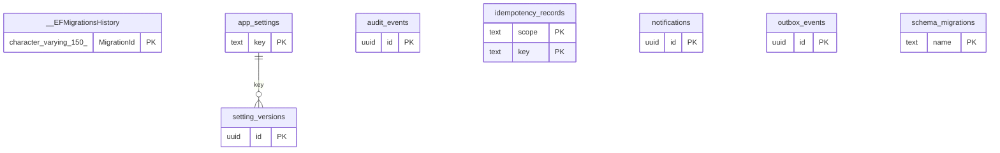

## Identity & people

```mermaid
erDiagram
  account {
    text id PK
  }
  addresses {
    uuid id PK
  }
  auth_sessions {
    uuid id PK
  }
  customer_profiles {
    text user_id PK
  }
  identity_role_claims {
    integer id PK
  }
  identity_roles {
    text id PK
  }
  identity_user_claims {
    integer id PK
  }
  identity_user_logins {
    text login_provider PK
    text provider_key PK
  }
  identity_user_roles {
    text user_id PK
    text role_id PK
  }
  identity_user_tokens {
    text user_id PK
    text login_provider PK
    text name PK
  }
  session {
    text id PK
  }
  staff_profiles {
    text user_id PK
  }
  user {
    text id PK
  }
  verification {
    text id PK
  }
  user ||--o{ account : "user_id"
  user ||--o{ addresses : "user_id"
  user ||--o{ auth_sessions : "user_id"
  user ||--o{ customer_profiles : "user_id"
  identity_roles ||--o{ identity_role_claims : "role_id"
  user ||--o{ identity_user_claims : "user_id"
  user ||--o{ identity_user_logins : "user_id"
  identity_roles ||--o{ identity_user_roles : "role_id"
  user ||--o{ identity_user_roles : "user_id"
  user ||--o{ identity_user_tokens : "user_id"
  user ||--o{ session : "user_id"
  user ||--o{ staff_profiles : "user_id"
```

## Catalogue

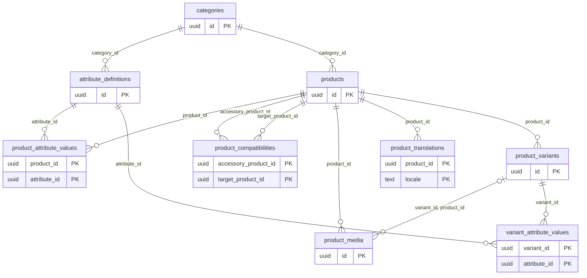

## Cart & promotions

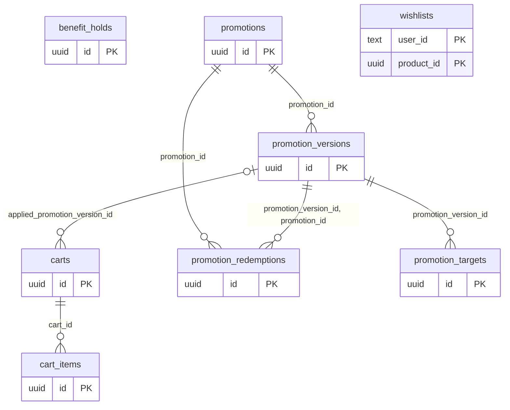

## Invoices & refunds

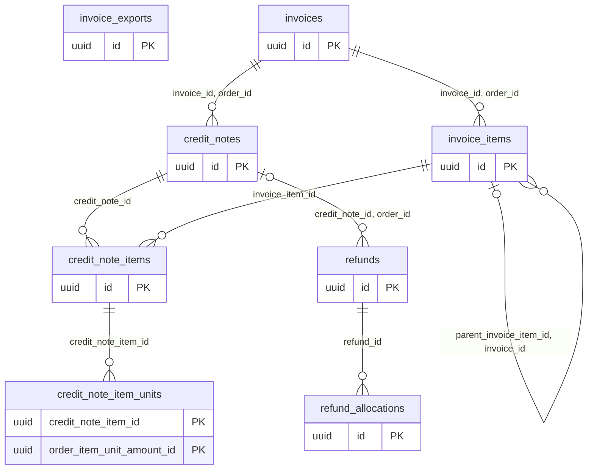

## Inventory & purchasing

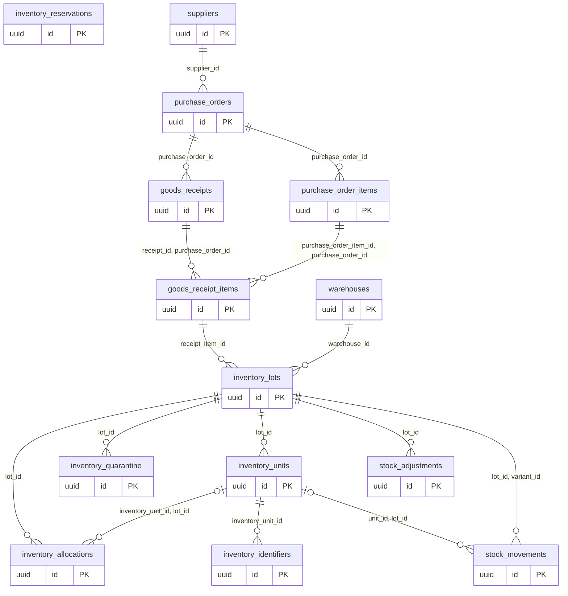

## Landing & media

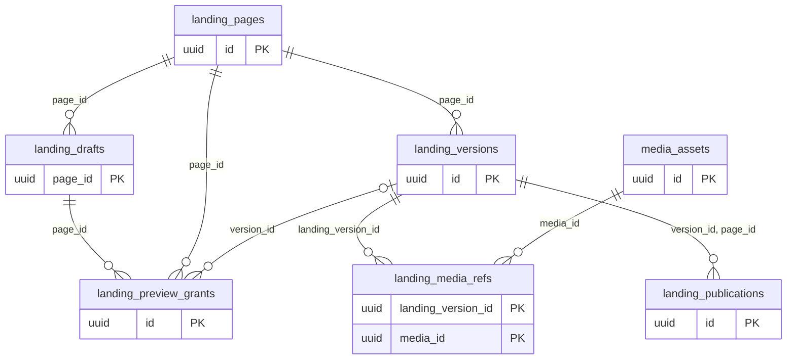

## Customer ledgers

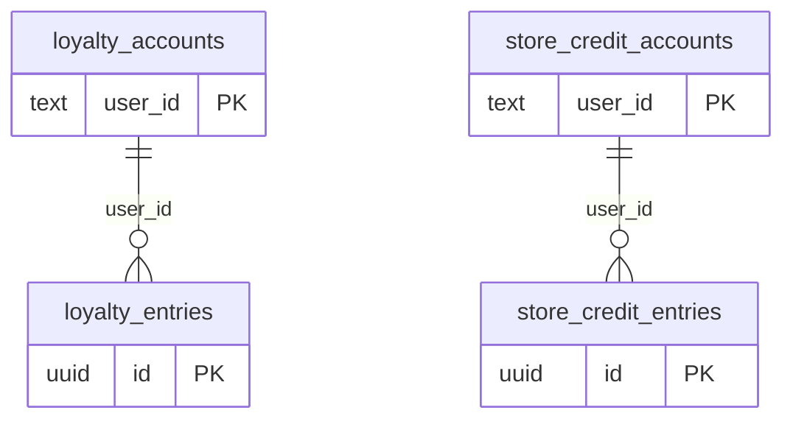

## Orders & payments

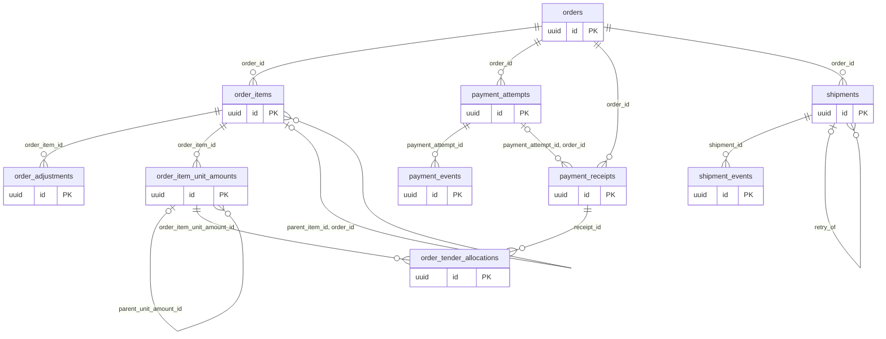

## Returns & trade in

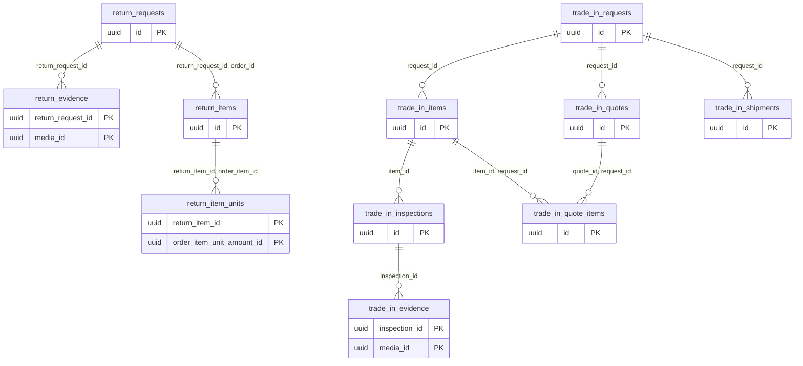

## Warranty

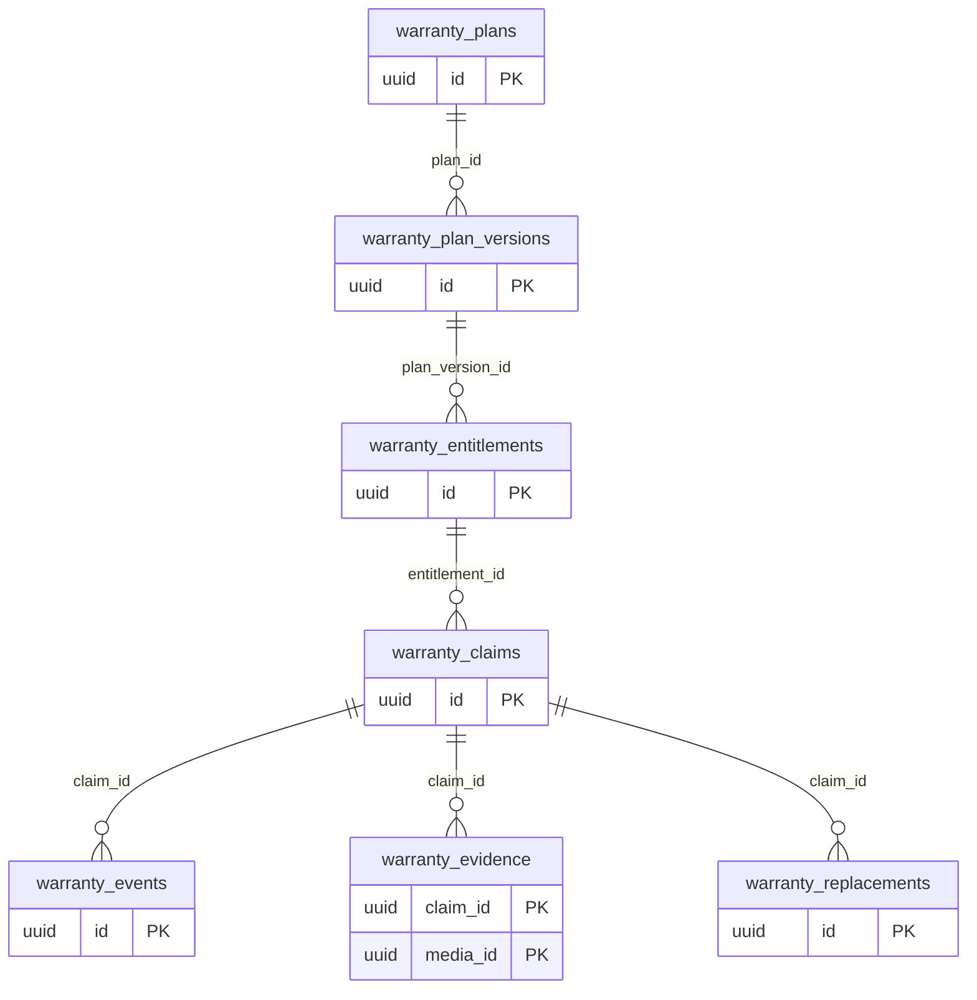

## Complete foreign-key register

Cardinality diagrams use `0..many` on the child side as a conservative overview. Unique FK constraints that narrow a relation to one-to-one are specified exactly in the dictionary. A nullable FK may have no parent; composite-FK semantics and delete/update actions are preserved below.

| Child table | Columns | Parent table | Referenced columns | Constraint / actions |
| --- | --- | --- | --- | --- |
| account | user_id | user | id | account_user_id_fkey: FOREIGN KEY (user_id) REFERENCES "user"(id) ON DELETE CASCADE |
| addresses | user_id | user | id | addresses_user_id_fkey: FOREIGN KEY (user_id) REFERENCES "user"(id) |
| attribute_definitions | category_id | categories | id | attribute_definitions_category_id_fkey: FOREIGN KEY (category_id) REFERENCES categories(id) |
| audit_events | actor_user_id | user | id | audit_events_actor_user_id_fkey: FOREIGN KEY (actor_user_id) REFERENCES "user"(id) |
| auth_sessions | user_id | user | id | FK_auth_sessions_user_user_id: FOREIGN KEY (user_id) REFERENCES "user"(id) ON DELETE RESTRICT |
| benefit_holds | customer_id | user | id | benefit_holds_customer_id_fkey: FOREIGN KEY (customer_id) REFERENCES "user"(id) |
| benefit_holds | order_id, customer_id | orders | id, customer_id | benefit_holds_order_id_customer_id_fkey: FOREIGN KEY (order_id, customer_id) REFERENCES orders(id, customer_id) |
| cart_items | cart_id | carts | id | cart_items_cart_id_fkey: FOREIGN KEY (cart_id) REFERENCES carts(id) ON DELETE CASCADE |
| cart_items | variant_id | product_variants | id | cart_items_variant_id_fkey: FOREIGN KEY (variant_id) REFERENCES product_variants(id) |
| carts | applied_promotion_version_id | promotion_versions | id | carts_applied_promotion_version_id_fkey: FOREIGN KEY (applied_promotion_version_id) REFERENCES promotion_versions(id) |
| carts | customer_id | user | id | carts_customer_id_fkey: FOREIGN KEY (customer_id) REFERENCES "user"(id) |
| credit_note_item_units | credit_note_item_id | credit_note_items | id | credit_note_item_units_credit_note_item_id_fkey: FOREIGN KEY (credit_note_item_id) REFERENCES credit_note_items(id) |
| credit_note_item_units | order_item_unit_amount_id | order_item_unit_amounts | id | credit_note_item_units_order_item_unit_amount_id_fkey: FOREIGN KEY (order_item_unit_amount_id) REFERENCES order_item_unit_amounts(id) |
| credit_note_items | credit_note_id | credit_notes | id | credit_note_items_credit_note_id_fkey: FOREIGN KEY (credit_note_id) REFERENCES credit_notes(id) |
| credit_note_items | invoice_item_id | invoice_items | id | credit_note_items_invoice_item_id_fkey: FOREIGN KEY (invoice_item_id) REFERENCES invoice_items(id) |
| credit_notes | approved_by_user_id | user | id | credit_notes_approved_by_user_id_fkey: FOREIGN KEY (approved_by_user_id) REFERENCES "user"(id) |
| credit_notes | invoice_id, order_id | invoices | id, order_id | credit_notes_invoice_id_order_id_fkey: FOREIGN KEY (invoice_id, order_id) REFERENCES invoices(id, order_id) |
| credit_notes | return_request_id, order_id | return_requests | id, order_id | credit_notes_return_request_id_order_id_fkey: FOREIGN KEY (return_request_id, order_id) REFERENCES return_requests(id, order_id) |
| credit_notes | shipment_id, order_id | shipments | id, order_id | credit_notes_shipment_id_order_id_fkey: FOREIGN KEY (shipment_id, order_id) REFERENCES shipments(id, order_id) |
| credit_notes | warranty_claim_id | warranty_claims | id | credit_notes_warranty_claim_id_fkey: FOREIGN KEY (warranty_claim_id) REFERENCES warranty_claims(id) |
| customer_profiles | user_id | user | id | customer_profiles_user_id_fkey: FOREIGN KEY (user_id) REFERENCES "user"(id) |
| goods_receipt_items | purchase_order_item_id, purchase_order_id | purchase_order_items | id, purchase_order_id | goods_receipt_items_purchase_order_item_id_purchase_order__fkey: FOREIGN KEY (purchase_order_item_id, purchase_order_id) REFERENCES purchase_order_items(id, purchase_order_id) |
| goods_receipt_items | receipt_id, purchase_order_id | goods_receipts | id, purchase_order_id | goods_receipt_items_receipt_id_purchase_order_id_fkey: FOREIGN KEY (receipt_id, purchase_order_id) REFERENCES goods_receipts(id, purchase_order_id) |
| goods_receipts | purchase_order_id | purchase_orders | id | goods_receipts_purchase_order_id_fkey: FOREIGN KEY (purchase_order_id) REFERENCES purchase_orders(id) |
| goods_receipts | received_by | user | id | goods_receipts_received_by_fkey: FOREIGN KEY (received_by) REFERENCES "user"(id) |
| identity_role_claims | role_id | identity_roles | id | FK_identity_role_claims_identity_roles_role_id: FOREIGN KEY (role_id) REFERENCES identity_roles(id) ON DELETE CASCADE |
| identity_user_claims | user_id | user | id | FK_identity_user_claims_user_user_id: FOREIGN KEY (user_id) REFERENCES "user"(id) ON DELETE CASCADE |
| identity_user_logins | user_id | user | id | FK_identity_user_logins_user_user_id: FOREIGN KEY (user_id) REFERENCES "user"(id) ON DELETE CASCADE |
| identity_user_roles | role_id | identity_roles | id | FK_identity_user_roles_identity_roles_role_id: FOREIGN KEY (role_id) REFERENCES identity_roles(id) ON DELETE CASCADE |
| identity_user_roles | user_id | user | id | FK_identity_user_roles_user_user_id: FOREIGN KEY (user_id) REFERENCES "user"(id) ON DELETE CASCADE |
| identity_user_tokens | user_id | user | id | FK_identity_user_tokens_user_user_id: FOREIGN KEY (user_id) REFERENCES "user"(id) ON DELETE CASCADE |
| inventory_allocations | inventory_unit_id, lot_id | inventory_units | id, lot_id | inventory_allocations_inventory_unit_id_lot_id_fkey: FOREIGN KEY (inventory_unit_id, lot_id) REFERENCES inventory_units(id, lot_id) |
| inventory_allocations | lot_id | inventory_lots | id | inventory_allocations_lot_id_fkey: FOREIGN KEY (lot_id) REFERENCES inventory_lots(id) |
| inventory_allocations | order_item_id | order_items | id | inventory_allocations_order_item_id_fkey: FOREIGN KEY (order_item_id) REFERENCES order_items(id) |
| inventory_allocations | order_item_unit_amount_id, order_item_id | order_item_unit_amounts | id, order_item_id | inventory_allocations_order_item_unit_amount_id_order_item_fkey: FOREIGN KEY (order_item_unit_amount_id, order_item_id) REFERENCES order_item_unit_amounts(id, order_item_id) |
| inventory_identifiers | inventory_unit_id | inventory_units | id | inventory_identifiers_inventory_unit_id_fkey: FOREIGN KEY (inventory_unit_id) REFERENCES inventory_units(id) |
| inventory_lots | receipt_item_id | goods_receipt_items | id | inventory_lots_receipt_item_id_fkey: FOREIGN KEY (receipt_item_id) REFERENCES goods_receipt_items(id) |
| inventory_lots | variant_id | product_variants | id | inventory_lots_variant_id_fkey: FOREIGN KEY (variant_id) REFERENCES product_variants(id) |
| inventory_lots | warehouse_id | warehouses | id | inventory_lots_warehouse_id_fkey: FOREIGN KEY (warehouse_id) REFERENCES warehouses(id) |
| inventory_quarantine | lot_id | inventory_lots | id | FK_inventory_quarantine_inventory_lots_lot_id: FOREIGN KEY (lot_id) REFERENCES inventory_lots(id) ON DELETE RESTRICT |
| inventory_quarantine | order_item_unit_amount_id | order_item_unit_amounts | id | FK_inventory_quarantine_order_item_unit_amounts_order_item_uni~: FOREIGN KEY (order_item_unit_amount_id) REFERENCES order_item_unit_amounts(id) ON DELETE RESTRICT |
| inventory_reservations | order_item_id | order_items | id | inventory_reservations_order_item_id_fkey: FOREIGN KEY (order_item_id) REFERENCES order_items(id) |
| inventory_reservations | variant_id | product_variants | id | inventory_reservations_variant_id_fkey: FOREIGN KEY (variant_id) REFERENCES product_variants(id) |
| inventory_units | lot_id | inventory_lots | id | inventory_units_lot_id_fkey: FOREIGN KEY (lot_id) REFERENCES inventory_lots(id) |
| invoice_exports | requested_by_user_id | user | id | invoice_exports_requested_by_user_id_fkey: FOREIGN KEY (requested_by_user_id) REFERENCES "user"(id) |
| invoice_items | invoice_id, order_id | invoices | id, order_id | invoice_items_invoice_id_order_id_fkey: FOREIGN KEY (invoice_id, order_id) REFERENCES invoices(id, order_id) |
| invoice_items | order_item_id, order_id | order_items | id, order_id | invoice_items_order_item_id_order_id_fkey: FOREIGN KEY (order_item_id, order_id) REFERENCES order_items(id, order_id) |
| invoice_items | parent_invoice_item_id, invoice_id | invoice_items | id, invoice_id | invoice_items_parent_invoice_item_id_invoice_id_fkey: FOREIGN KEY (parent_invoice_item_id, invoice_id) REFERENCES invoice_items(id, invoice_id) |
| invoice_items | product_id | products | id | invoice_items_product_id_fkey: FOREIGN KEY (product_id) REFERENCES products(id) |
| invoice_items | variant_id, product_id | product_variants | id, product_id | invoice_items_variant_id_product_id_fkey: FOREIGN KEY (variant_id, product_id) REFERENCES product_variants(id, product_id) |
| invoices | customer_id | user | id | invoices_customer_id_fkey: FOREIGN KEY (customer_id) REFERENCES "user"(id) |
| invoices | issued_by_user_id | user | id | invoices_issued_by_user_id_fkey: FOREIGN KEY (issued_by_user_id) REFERENCES "user"(id) |
| invoices | order_id, customer_id | orders | id, customer_id | invoices_order_id_customer_id_fkey: FOREIGN KEY (order_id, customer_id) REFERENCES orders(id, customer_id) |
| invoices | order_id | orders | id | invoices_order_id_fkey: FOREIGN KEY (order_id) REFERENCES orders(id) |
| invoices | responsible_staff_id | staff_profiles | user_id | invoices_responsible_staff_id_fkey: FOREIGN KEY (responsible_staff_id) REFERENCES staff_profiles(user_id) |
| landing_drafts | page_id | landing_pages | id | landing_drafts_page_id_fkey: FOREIGN KEY (page_id) REFERENCES landing_pages(id) |
| landing_drafts | updated_by | user | id | landing_drafts_updated_by_fkey: FOREIGN KEY (updated_by) REFERENCES "user"(id) |
| landing_media_refs | landing_version_id | landing_versions | id | landing_media_refs_landing_version_id_fkey: FOREIGN KEY (landing_version_id) REFERENCES landing_versions(id) |
| landing_media_refs | media_id | media_assets | id | landing_media_refs_media_id_fkey: FOREIGN KEY (media_id) REFERENCES media_assets(id) |
| landing_preview_grants | page_id | landing_drafts | page_id | FK_landing_preview_grants_landing_drafts_page_id: FOREIGN KEY (page_id) REFERENCES landing_drafts(page_id) ON DELETE RESTRICT |
| landing_preview_grants | page_id | landing_pages | id | FK_landing_preview_grants_landing_pages_page_id: FOREIGN KEY (page_id) REFERENCES landing_pages(id) ON DELETE RESTRICT |
| landing_preview_grants | version_id | landing_versions | id | FK_landing_preview_grants_landing_versions_version_id: FOREIGN KEY (version_id) REFERENCES landing_versions(id) ON DELETE RESTRICT |
| landing_preview_grants | issued_by | user | id | FK_landing_preview_grants_user_issued_by: FOREIGN KEY (issued_by) REFERENCES "user"(id) ON DELETE RESTRICT |
| landing_publications | published_by | user | id | landing_publications_published_by_fkey: FOREIGN KEY (published_by) REFERENCES "user"(id) |
| landing_publications | version_id, page_id | landing_versions | id, page_id | landing_publications_version_id_page_id_fkey: FOREIGN KEY (version_id, page_id) REFERENCES landing_versions(id, page_id) |
| landing_versions | created_by | user | id | landing_versions_created_by_fkey: FOREIGN KEY (created_by) REFERENCES "user"(id) |
| landing_versions | page_id | landing_pages | id | landing_versions_page_id_fkey: FOREIGN KEY (page_id) REFERENCES landing_pages(id) |
| loyalty_accounts | user_id | user | id | loyalty_accounts_user_id_fkey: FOREIGN KEY (user_id) REFERENCES "user"(id) |
| loyalty_entries | order_id | orders | id | loyalty_entries_order_id_fkey: FOREIGN KEY (order_id) REFERENCES orders(id) |
| loyalty_entries | unit_id | order_item_unit_amounts | id | loyalty_entries_unit_id_fkey: FOREIGN KEY (unit_id) REFERENCES order_item_unit_amounts(id) |
| loyalty_entries | user_id | loyalty_accounts | user_id | loyalty_entries_user_id_fkey: FOREIGN KEY (user_id) REFERENCES loyalty_accounts(user_id) |
| media_assets | owner_user_id | user | id | media_assets_owner_user_id_fkey: FOREIGN KEY (owner_user_id) REFERENCES "user"(id) |
| notifications | recipient_user_id | user | id | notifications_recipient_user_id_fkey: FOREIGN KEY (recipient_user_id) REFERENCES "user"(id) |
| order_adjustments | order_item_id | order_items | id | order_adjustments_order_item_id_fkey: FOREIGN KEY (order_item_id) REFERENCES order_items(id) |
| order_adjustments | promotion_redemption_id | promotion_redemptions | id | order_adjustments_promotion_redemption_id_fkey: FOREIGN KEY (promotion_redemption_id) REFERENCES promotion_redemptions(id) |
| order_item_unit_amounts | order_item_id | order_items | id | order_item_unit_amounts_order_item_id_fkey: FOREIGN KEY (order_item_id) REFERENCES order_items(id) |
| order_item_unit_amounts | parent_unit_amount_id | order_item_unit_amounts | id | order_item_unit_amounts_parent_unit_amount_id_fkey: FOREIGN KEY (parent_unit_amount_id) REFERENCES order_item_unit_amounts(id) |
| order_items | order_id | orders | id | order_items_order_id_fkey: FOREIGN KEY (order_id) REFERENCES orders(id) |
| order_items | parent_item_id, order_id | order_items | id, order_id | order_items_parent_item_id_order_id_fkey: FOREIGN KEY (parent_item_id, order_id) REFERENCES order_items(id, order_id) |
| order_items | product_id | products | id | order_items_product_id_fkey: FOREIGN KEY (product_id) REFERENCES products(id) |
| order_items | variant_id, product_id | product_variants | id, product_id | order_items_variant_id_product_id_fkey: FOREIGN KEY (variant_id, product_id) REFERENCES product_variants(id, product_id) |
| order_tender_allocations | order_item_unit_amount_id | order_item_unit_amounts | id | order_tender_allocations_order_item_unit_amount_id_fkey: FOREIGN KEY (order_item_unit_amount_id) REFERENCES order_item_unit_amounts(id) |
| order_tender_allocations | receipt_id | payment_receipts | id | order_tender_allocations_receipt_id_fkey: FOREIGN KEY (receipt_id) REFERENCES payment_receipts(id) |
| orders | customer_id | user | id | orders_customer_id_fkey: FOREIGN KEY (customer_id) REFERENCES "user"(id) |
| orders | responsible_staff_id | staff_profiles | user_id | orders_responsible_staff_id_fkey: FOREIGN KEY (responsible_staff_id) REFERENCES staff_profiles(user_id) |
| payment_attempts | order_id | orders | id | payment_attempts_order_id_fkey: FOREIGN KEY (order_id) REFERENCES orders(id) |
| payment_events | payment_attempt_id | payment_attempts | id | payment_events_payment_attempt_id_fkey: FOREIGN KEY (payment_attempt_id) REFERENCES payment_attempts(id) |
| payment_receipts | order_id | orders | id | payment_receipts_order_id_fkey: FOREIGN KEY (order_id) REFERENCES orders(id) |
| payment_receipts | payment_attempt_id, order_id | payment_attempts | id, order_id | payment_receipts_payment_attempt_id_order_id_fkey: FOREIGN KEY (payment_attempt_id, order_id) REFERENCES payment_attempts(id, order_id) |
| product_attribute_values | attribute_id | attribute_definitions | id | product_attribute_values_attribute_id_fkey: FOREIGN KEY (attribute_id) REFERENCES attribute_definitions(id) |
| product_attribute_values | product_id | products | id | product_attribute_values_product_id_fkey: FOREIGN KEY (product_id) REFERENCES products(id) |
| product_compatibilities | accessory_product_id | products | id | product_compatibilities_accessory_product_id_fkey: FOREIGN KEY (accessory_product_id) REFERENCES products(id) |
| product_compatibilities | target_product_id | products | id | product_compatibilities_target_product_id_fkey: FOREIGN KEY (target_product_id) REFERENCES products(id) |
| product_media | media_id | media_assets | id | product_media_media_id_fkey: FOREIGN KEY (media_id) REFERENCES media_assets(id) |
| product_media | product_id | products | id | product_media_product_id_fkey: FOREIGN KEY (product_id) REFERENCES products(id) |
| product_media | variant_id, product_id | product_variants | id, product_id | product_media_variant_id_product_id_fkey: FOREIGN KEY (variant_id, product_id) REFERENCES product_variants(id, product_id) |
| product_translations | product_id | products | id | product_translations_product_id_fkey: FOREIGN KEY (product_id) REFERENCES products(id) |
| product_variants | product_id | products | id | product_variants_product_id_fkey: FOREIGN KEY (product_id) REFERENCES products(id) |
| products | category_id | categories | id | products_category_id_fkey: FOREIGN KEY (category_id) REFERENCES categories(id) |
| promotion_redemptions | customer_id | user | id | promotion_redemptions_customer_id_fkey: FOREIGN KEY (customer_id) REFERENCES "user"(id) |
| promotion_redemptions | order_id, customer_id | orders | id, customer_id | promotion_redemptions_order_id_customer_id_fkey: FOREIGN KEY (order_id, customer_id) REFERENCES orders(id, customer_id) |
| promotion_redemptions | promotion_id | promotions | id | promotion_redemptions_promotion_id_fkey: FOREIGN KEY (promotion_id) REFERENCES promotions(id) |
| promotion_redemptions | promotion_version_id, promotion_id | promotion_versions | id, promotion_id | promotion_redemptions_promotion_version_id_promotion_id_fkey: FOREIGN KEY (promotion_version_id, promotion_id) REFERENCES promotion_versions(id, promotion_id) |
| promotion_targets | category_id | categories | id | promotion_targets_category_id_fkey: FOREIGN KEY (category_id) REFERENCES categories(id) |
| promotion_targets | product_id | products | id | promotion_targets_product_id_fkey: FOREIGN KEY (product_id) REFERENCES products(id) |
| promotion_targets | promotion_version_id | promotion_versions | id | promotion_targets_promotion_version_id_fkey: FOREIGN KEY (promotion_version_id) REFERENCES promotion_versions(id) |
| promotion_targets | variant_id | product_variants | id | promotion_targets_variant_id_fkey: FOREIGN KEY (variant_id) REFERENCES product_variants(id) |
| promotion_versions | promotion_id | promotions | id | promotion_versions_promotion_id_fkey: FOREIGN KEY (promotion_id) REFERENCES promotions(id) |
| purchase_order_items | purchase_order_id | purchase_orders | id | purchase_order_items_purchase_order_id_fkey: FOREIGN KEY (purchase_order_id) REFERENCES purchase_orders(id) |
| purchase_order_items | variant_id | product_variants | id | purchase_order_items_variant_id_fkey: FOREIGN KEY (variant_id) REFERENCES product_variants(id) |
| purchase_orders | approved_by | user | id | purchase_orders_approved_by_fkey: FOREIGN KEY (approved_by) REFERENCES "user"(id) |
| purchase_orders | created_by | user | id | purchase_orders_created_by_fkey: FOREIGN KEY (created_by) REFERENCES "user"(id) |
| purchase_orders | supplier_id | suppliers | id | purchase_orders_supplier_id_fkey: FOREIGN KEY (supplier_id) REFERENCES suppliers(id) |
| refund_allocations | order_item_unit_amount_id | order_item_unit_amounts | id | refund_allocations_order_item_unit_amount_id_fkey: FOREIGN KEY (order_item_unit_amount_id) REFERENCES order_item_unit_amounts(id) |
| refund_allocations | payment_receipt_id | payment_receipts | id | refund_allocations_payment_receipt_id_fkey: FOREIGN KEY (payment_receipt_id) REFERENCES payment_receipts(id) |
| refund_allocations | refund_id | refunds | id | refund_allocations_refund_id_fkey: FOREIGN KEY (refund_id) REFERENCES refunds(id) |
| refunds | approved_by | user | id | refunds_approved_by_fkey: FOREIGN KEY (approved_by) REFERENCES "user"(id) |
| refunds | credit_note_id, order_id | credit_notes | id, order_id | refunds_credit_note_id_order_id_fkey: FOREIGN KEY (credit_note_id, order_id) REFERENCES credit_notes(id, order_id) |
| refunds | order_id | orders | id | refunds_order_id_fkey: FOREIGN KEY (order_id) REFERENCES orders(id) |
| return_evidence | media_id | media_assets | id | return_evidence_media_id_fkey: FOREIGN KEY (media_id) REFERENCES media_assets(id) |
| return_evidence | return_request_id | return_requests | id | return_evidence_return_request_id_fkey: FOREIGN KEY (return_request_id) REFERENCES return_requests(id) |
| return_item_units | inventory_unit_id | inventory_units | id | return_item_units_inventory_unit_id_fkey: FOREIGN KEY (inventory_unit_id) REFERENCES inventory_units(id) |
| return_item_units | order_item_unit_amount_id, order_item_id | order_item_unit_amounts | id, order_item_id | return_item_units_order_item_unit_amount_id_order_item_id_fkey: FOREIGN KEY (order_item_unit_amount_id, order_item_id) REFERENCES order_item_unit_amounts(id, order_item_id) |
| return_item_units | return_item_id, order_item_id | return_items | id, order_item_id | return_item_units_return_item_id_order_item_id_fkey: FOREIGN KEY (return_item_id, order_item_id) REFERENCES return_items(id, order_item_id) |
| return_items | order_item_id, order_id | order_items | id, order_id | return_items_order_item_id_order_id_fkey: FOREIGN KEY (order_item_id, order_id) REFERENCES order_items(id, order_id) |
| return_items | return_request_id, order_id | return_requests | id, order_id | return_items_return_request_id_order_id_fkey: FOREIGN KEY (return_request_id, order_id) REFERENCES return_requests(id, order_id) |
| return_requests | inspected_by | user | id | return_requests_inspected_by_fkey: FOREIGN KEY (inspected_by) REFERENCES "user"(id) |
| return_requests | order_id, customer_id | orders | id, customer_id | return_requests_order_id_customer_id_fkey: FOREIGN KEY (order_id, customer_id) REFERENCES orders(id, customer_id) |
| session | user_id | user | id | session_user_id_fkey: FOREIGN KEY (user_id) REFERENCES "user"(id) ON DELETE CASCADE |
| setting_versions | changed_by | user | id | setting_versions_changed_by_fkey: FOREIGN KEY (changed_by) REFERENCES "user"(id) |
| setting_versions | key | app_settings | key | setting_versions_key_fkey: FOREIGN KEY (key) REFERENCES app_settings(key) |
| shipment_events | shipment_id | shipments | id | shipment_events_shipment_id_fkey: FOREIGN KEY (shipment_id) REFERENCES shipments(id) |
| shipments | order_id | orders | id | shipments_order_id_fkey: FOREIGN KEY (order_id) REFERENCES orders(id) |
| shipments | retry_of | shipments | id | shipments_retry_of_fkey: FOREIGN KEY (retry_of) REFERENCES shipments(id) |
| staff_profiles | user_id | user | id | staff_profiles_user_id_fkey: FOREIGN KEY (user_id) REFERENCES "user"(id) |
| stock_adjustments | approved_by | user | id | stock_adjustments_approved_by_fkey: FOREIGN KEY (approved_by) REFERENCES "user"(id) |
| stock_adjustments | lot_id | inventory_lots | id | stock_adjustments_lot_id_fkey: FOREIGN KEY (lot_id) REFERENCES inventory_lots(id) |
| stock_adjustments | requested_by | user | id | stock_adjustments_requested_by_fkey: FOREIGN KEY (requested_by) REFERENCES "user"(id) |
| stock_movements | actor_user_id | user | id | stock_movements_actor_user_id_fkey: FOREIGN KEY (actor_user_id) REFERENCES "user"(id) |
| stock_movements | lot_id, variant_id | inventory_lots | id, variant_id | stock_movements_lot_id_variant_id_fkey: FOREIGN KEY (lot_id, variant_id) REFERENCES inventory_lots(id, variant_id) |
| stock_movements | unit_id, lot_id | inventory_units | id, lot_id | stock_movements_unit_id_lot_id_fkey: FOREIGN KEY (unit_id, lot_id) REFERENCES inventory_units(id, lot_id) |
| stock_movements | variant_id | product_variants | id | stock_movements_variant_id_fkey: FOREIGN KEY (variant_id) REFERENCES product_variants(id) |
| store_credit_accounts | user_id | user | id | store_credit_accounts_user_id_fkey: FOREIGN KEY (user_id) REFERENCES "user"(id) |
| store_credit_entries | order_id | orders | id | store_credit_entries_order_id_fkey: FOREIGN KEY (order_id) REFERENCES orders(id) |
| store_credit_entries | quote_item_id | trade_in_quote_items | id | store_credit_entries_quote_item_id_fkey: FOREIGN KEY (quote_item_id) REFERENCES trade_in_quote_items(id) |
| store_credit_entries | refund_id | refunds | id | store_credit_entries_refund_id_fkey: FOREIGN KEY (refund_id) REFERENCES refunds(id) |
| store_credit_entries | trade_in_item_id | trade_in_items | id | store_credit_entries_trade_in_item_id_fkey: FOREIGN KEY (trade_in_item_id) REFERENCES trade_in_items(id) |
| store_credit_entries | user_id | store_credit_accounts | user_id | store_credit_entries_user_id_fkey: FOREIGN KEY (user_id) REFERENCES store_credit_accounts(user_id) |
| trade_in_evidence | inspection_id | trade_in_inspections | id | trade_in_evidence_inspection_id_fkey: FOREIGN KEY (inspection_id) REFERENCES trade_in_inspections(id) |
| trade_in_evidence | media_id | media_assets | id | trade_in_evidence_media_id_fkey: FOREIGN KEY (media_id) REFERENCES media_assets(id) |
| trade_in_inspections | inspector_staff_id | staff_profiles | user_id | trade_in_inspections_inspector_staff_id_fkey: FOREIGN KEY (inspector_staff_id) REFERENCES staff_profiles(user_id) |
| trade_in_inspections | item_id | trade_in_items | id | trade_in_inspections_item_id_fkey: FOREIGN KEY (item_id) REFERENCES trade_in_items(id) |
| trade_in_items | inventory_unit_id | inventory_units | id | trade_in_items_inventory_unit_id_fkey: FOREIGN KEY (inventory_unit_id) REFERENCES inventory_units(id) |
| trade_in_items | product_id | products | id | trade_in_items_product_id_fkey: FOREIGN KEY (product_id) REFERENCES products(id) |
| trade_in_items | request_id | trade_in_requests | id | trade_in_items_request_id_fkey: FOREIGN KEY (request_id) REFERENCES trade_in_requests(id) |
| trade_in_items | variant_id, product_id | product_variants | id, product_id | trade_in_items_variant_id_product_id_fkey: FOREIGN KEY (variant_id, product_id) REFERENCES product_variants(id, product_id) |
| trade_in_quote_items | item_id, request_id | trade_in_items | id, request_id | trade_in_quote_items_item_id_request_id_fkey: FOREIGN KEY (item_id, request_id) REFERENCES trade_in_items(id, request_id) |
| trade_in_quote_items | quote_id, request_id | trade_in_quotes | id, request_id | trade_in_quote_items_quote_id_request_id_fkey: FOREIGN KEY (quote_id, request_id) REFERENCES trade_in_quotes(id, request_id) |
| trade_in_quotes | approved_by | user | id | trade_in_quotes_approved_by_fkey: FOREIGN KEY (approved_by) REFERENCES "user"(id) |
| trade_in_quotes | quoted_by | user | id | trade_in_quotes_quoted_by_fkey: FOREIGN KEY (quoted_by) REFERENCES "user"(id) |
| trade_in_quotes | request_id | trade_in_requests | id | trade_in_quotes_request_id_fkey: FOREIGN KEY (request_id) REFERENCES trade_in_requests(id) |
| trade_in_requests | customer_id | user | id | trade_in_requests_customer_id_fkey: FOREIGN KEY (customer_id) REFERENCES "user"(id) |
| trade_in_shipments | request_id | trade_in_requests | id | trade_in_shipments_request_id_fkey: FOREIGN KEY (request_id) REFERENCES trade_in_requests(id) |
| variant_attribute_values | attribute_id | attribute_definitions | id | variant_attribute_values_attribute_id_fkey: FOREIGN KEY (attribute_id) REFERENCES attribute_definitions(id) |
| variant_attribute_values | variant_id | product_variants | id | variant_attribute_values_variant_id_fkey: FOREIGN KEY (variant_id) REFERENCES product_variants(id) |
| warranty_claims | entitlement_id | warranty_entitlements | id | warranty_claims_entitlement_id_fkey: FOREIGN KEY (entitlement_id) REFERENCES warranty_entitlements(id) |
| warranty_entitlements | inventory_unit_id | inventory_units | id | warranty_entitlements_inventory_unit_id_fkey: FOREIGN KEY (inventory_unit_id) REFERENCES inventory_units(id) |
| warranty_entitlements | order_item_unit_amount_id | order_item_unit_amounts | id | warranty_entitlements_order_item_unit_amount_id_fkey: FOREIGN KEY (order_item_unit_amount_id) REFERENCES order_item_unit_amounts(id) |
| warranty_entitlements | plan_version_id | warranty_plan_versions | id | warranty_entitlements_plan_version_id_fkey: FOREIGN KEY (plan_version_id) REFERENCES warranty_plan_versions(id) |
| warranty_events | actor_id | user | id | warranty_events_actor_id_fkey: FOREIGN KEY (actor_id) REFERENCES "user"(id) |
| warranty_events | claim_id | warranty_claims | id | warranty_events_claim_id_fkey: FOREIGN KEY (claim_id) REFERENCES warranty_claims(id) |
| warranty_evidence | claim_id | warranty_claims | id | warranty_evidence_claim_id_fkey: FOREIGN KEY (claim_id) REFERENCES warranty_claims(id) |
| warranty_evidence | media_id | media_assets | id | warranty_evidence_media_id_fkey: FOREIGN KEY (media_id) REFERENCES media_assets(id) |
| warranty_plan_versions | plan_id | warranty_plans | id | warranty_plan_versions_plan_id_fkey: FOREIGN KEY (plan_id) REFERENCES warranty_plans(id) |
| warranty_replacements | new_lot_id | inventory_lots | id | FK_warranty_replacements_inventory_lots_new_lot_id: FOREIGN KEY (new_lot_id) REFERENCES inventory_lots(id) ON DELETE RESTRICT |
| warranty_replacements | old_lot_id | inventory_lots | id | FK_warranty_replacements_inventory_lots_old_lot_id: FOREIGN KEY (old_lot_id) REFERENCES inventory_lots(id) ON DELETE RESTRICT |
| warranty_replacements | order_item_unit_amount_id | order_item_unit_amounts | id | FK_warranty_replacements_order_item_unit_amounts_order_item_un~: FOREIGN KEY (order_item_unit_amount_id) REFERENCES order_item_unit_amounts(id) ON DELETE RESTRICT |
| warranty_replacements | claim_id | warranty_claims | id | warranty_replacements_claim_id_fkey: FOREIGN KEY (claim_id) REFERENCES warranty_claims(id) |
| warranty_replacements | new_unit_id | inventory_units | id | warranty_replacements_new_unit_id_fkey: FOREIGN KEY (new_unit_id) REFERENCES inventory_units(id) |
| warranty_replacements | old_unit_id | inventory_units | id | warranty_replacements_old_unit_id_fkey: FOREIGN KEY (old_unit_id) REFERENCES inventory_units(id) |
| wishlists | product_id | products | id | wishlists_product_id_fkey: FOREIGN KEY (product_id) REFERENCES products(id) |
| wishlists | user_id | user | id | wishlists_user_id_fkey: FOREIGN KEY (user_id) REFERENCES "user"(id) |
